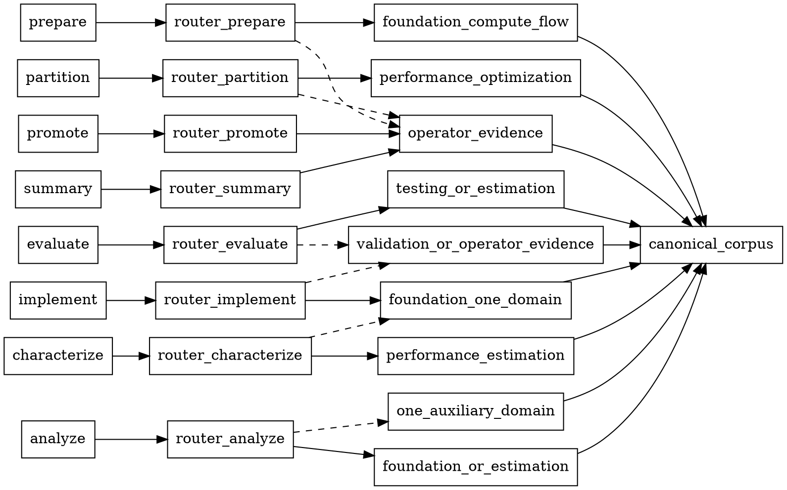

# Topsop tuning V2 knowledge routing expansion

Date: 2026-09-16

## Reason

The first V2 workers carried only four compact GCU400 summaries, copied into
five workers. That was enough to enforce a few hard limits, but materially
thinner than the KDS-derived V1 corpus: API/runtime semantics, compute/dataflow/
DTE/LDST/ISA references, quantitative performance material, debugging guides,
review checklists, and representative optimization cases were absent. Copying
the full corpus into each worker would increase repository and prompt weight and
would encourage indiscriminate reads. Adding a Piano capability loader would
violate V2's recipe-only compatibility boundary.

## Change

- Restore one canonical, approximately 8 MiB GCU400 corpus under
  `recipes/shared-skills/`, pinned to kerneldevsuite commit
  `36c559d465ac7636678e094ccf512cfc5ff61bbe`.
- Keep the generated import manifest, catalog, indexes, file hashes, and import
  script so provenance is auditable and refreshable.
- Add `recipes/topsop-v2-knowledge-routing.json` as a V2-only stage allowlist.
- Inject a small `topsop-v2-knowledge-router` through each worker's existing
  local skill directory. The router resolves the canonical corpus from its own
  injected absolute path; it does not search the target workspace or `$HOME`.
- Remove the five duplicated four-document knowledge packs.
- Enforce one primary domain plus at most one auxiliary domain. Historical
  optimization cases are hypotheses only and are prohibited in characterization,
  implementation, evaluation verdicts, promotion, and final performance claims.
- Update operator-evidence stage ownership from V1 stage names to V2 stages.
- Add integrity and routing tests; no `packages/` code or workflow DSL changes.

## Call graph

Dashed edges are optional auxiliary reads. A router opens the capability
`SKILL.md` and `document/INDEX.md` first and then only the documents needed for
the current claim.

## Commit ID

Pending: this work remains uncommitted until the surrounding V2/tournament
changes are reviewed and grouped.
