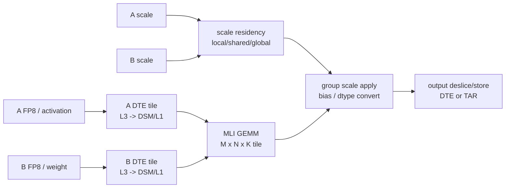

[TOC]

# 14. Matmul Quant FP8 L2 General Pipeline Kernel

## 0. 当前实现片段与阅读主线

这一篇必须先把执行系统钉住，否则很容易写成“某一段出现了多少个 `tcle`、多少个 `matrix_t`”的流水账。
这份 kernel 的真正价值不是某个局部 API，而是它把 per-group FP8 GEMM 拆成了一个能够在 GCU400 / Libra
上跑满的执行系统：host 只在特定大形状下选择它，global kernel 完成资源规划和角色分派，DTE
sub-thread 用 TTE pipeline 把 A/B/scale/bias 搬进合适层级，compute sub-thread 用 FP8 matrix mode
做 group 内 dot，再把 scale 延迟到 group partial 之后做。

下面这些片段已经包含理解报告所需的关键控制流，不需要再跳到外部文件查入口或行号。

```cpp
// Host 侧只在 per-group scale 和少数大形状上启用 pipeline kernel。
// 这说明它是优化型专用路径，不是所有 FP8 GEMM 的默认实现。
if (((512 < para.M && para.M < 1024 &&
      para.N == 4096 && para.K == 7168) ||
     ((para.M == 128 || para.M == 155 || para.M == 32) &&
      para.N >= 5120 && para.K >= 5120)) &&
    ((blockDim_x == 3 && blockDim_y == 2) ||
     (blockDim_x == 2 && blockDim_y == 3))) {
  use_pipeline = lhs_scale_mode == topsopScalingMode_t::TOPSOP_SCALING_PER_GROUP;
}

// pipeline 模式只覆盖 2x3x1 和 3x2x1 两种 thread shape。
// 这两个形状都在 M/N 维度并行，K 维不做 split-K。
if (use_pipeline && blockDim_x == 2 && blockDim_y == 3) {
  using thread_shape_t = tte::Shape<Int<2>, Int<3>, Int<1>>;
  CALL_PIPELINE_KERNEL(thread_shape_t, lhs_t, rhs_t, out_t,
                       bias_t, expanded, bias_enable, L1_SIZE);
} else if (use_pipeline && blockDim_x == 3 && blockDim_y == 2) {
  using thread_shape_t = tte::Shape<Int<3>, Int<2>, Int<1>>;
  CALL_PIPELINE_KERNEL(thread_shape_t, lhs_t, rhs_t, out_t,
                       bias_t, expanded, bias_enable, L1_SIZE);
}
```

```cpp
// 一个 TOPS thread 内部显式拆成 4 个 compute sub-thread 和 4 个 DTE/辅助 sub-thread。
static constexpr int dte_subthread_num = 4;
static constexpr int compute_subthread_count = 4;

#define MULTITHREAD \
  __thread_dims__(compute_subthread_count + dte_subthread_num, 1, 1)

template <typename T, int32_t N>
constexpr int32_t GetK() {
  if constexpr (std::is_same<T, tops::float_e4m3>::value) {
    return 64;
  } else if constexpr (std::is_same<T, tops::float_e5m2>::value) {
    return 64;
  } else if constexpr (std::is_same<T, tops::half>::value && N == 64) {
    return 32;
  } else {
    return 16;
  }
}

template <typename T>
constexpr tcle::MatrixMode get_matrix_detail_type() {
  return tcle::DT_DEFAULT;
}

template <>
constexpr tcle::MatrixMode get_matrix_detail_type<tops::float_e4m3>() {
  return tcle::DT_E4M3;
}

template <>
constexpr tcle::MatrixMode get_matrix_detail_type<tops::float_e5m2>() {
  return tcle::DT_E5M2;
}
```

```cpp
// A/B/scale/bias 的驻留策略在 global kernel 一次性决定。
// A scale 优先尝试完整 K-group 驻留 L1；B scale 和 bias 根据剩余 L1 空间选择 local 或 shared。
int A_scale_all_k_size = ceil_div(K, para.group_size);
int A_scale_part_k_size = ceil_div(get<2>(shared_tile_shape), para.group_size);
int B_scale_buff_size = cosize(B_scale_layout) * sizeof(float);
int A_scale_all_k_buff_size =
    pipeline_stage * get<0>(shared_tile_shape) * A_scale_all_k_size * sizeof(float);
int A_scale_part_k_buff_size =
    pipeline_stage * get<0>(shared_tile_shape) * A_scale_part_k_size * sizeof(float);

bool A_scale_all_in_l1 =
    A_scale_all_k_buff_size + B_scale_buff_size <= L1_SIZE ||
    (A_scale_all_k_buff_size <= L1_SIZE &&
     A_scale_part_k_buff_size + B_scale_buff_size > L1_SIZE);

int A_scale_k_size =
    A_scale_all_in_l1 ? A_scale_all_k_size : A_scale_part_k_size;

bool B_scale_in_l1 =
    A_scale_part_k_buff_size + B_scale_buff_size <= L1_SIZE;

int bias_in_l1_size =
    ((B_scale_in_l1 ? cosize(B_scale_layout) : 0) +
     A_scale_part_k_buff_size) * sizeof(float) +
             bias_all_size * sizeof(bias_t) <= L1_SIZE
        ? bias_all_size
        : 0;
bool bias_in_l1 = bias_in_l1_size > 0;
```

```cpp
// A/B queue 的 consumer 数体现复用关系：
// A tile 被同一个 M lane 下的多个 N lane 消费，所以乘 blockDim.y；
// B tile 被同一个 N lane 下的多个 M lane 消费，所以乘 blockDim.x。
using Pipeline = pipeline_t<SharedScope, Int<pipeline_stage>>;
using LocalPipeline = pipeline_t<LocalScope, Int<pipeline_stage>>;

int shared_A_cons = compute_subthread_count * blockDim.y;
int shared_B_cons = compute_subthread_count * blockDim.x;
int shared_scale_cons = compute_subthread_count * blockDim.x * blockDim.y;

extern __shared__ __valigned__ char smem_buf[];
auto smem_A = reinterpret_cast<lhs_t *>(smem_buf);
auto smem_B = reinterpret_cast<rhs_t *>(
    smem_A + get<0>(thread_shape) * get<2>(thread_shape) *
             pipeline_stage * cosize(A_shared_layout));
float *smem_B_scale = reinterpret_cast<float *>(
    smem_B + get<1>(thread_shape) * get<2>(thread_shape) *
             pipeline_stage * cosize(B_shared_layout));
auto smem_bias = reinterpret_cast<bias_t *>(
    smem_B_scale + cosize(B_scale_layout));
```

```cpp
// compute 热循环：先取 A/B queue，再按 K group 读取 scale，最后用矩阵指令得到 group partial。
// 反量化没有展开到输入矩阵上，而是对 group partial 执行 A_scale * B_scale。
constexpr int32_t MLI_M = 64;
constexpr int32_t MLI_N = GetN<rhs_t>();
constexpr int32_t MLI_K = GetK<lhs_t, MLI_N>();
constexpr int32_t OACC_N = 128;

f32_vt accRegs[64];
__valigned__ float stackScl[128];
float *stackSclPtr = reinterpret_cast<float *>(reinterpret_cast<uint64_t>(stackScl));
matrix_t<MLI_M, OACC_N, float, 0>::ty tmp_res;
f32_vt *gemmRegs = reinterpret_cast<f32_vt *>(&tmp_res);

for (int shared_k_idx = 0; shared_k_idx < shared_K_loop; ++shared_k_idx) {
  shared_A_pipe.consumer_wait();
  shared_B_pipe.consumer_wait();

  int lhsBufferId = lhs_l0p5_idxs[shared_A_pipe.cons_state_.stage_];
  int rhsBufferId = rhs_l0p5_idxs[shared_B_pipe.cons_state_.stage_];
  l0p5_inv(lhsBufferId, compute_subthread_count);
  l0p5_inv(rhsBufferId, compute_subthread_count);

  for (int local_k_idx = 0; local_k_idx < local_K_loop; local_k_idx++) {
    f32_vt A_scale_v = loadeoa<f32_vt>(A_scale_sub_ptr + local_k_idx,
                                       A_scale_k_size);
    f32_vt B_scale_v = loadeoa<f32_vt>(B_scale_sub_ptr + local_k_idx, 0);
    sclLptr.store(A_scale_v * B_scale_v);

    matrix_t<MLI_M, MLI_K, wrapped_lhs_t, LHS_DETAIL_TYPE>
        mat_lhs0(lhs_ptr0, lhsBufferId);
    matrix_t<MLI_M, MLI_K, wrapped_lhs_t, LHS_DETAIL_TYPE>
        mat_lhs1(lhs_ptr1, lhsBufferId);
    matrix_t<MLI_K, MLI_N, wrapped_rhs_t, RHS_DETAIL_TYPE, RHS_LOAD_MODE>
        mat_rhs0(rhs_ptr0, rhsBufferId);
    matrix_t<MLI_K, MLI_N, wrapped_rhs_t, RHS_DETAIL_TYPE, RHS_LOAD_MODE>
        mat_rhs1(rhs_ptr1, rhsBufferId);
    matrix_t<MLI_K, MLI_N, wrapped_rhs_t, RHS_DETAIL_TYPE, RHS_LOAD_MODE>
        mat_rhs2(rhs_ptr2, rhsBufferId);
    matrix_t<MLI_K, MLI_N, wrapped_rhs_t, RHS_DETAIL_TYPE, RHS_LOAD_MODE>
        mat_rhs3(rhs_ptr3, rhsBufferId);

    gemmSche.wait();
    set_spr<NACCOVR>(0x2);
    tmp_res += mat_lhs0.template dot<1, 0>(mat_rhs0);
    tmp_res += mat_lhs0.template dot<1, 2>(mat_rhs1);
    set_spr<NACCOVR>((k_spr_flag - 1) >> 63);
    tmp_res += mat_lhs1.template dot<1, 0>(mat_rhs2);
    tmp_res += mat_lhs1.template dot<1, 2>(mat_rhs3);
    gemmSche.arrive();

    for (int idx = 0; idx < MLI_M; idx++) {
      accRegs[idx] += gemmRegs[idx] * static_cast<f32_vt>(stackSclPtr[idx]);
    }
  }

  shared_A_pipe.consumer_release().advance();
  shared_B_pipe.consumer_release().advance();
}
```

```cpp
// 写回时只在输出端做 bias、dtype conversion 和 tail mask。
// 输出 FP8 分支存在，但当前显式实例化只覆盖 BF16/FP16 输出。
set_spr<LDST_DIM1_REAL>(atom_tail_M);
set_spr<LDST_DIM0_REAL>(TCLE_MAX_VECTOR_LENGTH);
i32_bool_vt mask_out = tcle::vset_mb<__vector bool int>(atom_tail_N);

for (int32_t i = 0; i < atomM; i++) {
  using out_vt = typename cc_kernel::stvector<out_t, 1>::VT;
  setslice_m2v(LDST_DIM0_REAL_DIM1_REAL, i, 0b10);
  if constexpr (bias_enable) {
    internal_tar_cvt_store_cond<out_vt, __vector float, i32_bool_vt>(
        accRegs[i] + bias_data, base, stride, mask_out);
  } else {
    internal_tar_cvt_store_cond<out_vt, __vector float, i32_bool_vt>(
        accRegs[i], base, stride, mask_out);
  }
}
```

因此，后文分析采用三层视角。

第一层是数学变换：per-group scale 没有逐元素展开，而是先做 `A_q @ B_q` 的 group partial，再乘
`A_scale * B_scale`。这个变换的收益是把 scale 乘法从 K 元素级推迟到 group partial 级，同时避免把
FP8 数据在 L1/L2 中展开成 float。

第二层是数据流：A/B FP8 tile 走 L3 到 L2 shared pipeline；A scale 尽量走 L1 local pipeline；
B scale 和 bias 根据容量在 L1/L2 之间选择；compute 端只消费已经排队好的 tile，不在热循环里直接碰
不规则全局搬运。

第三层是计算流和任务划分：一个 TOPS thread 内 4 个 compute sub-thread 分摊输出 atom，3 个 DTE
sub-thread 分别负责 A、B、scale/bias，最后一个 sub-thread 预留。计算端每个 sub-thread 的核心 atom
是 64x128，它由两个 64-K lhs fragment 与四个 rhs fragment 覆盖，并用 `GroupSche_t` 管住矩阵资源。

这套结构的优化思路可以迁移到其它 Libra kernel：先用 host 形状门控避免专用 pipeline 误伤短小 case；
再用 DTE sub-thread 把高延迟搬运从 compute 热循环里剥离；然后用模板和 `if constexpr` 固化 dtype、
layout、stage 和资源容量，最后在最内层只保留 matrix 指令、少量 vector scale、tail slice 和 store。

## 1. 这份 kernel 是什么

这是一份 GCU400 / Libra 上的 FP8 quantized GEMM L2 pipeline kernel。它实现的数学语义可以简化为：

```text
C[M, N] = sum_k dequant(A_fp8[M, K]) * dequant(B_fp8[K, N]) + bias[N]
```

更具体地说，它面向 per-group scale：

```text
A_real[m, k] = A_fp8[m, k] * lhs_scale[m, k_group]
B_real[k, n] = B_fp8[k, n] * rhs_scale[n_group, k_group]
C[m, n]      = sum_k A_real[m, k] * B_real[k, n]
```

但实现并不是先把 A/B 展开成 float 再 GEMM。它的关键优化是：每个 K group 内先用 FP8 matrix mode
做 GEMM，得到 float OACC partial，然后把这个 group 的 `A_scale * B_scale` 乘到 partial 上，再累加
到最终 `accRegs`：

```cpp
tmp_res += A_fp8_group dot B_fp8_group
accRegs[idx] += gemmRegs[idx] * stackSclPtr[idx]
```

这意味着 dequantization 被移到了 group-level GEMM partial 之后。只要一个 group 内的 scale 对
该 M row 与 N group 是常量，这个变换就是等价的：

```text
sum_{k in group} (A_q[m,k] * A_s[m,g]) * (B_q[k,n] * B_s[n_g,g])
= (A_s[m,g] * B_s[n_g,g]) * sum_{k in group} A_q[m,k] * B_q[k,n]
```

它入选高质量 GCU400 kernel 的原因是：这份实现把 FP8 GEMM 的几个难点同时处理了：

```text
1. A/B FP8 tile 的 L2 pipeline 搬运
2. A scale / B scale / bias 的 L1/L2 队列化搬运
3. 4 个 compute sub-thread 与多个 DTE sub-thread 协同
4. FP8 E4M3/E5M2 matrix mode 的模板选择
5. group scale 后乘 partial GEMM 的反量化策略
6. M/N/K 多维 parallel strategy
7. shared tile tail、atom tail、output tail mask
8. bias 可选、输出可为 FP16/BF16/FP8
9. L0.5 buffer id 按 pipeline stage 管理
10. 普通路径和 `expanded` 小 K/展开路径两套 compute 实现
```

这不是单纯“矩阵乘 + scale”的代码，而是一个完整的 L2 pipeline GEMM 执行框架。它既有 TTE
`pipeline_t` 和 tensor queue，又有底层 `matrix_t`、`setslice`、`NACCOVR`、`tarstore`，是学习
Libra GEMM kernel 优化的好材料。

## 2. Host 侧何时使用它

host 文件 `matmul_quant_fp8_kernel_host_primo_gcu400` 里有一段 `use_pipeline` 选择逻辑：

```cpp
if (((512 < M && M < 1024 && N == 4096 && K == 7168) ||
     ((M == 128 || M == 155 || M == 32) &&
      N >= 5120 && K >= 5120)) &&
    ((blockDim_x == 3 && blockDim_y == 2) ||
     (blockDim_x == 2 && blockDim_y == 3))) {
  use_pipeline = lhs_scale_mode == TOPSOP_SCALING_PER_GROUP;
}
```

也就是说，这份 pipeline kernel 不是所有 FP8 GEMM 的默认实现，而是针对特定大 N/K、per-group
lhs scale 场景启用。典型形状包括：

```text
M 介于 512 和 1024，N=4096，K=7168
或 M 为 32/128/155，N/K 都很大
```

这些形状很像 LLM 中的投影层或 MoE expert GEMM：M 可能是 token 数，N/K 是 hidden/intermediate
维度。对这些形状，A/B tile 和 scale 的搬运成本很高，使用 L2 pipeline 更容易隐藏 DTE latency。

host 调用：

```cpp
matmul_quant_fp8_l2_pipeline_general<
    thread_shape_t, STAGE_2, lhs_t, rhs_t, out_t, bias_t,
    expanded_v, bias_enable, L1_SIZE>
<<<gridDim, blockDim, L2_bytes, stream>>>(
    lhs, rhs, out_0, out_1, bias,
    lhs_scale, rhs_scale,
    para, shared_tile_shape, sub_thread_shape, parallel_strategy);
```

`thread_shape_t` 只在两种配置中实例化：

```cpp
using thread_3x2x1 = Shape<Int<3>, Int<2>, Int<1>>;
using thread_2x3x1 = Shape<Int<2>, Int<3>, Int<1>>;
```

对应 block 里的 TOPS thread 布局 `(blockDim.x, blockDim.y, blockDim.z)` 为 `3x2x1` 或 `2x3x1`。
每个 TOPS thread 内又有 8 个 sub-thread：

```cpp
static constexpr int dte_subthread_num = 4;
static constexpr int compute_subthread_count = 4;
#define MULTITHREAD __thread_dims__(8, 1, 1)
```

其中 4 个 compute sub-thread 做 GEMM，DTE sub-thread 中实际使用 3 个：A DTE、B DTE、scale/bias DTE；
最后一个 sub-thread 保留不用。

### 2.1 block、thread、subthread 的完整任务划分

这份实现里有三层“并行坐标”，必须分清。

第一层是 block/grid。host 侧默认从 `gridDim=(1,1,1)`、`blockDim=(2,3,1)`、`threadDim=(2,2,1)`
开始调参，并允许切到 `blockDim=(3,2,1)`。`threadDim` 不是 CUDA threadDim 的概念，而是传给 kernel
的 `sub_thread_shape`，用于说明 4 个 compute sub-thread 在 M/N atom 上如何排布。global kernel 中
`PARALLEL_MN_AMONG_BLOCKS` 与 `PARALLEL_BATCH_AMONG_BLOCKS` 通过 `parallel_config_t` 把
`blockIdx/threadIdx` 映射成 shared tile 的 M/N/K 位置。入口里的并行配置分支说明，MN 模式下
grid 和 block 共同切 M/N/K；batch 模式下 blockIdx 更像 batch tile 编号，block 内 threadIdx 负责
M/N/K tile。这个设计的学习点是：dataflow 函数不直接写死 grid 语义，而是只读 `parallel_config`，
所以同一套 A/B/scale 搬运逻辑可以复用在两种并行策略上。

第二层是 TOPS thread。`thread_shape_t` 只有 `Shape<3,2,1>` 和 `Shape<2,3,1>` 两种 pipeline
实例。它决定一个 block 内有多少 TOPS thread 在 M/N 方向共同覆盖 shared tile。A pipe 数组大小取
`get<0>(thread_shape)`，B pipe 数组大小取 `get<1>(thread_shape)`；每个 `threadIdx.x` 选择一个
A pipe，每个 `threadIdx.y` 选择一个 B pipe。换句话说，A tile 在 M 方向被多条 A pipe 管住，
B tile 在 N 方向被多条 B pipe 管住，compute 端用 `shared_A_pipes[threadIdx.x]` 和
`shared_B_pipes[threadIdx.y]` 正好拿到自己这块输出所需的 A/B tile。这比所有 thread 争用一个
pipe 更好，因为消费计数、stage 状态和 L2 地址都沿 M/N 维拆开了。

第三层是 subthread。`MULTITHREAD` 固定为 8 个 sub-thread，其中 `subThreadIdx.x < 4` 是 compute，
4 是 A 搬运，5 是 B 搬运，6 是 scale/bias 搬运，7 空闲。compute sub-thread 再由
`sub_thread_shape` 映射成 atom 坐标：

```text
sub_thread_coord_m = subThreadIdx.x % sub_thread_shape.m
sub_thread_coord_n = subThreadIdx.x / sub_thread_shape.m
```

当 host 传入 `(2,2,1)` 时，4 个 compute sub-thread 组成 2x2 矩阵：两个分 M，两个分 N。每个
sub-thread 的 atom 是 64x128，因此一个 TOPS thread 在理想整块上覆盖 128x256 输出。若 blockDim
为 2x3，则一个 block 的 TOPS thread 再覆盖约 `2 * 128` 的 M 和 `3 * 256` 的 N；若 blockDim
为 3x2，则覆盖关系反过来。host 只允许 2x3 或 3x2 命中 pipeline，是因为这两个形状在 M/N 并行度、
L2 tile 体积、A/B pipe 消费者数量之间比较均衡。1x6 或 6x1 在通用 Primo++ 里可用，但对这条
pipeline 路径会让 A 或 B 某一边 pipe 的 fan-out 过大，另一边又过小，不利于同时隐藏两边搬运。

这套划分还有一个容易忽略的优化点：DTE sub-thread 的切分方向与 A/B 数据依赖正交。A dataflow
用 `threadIdx.y` 切 M slice，因为同一个 `threadIdx.x` 下的不同 N thread 需要复用同一块 A；B
dataflow 用 `threadIdx.x` 切 N slice，因为同一个 `threadIdx.y` 下的不同 M thread 需要复用同一块 B。
这不是随便选的方向，而是在利用 GEMM 的复用结构：

```text
A[m,k] 对多个 n tile 复用，所以 A 搬运沿 M 切，pipe 以 threadIdx.x 为索引。
B[k,n] 对多个 m tile 复用，所以 B 搬运沿 N 切，pipe 以 threadIdx.y 为索引。
```

consumer 数也体现了这个复用关系。`shared_A_cons = 4 * blockDim.y`，表示同一条 A pipe 的一个 stage
会被 blockDim.y 个 N 方向 TOPS thread、每个 4 个 compute sub-thread 消费。`shared_B_cons = 4 *
blockDim.x`，表示同一条 B pipe 会被 blockDim.x 个 M 方向 TOPS thread 消费。scale/bias 如果放在
shared scope，则 consumer 是 `4 * blockDim.x * blockDim.y`，因为它被整个 block 的 compute
sub-thread 共享。这个 consumer 计数如果写错，不一定马上错在数学结果上，更可能表现为 pipeline
stage 提前复用、DTE 覆盖还没消费完的 tile，或者 compute 永远等不到 release。

### 2.2 数据流与计算流的执行蓝图

把上面的入口、缓存决策和队列片段当成一个执行蓝图，可以看到 kernel 的启动顺序非常清晰。

首先，global kernel 清掉 L0.5 ids `11..18`，随后根据 `para.M/K/N` 建立 A、B、输出、A scale、
B scale、bias 的 tensor shape。A scale 是 `[M, ceil(K/group_size)]`，B scale 是
`[ceil(N/group_size), ceil(K/group_size)]`，这已经暗示了后面反量化的粒度：A scale 按 row 和 K
group 变化，B scale 按 N group 和 K group 变化，而不是每个 N 元素一个 scale。

然后，kernel 计算 shared tile 的全局并行形状。这里最重要的不是公式本身，而是 `parallel_config`
把 `shared_m_parallel_num/pos`、`shared_n_parallel_num/pos`、`shared_k_parallel_num/pos` 都变成
统一字段。后续 A/B/scale dataflow 只需要用这些字段算 offset，不必知道当前是 MN among blocks 还是
batch among blocks。这是高质量 C++ kernel 的一个常见写法：把并行策略的分支集中在入口处，热路径
只消费已经归一化的坐标。

接着，kernel 做 L1/L2 资源决策。`A_scale_all_in_l1` 的判断不是简单“能放下就放下”。实现的条件是：

```text
A_scale_all_k_buff_size + B_scale_buff_size <= L1_SIZE
或 A_scale_all_k_buff_size <= L1_SIZE 且 A_scale_part_k_buff_size + B_scale_buff_size > L1_SIZE
```

第一项很好理解：A 全 K scale 和 B scale 都能进 L1，就全放。第二项更有意思：如果 A 全 K scale
能放进 L1，但 A part-k 加 B scale 反而不能一起放下，那么仍选择 A 全 K 驻留。这里的优化思路是避免
一种尴尬状态：为了省 A scale 空间改成 part-k，却仍然放不下 B scale，结果 A scale 需要按 K tile
反复搬，B scale 也不能在 local 里复用。实现选择 A 全 K 驻留，至少保证 A scale 对 M tile 的复用
最大化。这种判断不是教科书公式，而是资源冲突下的工程取舍。

随后，kernel 规划 L2：`smem_A`、`smem_B`、`smem_reduce/smem_B_scale`、`smem_bias` 连续排布。
这里的 trick 是 `smem_reduce` 被复用为 `smem_B_scale`。当前 pipeline 路径没有 split-K reduce，
所以原本可能用于 reduce partial 的 L2 空间可以拿来放 B scale。高性能 kernel 里这种复用很常见，
但它要求调用路径和模板参数非常明确；如果后续有人给这条 pipeline 增加 split-K，却忘记这里的复用，
就会让 B scale 与 reduce buffer 互相覆盖。

再之后，kernel 初始化 queue 和 pipe。A/B 用 `pipeline_t<SharedScope, Int<2>>`，A scale 用
`pipeline_t<LocalScope, Int<2>>`，B scale 和 bias 用 stage 1。这个 stage 数选择对应数据复用周期：
A/B tile 每个 shared_K stage 都要 ping-pong；A scale 在 part-k 模式下也随 K stage 变化；B scale
按整个 N/K scale 表读取，bias 按 N 读取，没必要用 2-stage 反复 ping-pong。优化的核心是让 stage
数匹配真实生产/消费节奏，而不是所有队列一律双缓冲。stage 太少会让 compute 等 DTE，stage 太多
会吃掉 L1/L2 并增加 consumer bookkeeping。

最后，`DISPATCH_SUB_THREAD` 把角色分派出去。compute sub-thread 调普通路径或 small-k 路径，
A DTE 只跑 `shared_A_dataflow_gemm`，B DTE 只跑 `shared_B_dataflow_gemm`，scale DTE 负责 B scale、
bias 和 A scale。注意 B scale/bias 的搬运里有 `threadIdx.x == 0 && threadIdx.y == 0` 条件：
如果数据进入 shared L2，只需要一个 TOPS thread 的 scale sub-thread 发起搬运，否则所有 thread 都
发同一份 shared tile 会浪费带宽并破坏 queue 协议；如果数据进入 local L1，则每个 TOPS thread 都有
自己的 local buffer，需要各自搬运。这一段体现了 LocalScope 与 SharedScope 的关键差别。

计算流则可以压缩成下面的顺序。

```text
1. compute sub-thread 等待 A/B pipe 的当前 stage。
2. 根据 stage 选择 lhs/rhs L0.5 buffer id，并 invalidate 对应 id。
3. 弹出 A scale queue，确定 A_scale_sub_ptr；B_scale 指针按 N group 与 K group 定位。
4. 对每个 local K group：
   4.1 set_vl(atomM)，load A_scale vector。
   4.2 恢复 VL，load B_scale vector。
   4.3 stackScl = A_scale_v * B_scale_v。
   4.4 构造 lhs0/lhs1/rhs0/rhs1/rhs2/rhs3 六个 matrix_t fragment。
   4.5 gemmSche.wait 后做四次 dot，覆盖 64x128 atom 的两个 N half 和两个 K half。
   4.6 gemmSche.arrive 后，把 gemmRegs 乘 stackScl 累加到 accRegs。
5. K loop 结束后释放 A/B pipe stage。
6. 可选读取 bias，按 atom_tail_N 生成 mask，用 internal_tar_cvt_store_cond 写回 output。
```

这里最值得借鉴的优化思想是：计算热循环里没有全局 tensor 操作，没有复杂分支，没有运行时 dtype
switch。它只做 pipe wait、scale vector load、matrix dot、scale 后乘、store。复杂性全部被提前放在
host dispatch、模板实例化、layout 构造、queue 初始化和 DTE dataflow 中。写 GCU400 kernel 时，如果
热循环里还在判断 scale mode、dtype、layout、scope，通常说明结构还没有拆干净。

## 3. 模板实例化覆盖范围

当前显式实例化只覆盖：

```cpp
DECLARE_GLOBAL_FUNC(float_e4m3, float_e4m3, bfloat16, bfloat16)
DECLARE_GLOBAL_FUNC(float_e4m3, float_e4m3, half,     half)
DECLARE_GLOBAL_FUNC(float_e4m3, float_e5m2, bfloat16, bfloat16)
DECLARE_GLOBAL_FUNC(float_e4m3, float_e5m2, half,     half)
DECLARE_GLOBAL_FUNC(float_e5m2, float_e4m3, bfloat16, bfloat16)
DECLARE_GLOBAL_FUNC(float_e5m2, float_e4m3, half,     half)
DECLARE_GLOBAL_FUNC(float_e5m2, float_e5m2, bfloat16, bfloat16)
DECLARE_GLOBAL_FUNC(float_e5m2, float_e5m2, half,     half)
```

每个 `DECLARE_GLOBAL_FUNC` 又展开：

```text
thread_3x2x1 / thread_2x3x1
expanded = true / false
bias_enable = true / false
L1_SIZE = 127KB / 255KB
pipeline_stage = 2
```

因此实际实例化数量不少。这个设计是典型的高性能 GEMM 写法：通过模板把 dtype、thread shape、
是否 bias、是否 expanded、L1 容量选择都编译进代码，避免运行时分支污染热循环。

输入 FP8 类型：

```text
lhs_t = tops::float_e4m3 或 tops::float_e5m2
rhs_t = tops::float_e4m3 或 tops::float_e5m2
```

输出类型：

```text
out_t = tops::half 或 tops::bfloat16
```

实现里也保留了输出 FP8 的转换分支：

```cpp
if constexpr (std::is_same<out_t, tops::float_e4m3>()) {
  internal_tar_cvt_store_cond<out_vt, __vector float, i32_bool_vt, F8E4M3>(
      accRegs[i], base, stride, mask_out);
} else if constexpr (std::is_same<out_t, tops::float_e5m2>()) {
  internal_tar_cvt_store_cond<out_vt, __vector float, i32_bool_vt, F8E5M2>(
      accRegs[i], base, stride, mask_out);
}
```

但当前显式实例化没有覆盖 FP8 output。这个分支可能是为了同一模板被其它配置复用。

## 4. 算子语义和等价伪代码

等价 Python 逻辑：

```python
def fp8_group_matmul(A_q, B_q, A_scale, B_scale, bias, group_size):
    # A_q: [M, K] FP8 logical
    # B_q: [K, N] FP8 logical
    # A_scale: [M, ceil(K / group_size)]
    # B_scale: [ceil(N / group_size), ceil(K / group_size)]
    M, K = A_q.shape
    K2, N = B_q.shape
    assert K == K2
    C = zeros([M, N], dtype=float32)
    for m0 in range(M):
        for n0 in range(N):
            acc = 0.0
            for g in range(ceil(K / group_size)):
                k_begin = g * group_size
                k_end = min(K, k_begin + group_size)
                a_s = A_scale[m0, g]
                b_s = B_scale[n0 // group_size, g]
                partial = 0.0
                for k in range(k_begin, k_end):
                    partial += fp8_to_float(A_q[m0, k]) * fp8_to_float(B_q[k, n0])
                acc += partial * a_s * b_s
            if bias is not None:
                acc += bias[n0]
            C[m0, n0] = cast_to_output(acc)
    return C
```

真实 kernel 按 tile 做：

```text
shared tile: [shared_M, shared_N, shared_K]
atom tile per compute sub-thread: [64, 128]
group loop inside shared_K: shared_K / group_size
matrix instruction fragment: M=64, N=64 or 32, K=64/32/16 depending dtype
```

对 FP8 来说：

```cpp
GetN<rhs_t>() -> 64
GetK<lhs_t, 64>() -> 64
```

但 OACC result tile 是 `64 x 128`：

```cpp
constexpr int32_t MLI_M = 64;
constexpr int32_t MLI_N = GetN<rhs_t>();   // FP8 -> 64
constexpr int32_t MLI_K = GetK<lhs_t, MLI_N>(); // FP8 -> 64
constexpr int32_t OACC_N = 128;
```

因此每个 group 里对一个 `64 x 128` atom，代码使用两个 K half 和两个 N half：

```text
lhs0: M64 x K64
lhs1: M64 x K64
rhs0: K64 x N64
rhs1: K64 x N64
rhs2: K64 x N64
rhs3: K64 x N64
```

然后：

```cpp
tmp_res += lhs0 @ rhs0  // N[0:64], K[0:64]
tmp_res += lhs0 @ rhs1  // N[64:128], K[0:64]
tmp_res += lhs1 @ rhs2  // N[0:64], K[64:128]
tmp_res += lhs1 @ rhs3  // N[64:128], K[64:128]
```

如果 `group_size=128`，这正好覆盖一个 group。如果 group size 与 128 不同，`local_K_loop` 和
`setslice` 会处理 tail，但从指针布局看，代码最自然的高效路径是 group size 与两个 64-K fragment
匹配。

## 5. thread / sub-thread 层级

这份 kernel 有两层并行：

```text
blockDim.x/y/z: TOPS thread 网格，用于 shared tile 在 M/N/K 上的分块
subThreadIdx.x: 每个 TOPS thread 内的 8 个 sub-thread
```

compile-time `thread_shape_t` 是 TOPS thread 的布局：

```cpp
thread_3x2x1 或 thread_2x3x1
```

runtime `sub_thread_shape` 是 4 个 compute sub-thread 在 atom tile 上的布局。host 默认：

```cpp
threadDim_x = 2
threadDim_y = 2
threadDim_z = 1
sub_thread_shape = (2, 2, 1)
```

compute sub-thread 的坐标：

```cpp
sub_thread_coord_m = subThreadIdx.x % sub_thread_shape.m;
sub_thread_coord_n = subThreadIdx.x / sub_thread_shape.m;
```

如果 `sub_thread_shape=(2,2,1)`，4 个 compute sub-thread 覆盖：

```text
sub 0 -> atom M tile 0, N tile 0
sub 1 -> atom M tile 1, N tile 0
sub 2 -> atom M tile 0, N tile 1
sub 3 -> atom M tile 1, N tile 1
```

每个 atom 是 `64 x 128`，所以一个 TOPS thread 的 compute subthreads 共同覆盖约 `128 x 256`
的 output 子块。多个 TOPS thread 再通过 `blockDim.x/y` 覆盖更大的 shared tile。

sub-thread 角色：

```cpp
is_compute_subthread = subThreadIdx.x < 4
is_lhs_dte_subthread = subThreadIdx.x == 4
is_rhs_dte_subthread = subThreadIdx.x == 5
is_scale_dte_subthread = subThreadIdx.x == 6
subThreadIdx.x == 7 unused
```

这种 4 compute + 3 DTE 的分工很适合 GEMM pipeline：A/B tile 搬运、scale/bias 搬运和 compute
可以并行推进。第 7 个 DTE sub-thread 预留不用，可能是为了保持 `__thread_dims__(8)` 与硬件子线程
资源对齐，也可能为未来的 out/reduce dataflow 预留。

## 6. parallel_config：M/N/K 并行策略

kernel 支持两种 parallel strategy：

```cpp
PARALLEL_MN_AMONG_BLOCKS
PARALLEL_BATCH_AMONG_BLOCKS
```

`PARALLEL_MN_AMONG_BLOCKS` 下：

```cpp
parallel_shared_tile_shape =
    block_shape * thread_shape * shared_tile_shape;

shared_m_parallel_num = gridDim.x * blockDim.x
shared_m_parallel_pos = blockIdx.x * blockDim.x + threadIdx.x
shared_n_parallel_num = gridDim.y * blockDim.y
shared_n_parallel_pos = blockIdx.y * blockDim.y + threadIdx.y
shared_k_parallel_num = gridDim.z * blockDim.z
shared_k_parallel_pos = blockIdx.z * blockDim.z + threadIdx.z
```

也就是说 grid 和 block 的 x/y/z 一起切 M/N/K。每个 TOPS thread 在 M/N/K tile 空间里有全局位置。

`PARALLEL_BATCH_AMONG_BLOCKS` 下：

```cpp
parallel_shared_tile_shape = thread_shape * shared_tile_shape;
batch_base = blockIdx.z * gridDim.x * gridDim.y + blockIdx.y * gridDim.x + blockIdx.x;
batch_step = product(block_shape);
shared_m_parallel_num = blockDim.x
shared_m_parallel_pos = threadIdx.x
shared_n_parallel_num = blockDim.y
shared_n_parallel_pos = threadIdx.y
shared_k_parallel_num = blockDim.z
shared_k_parallel_pos = threadIdx.z
```

这条路径把 block 当成 batch 维并行，M/N/K 主要由 block 内 TOPS thread 切分。当前实现的主要
shape 是二维 GEMM，没有显式 batch tensor，但 parallel_config 保留了 batch 字段，说明这套框架
可能来自更通用的 PPP GEMM。

`shared_A_dataflow_gemm`、`shared_B_dataflow_gemm` 和 scale dataflow 都通过 `parallel_config` 计算
全局 tile offset。这样同一份 dataflow 函数能适配两种并行策略。

## 7. A/B L2 pipeline dataflow

A dataflow 函数：

```cpp
shared_A_dataflow_gemm(global_A_batches, shared_A_pipe, engine_A,
                       shared_A_buf, shared_tile_shape,
                       batched_prob_shape, shared_loop_info,
                       para.lhsTrans, para.lhsFormat, parallel_config);
```

它按 shared M/N/K 三重循环推进。A tile 只与 M/K 有关，但循环里仍包含 `shared_n_idx`，这是因为
pipeline stage 的消费方是按 M/N/K tile 组合推进的；A pipe 需要为每个 N tile 的 compute 提供
对应 A tile，或者提交一个空 stage 保持 pipe 状态一致。

每个 TOPS thread 在 M 方向再被 blockDim.y 切开：

```cpp
thread_split_m_num = blockDim.y;
thread_split_m_pos = threadIdx.y;
thread_M = shared_M / blockDim.y 或 tail
thread_m_pos = thread_split_m_pos * thread_M
```

也就是说同一个 `threadIdx.x` 的 A pipe 由不同 `threadIdx.y` 负责搬 A tile 的不同 M slice。目标地址：

```cpp
shared_A_buf +
  stage * shared_M * shared_K +
  thread_m_pos * shared_K
```

如果 A 需要转置，使用：

```cpp
cmd::slice_transpose
```

否则使用：

```cpp
cmd::slice
```

B dataflow 类似，但 N 方向被 `blockDim.x` 切开：

```cpp
thread_split_n_num = blockDim.x;
thread_split_n_pos = threadIdx.x;
thread_N = shared_N / blockDim.x 或 tail
thread_n_pos = thread_split_n_pos * thread_N
```

B 的转置逻辑和 A 相反一些：

```cpp
if (isTransB) cmd::slice
else          cmd::slice_transpose
```

因为 kernel 内部希望 B shared layout 是 `[shared_N, shared_K]` row-major，方便后续按 N-major 读取。
如果 HBM 中 B 是普通 `[K, N]`，就需要搬运时 transpose 成 `[N, K]`。

如果 tile offset 越界，dataflow 不发真实 copy，而是：

```cpp
pipe.producer_acquire();
pipe.producer_commit().advance();
```

这相当于提交一个空 stage，保证 compute 端 `consumer_wait/release` 的 pipeline 节奏不乱。这个细节
对 tail tile 很重要：compute 端不需要为“该 stage 是否真实搬运”写额外同步分支。

## 8. scale 和 bias dataflow

量化 scale 是这份 kernel 的另一个核心。A scale shape：

```cpp
A_scale_global_shape = [M, ceil(K / group_size)]
```

B scale shape：

```cpp
B_scale_global_shape = [ceil(N / group_size), ceil(K / group_size)]
```

B scale 一次性读入：

```cpp
B_scale_layout = make_layout(B_scale_global_shape, GenRowMajor{});
```

实现根据 L1 容量判断 B scale 是否进 L1：

```cpp
B_scale_in_l1 =
    A_scale_part_k_buff_size + B_scale_buff_size <= L1_SIZE;
```

如果能进 L1：

```cpp
local_B_scale_queue.tile_async(local_B_scale_queue,
                               global_B_scale_batches,
                               make_coord(0,0));
```

否则只由 `threadIdx.x==0 && threadIdx.y==0` 把 B scale 搬到 L2 shared queue：

```cpp
shared_B_scale_queue.tile_async(shared_B_scale_queue,
                                global_B_scale_batches,
                                make_coord(0,0));
```

A scale 有两种策略：

```cpp
A_scale_all_in_l1
A_scale_part_k
```

判定：

```cpp
A_scale_all_in_l1 =
  A_scale_all_k_buff_size + B_scale_buff_size <= L1_SIZE ||
  (A_scale_all_k_buff_size <= L1_SIZE &&
   A_scale_part_k_buff_size + B_scale_buff_size > L1_SIZE);
```

如果 A 的全 K scale 能装进 L1，就每个 M tile 只加载一次 `[shared_M, ceil(K/group)]`，后续所有 K
tile 复用；如果装不下，就按 shared_K 分段加载 `[shared_M, ceil(shared_K/group)]`。这对大 K GEMM
很重要：A scale 的体积是 `M * K/group`，在 K 很大时不可能总是全量进 L1。

bias shape：

```cpp
bias_global_shape = [1, N]
```

如果 bias 加上 scale 能放入 L1，就 local queue；否则 shared queue。compute 端在 output store 前
按 N tile 读取 bias 并加到 `accRegs`。

## 9. L1/L2 buffer 规划

L2 shared memory：

```cpp
extern __shared__ char smem_buf[];
smem_A = reinterpret_cast<lhs_t *>(smem_buf);
smem_B = smem_A + thread_shape.m * thread_shape.k * pipeline_stage * cosize(A_layout);
smem_reduce = smem_B + thread_shape.n * thread_shape.k * pipeline_stage * cosize(B_layout);
smem_B_scale = smem_reduce;
smem_bias = reinterpret_cast<bias_t *>(smem_B_scale + cosize(B_scale_layout));
```

当前 kernel 不做 split-K reduce，因此 `smem_reduce` 被复用为 B scale 的 L2 区。A/B shared tile
按照 TOPS thread shape 分配：

```text
A: thread_shape.m * thread_shape.k * pipeline_stage * shared_M * shared_K
B: thread_shape.n * thread_shape.k * pipeline_stage * shared_N * shared_K
```

L1 local memory：

```cpp
__local__ char scale_buff[L1_SIZE];
local_A_scale = scale_buff
local_B_scale = local_A_scale + pipeline_stage * cosize(A_scale_layout)
local_bias    = local_B_scale + cosize(B_scale_layout)
```

`L1_SIZE` 是模板参数，实例化为 127KB 或 255KB。host 根据 estimated L2 bytes 选择 L1 版本：

```cpp
if (L2_bytes > L2_SIZE_5M) use L1_SIZE_127K
else                      use L1_SIZE_255K
```

从命名看，这和 GCU400 的本地资源划分有关：当 L2 shared 占用过大时，留给 L1 的可用空间更紧，需要
更小的 local scale buffer 版本。

## 10. pipeline queue 初始化

实现创建多类 pipeline：

```cpp
using Pipeline = pipeline_t<SharedScope, Int<pipeline_stage>>;
using LocalPipeline = pipeline_t<LocalScope, Int<pipeline_stage>>;
using scale_B_pipeline = pipeline_t<SharedScope, Int<1>>;
using local_scale_B_pipeline = pipeline_t<LocalScope, Int<1>>;
using local_bias_pipeline = pipeline_t<LocalScope, Int<1>>;
using shared_bias_pipeline = pipeline_t<SharedScope, Int<1>>;
```

A/B tile 使用 `pipeline_stage=2` 的 shared pipeline。A scale 使用同样 stage 的 local pipeline，因为
A scale 可能随 shared_K stage 变化。B scale 和 bias 只需要 stage 1，因为它们一般一次性载入或按
N tile 简单消费。

consumer 数：

```cpp
shared_A_cons = compute_subthread_count * blockDim.y;
shared_B_cons = compute_subthread_count * blockDim.x;
shared_scale_cons = compute_subthread_count * blockDim.x * blockDim.y;
local_scale_cons = compute_subthread_count;
```

A pipe 被同一个 `threadIdx.x` 下的所有 `threadIdx.y` 和 compute subthreads 消费，所以是
`4 * blockDim.y`；B pipe 被同一个 `threadIdx.y` 下的所有 `threadIdx.x` 和 compute subthreads 消费，
所以是 `4 * blockDim.x`。scale/bias 如果在 shared scope，则被整个 block 的 compute subthreads
消费。

A/B pipe 数组：

```cpp
auto shared_A_pipes = make_pipeline_array(thread_shape.m, Pipeline);
auto shared_B_pipes = make_pipeline_array(thread_shape.n, Pipeline);
```

每个 `threadIdx.x` 选一个 A pipe，每个 `threadIdx.y` 选一个 B pipe：

```cpp
auto &shared_A_pipe = shared_A_pipes[threadIdx.x];
auto &shared_B_pipe = shared_B_pipes[threadIdx.y];
```

这避免所有 TOPS thread 争用单一 A/B pipe，也让 A/B dataflow 与 compute tile 的二维划分一致。

## 11. compute 主路径：shared_compute_gemm_quant

普通路径 `shared_compute_gemm_quant` 的循环结构：

```text
for shared_m_idx:
  maybe pop A_scale all-k
  for shared_n_idx:
    compute output atom location
    for shared_k_idx:
      wait A/B pipe
      maybe pop A_scale part-k
      compute local_K_loop groups
      release A/B pipe
      pop A_scale part-k
    add bias and store output
  pop A_scale all-k
pop B_scale / bias
```

每个 compute sub-thread 负责一个 `64 x 128` atom：

```cpp
atomM = 64;
atomN = 128;
sub_thread_coord_m = subThreadIdx.x % sub_thread_shape.m;
sub_thread_coord_n = subThreadIdx.x / sub_thread_shape.m;
```

输出 tile 地址：

```cpp
shared_global_out_0 =
  local_tile(global_out, [shared_M, shared_N], [thread_m_idx, thread_n_idx]);

out_atom =
  local_tile(shared_global_out_0, [64,128],
             [sub_thread_coord_m, sub_thread_coord_n]);
```

tail 保护：

```cpp
shared_tail_M = slice_size(thread_m_idx, M, shared_M)
shared_tail_N = slice_size(thread_n_idx, N, shared_N)
atom_tail_M = slice_size(sub_thread_coord_m, shared_tail_M, 64)
atom_tail_N = slice_size(sub_thread_coord_n, shared_tail_N, 128)
```

`setslice(SLICE_LHS_DIM1_REAL1_REAL2, 0, atom_tail_M, SLICE_M)` 保护 M 尾块；output store 使用
`mask_out = vset_mb(atom_tail_N)` 保护 N 尾块。

## 12. group-scale 反量化细节

在每个 `shared_k_idx` 内：

```cpp
shared_k_scale_size = shared_K / group_size;
k_scale_size = ceil_div(K, group_size);
scale_k_global_idx =
  shared_k_idx * shared_k_scale_size * blockDim.z + threadIdx.z * shared_k_scale_size;
```

如果 A scale 全 K 在 L1：

```cpp
A_scale_sub_ptr =
  A_scale_ptr +
  sub_thread_coord_m * atomM * A_scale_k_size +
  scale_k_global_idx;
```

如果 A scale 只加载当前 K 段：

```cpp
A_scale_sub_ptr =
  A_scale_ptr +
  sub_thread_coord_m * atomM * A_scale_k_size;
```

B scale offset：

```cpp
scale_n_global_idx =
  thread_n_idx * (shared_N / group_size) +
  sub_thread_coord_n * atomN / group_size;

B_scale_sub_ptr =
  B_scale_ptr + scale_n_global_idx * k_scale_size + scale_k_global_idx;
```

每个 local K group：

```cpp
A_scale_v = loadeoa(A_scale_sub_ptr + local_k_idx, A_scale_k_size);
B_scale_v = loadeoa(B_scale_sub_ptr + local_k_idx, 0);
sclLptr.store(A_scale_v * B_scale_v);
```

`A_scale_v` 是按 M row 变化的 vector，`B_scale_v` 是按 N group 变化的 vector。`sclLptr.store` 把
二者乘积写到 `stackScl[128]`，后面每一行 `accRegs[idx]` 用 `stackSclPtr[idx]` 缩放。这里有一个
细节：`set_vl(atomM)` 保护 A scale 的 M tail，然后恢复 `TCLE_MAX_VECTOR_LENGTH`；B scale 的 N tail
通过 output mask 和 scale pointer fallback 保护。

核心变换：

```cpp
tmp_res = A_q_group @ B_q_group
accRegs[idx] += gemmRegs[idx] * stackSclPtr[idx]
```

因为 scale 是 per-group 的，group 内所有 K 元素共享同一个 A/B scale，因此可以把 scale 乘法放在
matrix dot 后。这样避免在 L1 中展开 `A_real` 和 `B_real`，也减少了逐元素 float 乘法。

## 13. matrix_t 指令和 OACC 管理

矩阵 mode：

```cpp
get_matrix_detail_type<float_e4m3>() -> DT_E4M3
get_matrix_detail_type<float_e5m2>() -> DT_E5M2
```

RHS load mode：

```cpp
is_rhs_kn_format=false
RHS_LOAD_MODE = LD_COL | PRI_DEFAULT
```

因为 kernel 内 B shared layout 是 `[N, K]`，矩阵乘需要读成 KxN，所以 RHS 用 `LD_COL`。

每个 group 的指针：

```cpp
local_gemm_A_ptr = shared_A_buf + stage * shared_M * shared_K
                 + local_k_idx * group_size
                 + sub_thread_coord_m * atomM * shared_K;

local_gemm_B_ptr = shared_B_buf + stage * shared_N * shared_K
                 + local_k_idx * group_size * rhs_stride_k
                 + sub_thread_coord_n * atomN * rhs_stride_n;
```

FP8 GEMM fragment：

```cpp
matrix_t<64,64,lhs,mode> lhs0(lhs_ptr0, lhsBufferId)
matrix_t<64,64,lhs,mode> lhs1(lhs_ptr1, lhsBufferId)
matrix_t<64,64,rhs,mode,RHS_LOAD_MODE> rhs0(rhs_ptr0, rhsBufferId)
matrix_t<64,64,rhs,mode,RHS_LOAD_MODE> rhs1(rhs_ptr1, rhsBufferId)
matrix_t<64,64,rhs,mode,RHS_LOAD_MODE> rhs2(rhs_ptr2, rhsBufferId)
matrix_t<64,64,rhs,mode,RHS_LOAD_MODE> rhs3(rhs_ptr3, rhsBufferId)
```

OACC accumulation is guarded by `GroupSche_t gemmSche`：

```cpp
gemmSche.wait();
set_spr<NACCOVR>(0x2);
tmp_res += lhs0.dot(rhs0);
tmp_res += lhs0.dot(rhs1);
set_spr<NACCOVR>((k_spr_flag - 1) >> 63);
tmp_res += lhs1.dot(rhs2);
tmp_res += lhs1.dot(rhs3);
gemmSche.arrive();
```

`GroupSche_t` 使用 L1 mailbox ids 初始化：

```cpp
__local__ int mbx_ids[4];
gemmSche.init(mbx_ids);
```

它的作用是协调 4 个 compute sub-thread 对矩阵/OACC 资源的访问，避免多个 sub-thread 同时触发会冲突
的 OACC 操作。`NACCOVR` 控制 OACC 覆盖/累加：开始一个 group 时需要覆盖 tmp_res，后续 K fragment
需要累加。`(k_spr_flag - 1) >> 63` 用无分支方式在第一个 fragment 和后续 fragment 之间切换行为。

L0.5 buffer id 按 pipeline stage：

```cpp
lhs_l0p5_idxs[4] = {11,12,13,14};
rhs_l0p5_idxs[4] = {15,16,17,18};
lhsBufferId = lhs_l0p5_idxs[shared_A_pipe.cons_state_.stage_];
rhsBufferId = rhs_l0p5_idxs[shared_B_pipe.cons_state_.stage_];
l0p5_inv(lhsBufferId, compute_subthread_count);
l0p5_inv(rhsBufferId, compute_subthread_count);
```

每个 stage 用不同 buffer id，可以减少 stage ping-pong 时的 cache hazard；每次 consumer 读新 stage 前
invalidate，确保矩阵指令看到当前 L2 tile。

## 14. output store 和 bias

所有 K groups 累加到 `accRegs[64]` 后，进入 output store。bias 可选：

```cpp
if constexpr (bias_enable) {
  bias_data_org = load(bias_ptr + thread_n_idx * shared_N + sub_thread_coord_n * atom_tail_N)
  bias_data = cvt<float>(bias_data_org)
}
```

普通路径中 bias 指针：

```cpp
bias_ptr + thread_n_idx * shared_N + sub_thread_coord_n * atom_tail_N
```

这里看起来用的是 `atom_tail_N` 而不是 `atomN`，在尾块场景下需要特别关注。expanded 路径中则使用：

```cpp
bias_ptr + thread_n_idx * shared_N + n_off + sub_thread_coord_n * atom_tail_N
```

同样是按实际 tail 计算。由于 bias 是 `[1,N]`，正确 offset 应该随 N block 和 sub-thread N lane 走。
如果 `atom_tail_N` 小于 128，使用它做乘法可以避免越过有效 N，但也要求 `setslice` 和 mask 完整配合。

store：

```cpp
set_spr<LDST_DIM1_REAL>(atom_tail_M);
set_spr<LDST_DIM0_REAL>(TCLE_MAX_VECTOR_LENGTH);
mask_out = vset_mb(atom_tail_N);
for i in 0..63:
  setslice_m2v(LDST_DIM0_REAL_DIM1_REAL, i, 0b10);
  internal_tar_cvt_store_cond(out_vt, accRegs[i] + bias, base, stride, mask_out)
```

`setslice_m2v` 把第 `i` 行的 OACC/vector 数据映射到 output 的二维位置；`mask_out` 保护 N tail；
`LDST_DIM1_REAL` 保护 M tail。输出 dtype 如果是 FP16/BF16，走普通 float-to-out conversion；如果是
FP8，走 `F8E4M3/F8E5M2` conversion。

## 15. expanded / small-k 路径

当模板参数 `expanded=true` 时，宏会调用：

```cpp
shared_compute_gemm_quant_small_k
```

这条路径与普通路径最大的差异是：它不在外层显式循环 `shared_K_loop`，而是在一个 shared tile 内
直接循环 `shared_k_scale_size = shared_K / group_size`。它还重新分配 M chunks：

```cpp
total_m_chunks = ceil(shared_tail_M / atomM)
base_m_chunks = total_m_chunks / num_sub_m
extra_m = total_m_chunks % num_sub_m
my_m_chunks = base_m_chunks + (sub_thread_coord_m < extra_m)
my_m_start = sub_thread_coord_m * base_m_chunks + min(sub_thread_coord_m, extra_m)
```

也就是说 expanded 路径让 compute sub-thread 在 M chunk 上更灵活地分摊工作，而不是每个 sub-thread
固定只处理一个 atomM。N 方向也有：

```cpp
thread_n = sub_thread_shape.n * atomN
loop_n = ceil(shared_tail_N / thread_n)
```

这条路径适合某些 M/N/K tile 展开后，一个 shared tile 内有多个 M/N atom 需要同一组 compute
sub-thread 轮流处理。它仍然复用同样的 A/B pipe、scale queue、matrix_t fragment、group scale
后乘和 output store，只是 loop nest 和 atom 分配方式不同。

从代码质量角度看，把 expanded 路径单独写成函数是合理的。它避免普通路径里塞满 `if expanded`
分支，也让两种访问模式各自有清晰的 pointer arithmetic。

## 16. 尾块处理

这份 kernel 对 tail 的处理分成多个层级。

shared tile tail：

```cpp
shared_tail_M = slice_size(thread_m_idx, M, shared_M)
shared_tail_N = slice_size(thread_n_idx, N, shared_N)
atom_tail_K = slice_size(shared_k_idx*blockDim.z+threadIdx.z, K, shared_K)
```

atom tail：

```cpp
atom_tail_M = slice_size(sub_thread_coord_m, shared_tail_M, atomM)
atom_tail_N = slice_size(sub_thread_coord_n, shared_tail_N, atomN)
```

K scale tail：

```cpp
k_scale_size_tail = ceil_div((K % shared_K), group_size)
local_K_loop = atom_tail_K < shared_K ? k_scale_size_tail : shared_k_scale_size
local_K_loop = atom_tail_K == 0 ? 0 : local_K_loop
```

M tail 用 `setslice(SLICE_LHS_DIM1_REAL1_REAL2, atom_tail_M)`；K tail 用
`setslice(SLICE_LHS_DIM0_REAL / SLICE_RHS_DIM1_REAL, atom_tail_K)`；N tail 用 output mask。这个分层
很重要：GEMM 的 M/N/K 三维 tail 出现在不同指令上，不能只靠 output mask。

越界 tile 的 dataflow 还会提交空 pipeline stage；compute 端如果 `atom_tail_M==0` 或 `atom_tail_N==0`
会把 scale pointer fallback 到 base，避免空 tile 访问非法地址：

```cpp
B_scale_sub_ptr = atom_tail_N == 0 ? B_scale_ptr : B_scale_sub_ptr;
A_scale_sub_ptr = atom_tail_M == 0 ? A_scale_ptr : A_scale_sub_ptr;
```

## 17. 与 Primo++ kernel 的关系

这份文件名里有 `pipeline`，host 中它与 `matmul_quant_fp8_l2_primo_plus_plus_general` 并列。Primo++
版本通常是主力通用 GEMM；pipeline 版本只在部分 per-group FP8 大形状下启用。区别可以概括为：

```text
Primo++ general:
  更通用，支持 split-k、更多 thread shape、更多 scale mode。

L2 general pipeline:
  专门针对 per-group FP8、特定大 N/K、2-stage L2 pipeline，把 A/B/scale/bias dataflow 拆给 sub-thread。
```

本文件还有一个 `#define PPP_NO_DTE_WAIT`，说明它与 PPP 系列共享一些设计背景，但在这里 dataflow
更显式地由 TTE pipeline 和 DTE sub-thread 驱动。

## 18. 性能画像

对这份 kernel 做 profiling，可以重点看：

```text
DTE overlap:
  A/B tile 搬运是否被 compute 隐藏

L2 bandwidth:
  shared_A/shared_B 双 pipeline 是否饱和

L1 pressure:
  A/B scale 和 bias 是否放得下，是否频繁切 A_scale part-k

GEMM issue:
  matrix_t dot 指令是否连续，GroupSche 是否引入等待

OACC efficiency:
  NACCOVR、setslice tail 是否造成过多泡泡

output bandwidth:
  64x128 atom store 和 bias load 是否拖尾
```

对 per-group FP8，瓶颈经常不是纯矩阵 FLOPs，而是 scale 读取与 group-level rescale。这里的优化点是
把 `A_scale * B_scale` 先 vector load 到 `stackScl`，再对 `gemmRegs` 后乘，而不是在每个 K 元素上
乘 scale。这样 scale bandwidth 从每个元素降低到每个 group。

## 19. 易错点和维护风险

第一，`group_size` 必须与 shared_K 和矩阵 fragment 关系正确。代码大量使用：

```cpp
shared_k_scale_size = shared_K / group_size;
local_gemm_A_ptr = shared_A_buf + stage_offset + local_k_idx * group_size;
lhs_ptr1 = lhs_ptr0 + MLI_K;
```

如果 `group_size` 小于两个 `MLI_K` fragment 或不能整除 shared_K，高效路径可能不成立，tail slice
必须严格验证。

第二，`A_scale_all_in_l1` 的判定非常关键。它决定 A scale queue 的 shape 和 compute 端 offset。
如果 L1_SIZE 估算错误，compute 会按错误的 `A_scale_k_size` 解释 buffer。

第三，B scale shape 是 `[ceil(N/group), ceil(K/group)]`，而不是 `[N, K/group]`。compute 中
`scale_n_global_idx = n / group_size`，说明 B scale 是按 N group 共享。如果调用侧传 per-channel
scale layout，需要走其它 kernel，不应走本文件。

第四，A/B dataflow 的 transpose 语义要与 HBM layout 匹配。B 在 `rhsTrans=false` 时使用
`slice_transpose` 搬到 `[N,K]` shared layout；如果 host 的 `rhsFormat` 和 `rhsTrans` 不一致，
矩阵结果会整体错位。

第五，`GroupSche_t` 是矩阵资源同步关键。移除 `gemmSche.wait/arrive` 可能在功能测试中偶发通过，
但在高并发 sub-thread 下出现 OACC hazard。

第六，output bias offset 在 tail 场景值得重点测试。尤其 `atom_tail_N` 小于 128 时，bias 指针和
mask 要同时正确，否则会加错 bias 或漏加 bias。

第七，实例化很多，编译期分支复杂。修改模板签名、增加 dtype 或改变 `thread_shape` 时，必须同步
更新显式实例化宏和 host dispatch。

## 20. 测试建议

功能测试应覆盖：

```text
lhs/rhs dtype: E4M3/E4M3, E4M3/E5M2, E5M2/E4M3, E5M2/E5M2
output dtype: FP16, BF16
bias_enable: true/false
thread_shape: 3x2x1, 2x3x1
expanded: true/false
L1_SIZE: 127KB, 255KB
parallel_strategy: MN among blocks, batch among blocks
M/N/K 正好整除 shared tile
M tail, N tail, K tail
group_size = 128 以及其它调用侧允许值
A_scale_all_in_l1 true/false
B_scale_in_l1 true/false
bias_in_l1 true/false
lhsTrans/rhsTrans 组合
```

reference 要按 group scale 做：

```text
C += (A_q_group @ B_q_group) * A_scale[m,g] * B_scale[n_group,g]
```

不要先用一个 per-tensor scale 反量化，也不要把 B scale 当成 per-N-element 而非 per-N-group。输出比较
应考虑 FP8 输入量化误差和 FP16/BF16 输出舍入。

性能测试应分辨是否真的命中 pipeline kernel。host 只有在特定 shape 和 per-group scale 时启用
`use_pipeline`。如果实际 case 没有命中，这份实现再优秀也不会影响运行。

## 21. 入选理由总结

这份 `matmul_quant_fp8_kernel_l2_general_pipeline_gcu400` 是一份很有代表性的 GCU400 GEMM 优化实现。
它把 FP8 per-group quant GEMM 的核心瓶颈拆成了几个可流水的部分：

```text
A tile DTE -> L2 pipeline
B tile DTE -> L2 pipeline
A scale DTE -> L1 pipeline
B scale / bias -> L1 或 L2 queue
4 compute sub-thread -> 64x128 atom GEMM
group partial GEMM -> scale 后乘 -> accRegs
tail-safe tar store -> output
```

它的高水平不在于某一个 API，而在于整体结构：DTE 和 compute 明确分工，scale 存储层级动态选择，
matrix fragment 与 group scale 数学等价，tail 处理贯穿 M/N/K 三维，模板实例化覆盖 dtype/shape/bias/
L1 组合。对于理解 Libra 上 FP8 GEMM 如何从“量化矩阵乘”变成真正可部署的高吞吐 kernel，这份实现
很值得排进前 30。

## 硬件执行图解



这个 kernel 的图解重点是 scale 不再是旁路 metadata，而是 GEMM pipeline 的一等输入。A/B tile 由 DTE 放入本地/DSM，MLI 做 FP8 乘加，scale residency 根据 shape 和资源决定放 local、shared 还是 global。后处理把 group scale、bias、dtype convert 和 tail store 串起来，才形成真正可部署的 FP8 GEMM。
