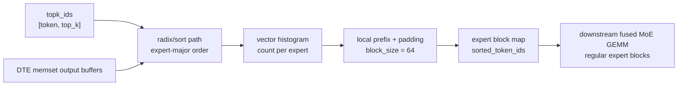

[TOC]

# 19. moe_align_block_size GCU400 kernel 深度解读

## 0. 当前实现片段与 MoE 路由整理优化主线

这份报告要先避开一个常见误区：`moe_align_block_size` 不是普通排序算子，也不是简单把 `topk_ids` flatten 后按 expert 排序。它真正服务的是后续 fused MoE GEMM 的输入组织。后续 GEMM 希望每个 block 只对应一个 expert，并且 block 内 token id 连续放在 `sorted_ids` 中；每个 expert 的真实 token 数又通常不是 `block_size` 的整数倍，所以尾部要用 pad sentinel 补齐。也就是说，这个 kernel 的性能目标不是“把 topk_ids 排序完就结束”，而是在一次 GCU400 kernel 中同时完成排序、每 expert 计数、padded prefix、`experts_ids` block metadata、可选 invalid expert 过滤，以及对后续 non-gather/fused path 有用的 unpadded 辅助信息。

### 0.1 host 合约：三类 blk-valid 输出必须成组出现

```cpp
topsopStatus_t CheckArgs(void) const override {
  if (topk_ > num_experts_) {
    OPLIB_LOG_ERR(TopsFlame) << "topk must be no larger than num_experts";
    return TOPSOP_STATUS_BAD_PARAM;
  }
  if (num_experts_ <= 0 || block_size_ <= 0 ||
      token_num_ <= 0 || topk_ <= 0) {
    OPLIB_LOG_ERR(TopsFlame) << "invalid moe_align_block_size shape";
    return TOPSOP_STATUS_BAD_PARAM;
  }

  const bool has_blk_valid =
      real_sorted_ids_ != nullptr ||
      blk_valid_cnt_ != nullptr ||
      blk_valid_offset_ != nullptr;
  const bool full_blk_valid =
      real_sorted_ids_ != nullptr &&
      blk_valid_cnt_ != nullptr &&
      blk_valid_offset_ != nullptr;
  if (has_blk_valid && !full_blk_valid) {
    OPLIB_LOG_ERR(TopsFlame)
        << "real_sorted_ids, blk_valid_cnt and blk_valid_offset "
        << "must be provided together";
    return TOPSOP_STATUS_BAD_PARAM;
  }
  return TOPSOP_STATUS_SUCCESS;
}

topsopStatus_t PreHandle(void) override {
  // 每个 expert 最坏只差 block_size - 1 个 padding slot。
  op_paras_.sorted_topk_ids_num =
      token_num_ * topk_ + num_experts_ * (block_size_ - 1);
  op_paras_.pad_value = token_num_ * topk_;
  op_paras_.num_experts = num_experts_;
  op_paras_.block_size = block_size_;
  op_paras_.token_num = token_num_;
  op_paras_.topk = topk_;
  return TOPSOP_STATUS_SUCCESS;
}
```

这段合约解释了两个容易误读的点。第一，`sorted_ids` 的容量不是恰好 `token_num * topk`，而是还要为每个 expert 的尾 block 预留 padding；padding sentinel 是 flatten 后长度 `token_num * topk`。第二，blk-valid 路径不是可选地多给一个输出就能启用，`real_sorted_ids/blk_valid_cnt/blk_valid_offset` 必须一起出现，否则后续 non-gather/fused 路径无法同时知道“真实 token 序列”和“每个 padded block 的有效范围”。

### 0.2 host dispatch：sort-parallel 优先，旧路径兜底

```cpp
int total_tokens = token_num * topk;
int num_experts_align_v = AlignUp(num_experts, 128);
int sort_dims_align = AlignUp(total_tokens, 128 * dimBlocks.x);
int tokens_align = AlignUp(total_tokens, 128);

constexpr int kLevel2TokenThreshold = 20480;
int sort_level;
if (total_tokens > kLevel2TokenThreshold) {
  int l2_uint32s_level2 = 128 * dimBlocks.x + 4 * sort_dims_align;
  int level2_bytes = l2_uint32s_level2 * sizeof(uint32_t);
  if (level2_bytes <= GCU_CSB_SIZE) {
    sort_level = 2;  // shared/CSB workspace 足够，使用 Level2 sort。
    used_L2_size = level2_bytes;
  } else {
    sort_level = 3;  // Level2 算法保留，但 sort workspace 放 device memory。
    used_L2_size =
        (tokens_align + num_experts_align_v) * sizeof(int32_t);
  }
} else {
  sort_level = 1;    // 小 token 走 local Level1 sort。
  used_L2_size = (tokens_align + num_experts_align_v) * sizeof(int32_t);
}

bool sort_parallel_ok = num_experts <= 512 && numBlocks.x > 1;
if (sort_parallel_ok) {
  int sorted_idx_align = AlignUp(total_tokens, 128);
  int workspace_uint32s = sorted_idx_align + num_experts_align_v;
  if (sort_level == 3) {
    int l2_uint32s_level2 = 128 * dimBlocks.x + 4 * sort_dims_align;
    workspace_uint32s += l2_uint32s_level2;
  }
  void* workspace_ptr = nullptr;
  TOPSRT_CHECK(topsopMallocAsync(
      &workspace_ptr, workspace_uint32s * sizeof(uint32_t), stream, 0));

  bool use_device_mem_sort = (sort_level == 3);
  bool exclude_invalid =
      real_sorted_ids && blk_valid_cnt && blk_valid_offset;

  if (sort_level == 2 || sort_level == 3) {
    if (exclude_invalid) {
      moe_align_block_size_sort_parallel_kernel_gcu400<true, true>
          <<<numBlocks, dimBlocks, used_L2_size, stream>>>(
              sorted_ids, real_sorted_ids, experts_ids, num_tokens_post_pad,
              num_tokens_unpad, blk_valid_cnt, blk_valid_offset,
              topk_ids, real_token_num, expert_map,
              num_experts, block_size, token_num, topk,
              max_padded_num, max_block_num, pad_value,
              reinterpret_cast<int32_t*>(workspace_ptr),
              use_device_mem_sort);
    } else {
      moe_align_block_size_sort_parallel_kernel_gcu400<true, false>
          <<<numBlocks, dimBlocks, used_L2_size, stream>>>(
              sorted_ids, real_sorted_ids, experts_ids, num_tokens_post_pad,
              num_tokens_unpad, blk_valid_cnt, blk_valid_offset,
              topk_ids, real_token_num, expert_map,
              num_experts, block_size, token_num, topk,
              max_padded_num, max_block_num, pad_value,
              reinterpret_cast<int32_t*>(workspace_ptr),
              use_device_mem_sort);
    }
  } else {
    if (exclude_invalid) {
      moe_align_block_size_sort_parallel_kernel_gcu400<false, true>
          <<<numBlocks, dimBlocks, used_L2_size, stream>>>(
              sorted_ids, real_sorted_ids, experts_ids, num_tokens_post_pad,
              num_tokens_unpad, blk_valid_cnt, blk_valid_offset,
              topk_ids, real_token_num, expert_map,
              num_experts, block_size, token_num, topk,
              max_padded_num, max_block_num, pad_value,
              reinterpret_cast<int32_t*>(workspace_ptr),
              use_device_mem_sort);
    } else {
      moe_align_block_size_sort_parallel_kernel_gcu400<false, false>
          <<<numBlocks, dimBlocks, used_L2_size, stream>>>(
              sorted_ids, real_sorted_ids, experts_ids, num_tokens_post_pad,
              num_tokens_unpad, blk_valid_cnt, blk_valid_offset,
              topk_ids, real_token_num, expert_map,
              num_experts, block_size, token_num, topk,
              max_padded_num, max_block_num, pad_value,
              reinterpret_cast<int32_t*>(workspace_ptr),
              use_device_mem_sort);
    }
  }

  CC_KERNEL_LAUNCH_CHECK_NO_RT();
  TOPSRT_CHECK(topsopFreeAsync(workspace_ptr, stream));
  return topsSuccess;
}

if (blk_valid_cnt && blk_valid_offset) {
  OPLIB_LOG_ERR(TopsFlame)
      << "blk_valid output requires sort-parallel support";
  return topsErrorLaunchFailure;
}

// 非 blk-valid 请求才允许回退到旧路径。
if (kernel_flag == 0) dispatch_radix_l2();
else if (kernel_flag == 1) dispatch_cache_l2();
else if (kernel_flag == 2) dispatch_parallel_histogram();
else dispatch_single_thread_fallback();
```

上面的片段保留了真实路由的关键边界：sort-parallel 是当前优先路径；`num_experts <= 512` 且 `numBlocks.x > 1` 才能使用；blk-valid 请求不能回退到旧路径，因为旧路径不会生成 `blk_valid_cnt/blk_valid_offset`；Level3 不是另一套排序算法，而是把 Level2 所需 workspace 挪到 device memory。

### 0.3 sort-parallel 入口和三阶段工作区

```cpp
template <bool USE_LEVEL2_SORT, bool EXCLUDE_INVALID_EXPERT>
__thread_dims__(DEFAULT_SUBTHREAD_NUM, 1, 1)
__global__ __cooperative__
void moe_align_block_size_sort_parallel_kernel_gcu400(
    int32_t* sorted_ids, int32_t* real_sorted_ids, int32_t* experts_ids,
    int32_t* num_tokens_post_pad, int32_t* num_tokens_unpad,
    int32_t* blk_valid_cnt, int32_t* blk_valid_offset,
    int32_t* topk_ids, int32_t* real_token_num, int32_t* expert_map,
    int32_t num_experts, int32_t block_size,
    int32_t token_num, int32_t topk, int32_t max_padded_num,
    int32_t max_block_num, int32_t pad_value,
    int32_t* workspace, bool use_device_mem_sort) {
  extern __shared__ __attribute__((aligned(512))) char shared_buf_raw[];
  const int block_id = blockIdx.x;
  const int thread_id = threadIdx.x;
  const int sub_id = subThreadIdx.x;
  const int sips_per_block = blockDim.x;
  const int global_sip = block_id * sips_per_block + thread_id;
  const int global_sub_id =
      global_sip * DEFAULT_SUBTHREAD_NUM + sub_id;
  const int global_subs =
      gridDim.x * sips_per_block * DEFAULT_SUBTHREAD_NUM;

  if (real_token_num) {
    int val = real_token_num[0];
    op_assert(val >= 0, "real_token_num cannot be negative");
    op_assert(val <= token_num, "real_token_num exceeds token_num");
    token_num = val * topk;
  } else {
    token_num = token_num * topk;
  }

  if (token_num == 0) {
    if (cc_kernel::GetSubThreadEvenIdx() == 0) {
      tops::private_dte ctx;
      num_tokens_post_pad[0] = 0;
      if KERNEL_CONSTEXPR17 (EXCLUDE_INVALID_EXPERT) {
        if (num_tokens_unpad) {
          num_tokens_unpad[0] = 0;
        }
      }
      tops::memset(ctx, tops::mdspan(tops::Global, sorted_ids,
                                     max_padded_num), pad_value);
      tops::memset(ctx, tops::mdspan(tops::Global, experts_ids,
                                     max_block_num), 0);
    }
    return;
  }

  constexpr int kMaxExperts = 512;
  __local__ __valigned__ int32_t local_cnt[kMaxExperts];
  __local__ __valigned__ int32_t local_cumsum[kMaxExperts];
  __local__ __valigned__ int32_t local_cumsum_valid[kMaxExperts];
  __local__ __valigned__ int32_t local_blkcnt[kMaxExperts];

  using sort_vtype = typename stvector<unsigned int, 1>::VT;
  constexpr int vlen = sizeof(sort_vtype) / sizeof(unsigned int);
  const int num_experts_align = AlignUp(num_experts, vlen);
  const int sort_dims_align = AlignUp(token_num, vlen * sips_per_block);
  const int sorted_idx_align = AlignUp(token_num, vlen);

  char* sort_workspace = shared_buf_raw;
  uint32_t* sorted_idx_l2 = nullptr;
  if KERNEL_CONSTEXPR17 (USE_LEVEL2_SORT) {
    sorted_idx_l2 = reinterpret_cast<uint32_t*>(sort_workspace)
        + vlen * sips_per_block + 3 * sort_dims_align;
  }

  int32_t* topk_ids_l2 = reinterpret_cast<int32_t*>(shared_buf_raw);
  int token_num_align_shared = AlignUp(token_num, vlen);
  int32_t* expert_cnt_l2 =
      topk_ids_l2 + token_num_align_shared;

  uint32_t* sorted_idx_dev = reinterpret_cast<uint32_t*>(workspace);
  int32_t* expert_cnt_dev =
      reinterpret_cast<int32_t*>(sorted_idx_dev + sorted_idx_align);
  uint32_t* level3_sort_workspace =
      reinterpret_cast<uint32_t*>(expert_cnt_dev + num_experts_align);
}
```

这个入口把 token 行数变成 flatten 后的路由项数，并把跨 block 的两个结果放进 device workspace：`sorted_idx_dev` 保存“按 expert 排序后的原始 flatten index”，`expert_cnt_dev` 保存每个 expert 的 token 数。CSB 只做每个阶段的临时加速空间，跨 block 交接统一走 workspace，这也是 `__syncblocks()` 之后 Phase 3 能同时读取 sort 和 histogram 结果的原因。

### 0.4 Phase 1 和 Phase 2：sort 与 histogram 并行

```cpp
if (block_id == 0) {
  tops::local_dte dte_sorted, dte_experts, dte_copy;
  tops::event evt_sorted, evt_experts;

  if KERNEL_CONSTEXPR17 (!USE_LEVEL2_SORT) {
    if (thread_id == 0 && sub_id == 0) {
      dte_copy.init();
    }
  }
  if (thread_id == 1 && sub_id == 0) {
    dte_sorted.init();
    evt_sorted = tops::memset_async(
        dte_sorted,
        tops::mdspan(tops::Global, sorted_ids, max_padded_num),
        pad_value);
  }
  if (thread_id == 2 && sub_id == 0) {
    dte_experts.init();
    evt_experts = tops::memset_async(
        dte_experts,
        tops::mdspan(tops::Global, experts_ids, max_block_num),
        0);
  }

  if KERNEL_CONSTEXPR17 (USE_LEVEL2_SORT) {
    char* sort_buf = use_device_mem_sort
        ? reinterpret_cast<char*>(level3_sort_workspace)
        : sort_workspace;
    uint32_t* sort_indices_out =
        use_device_mem_sort ? sorted_idx_dev : sorted_idx_l2;
    sort_kernel_gcu400_level2_device_func
        <false, false, true, uint32_t, true>(
            reinterpret_cast<uint32_t*>(topk_ids),
            sort_indices_out,
            reinterpret_cast<uint32_t*>(topk_ids),
            1, static_cast<int64_t>(token_num), 1,
            sort_buf);
  } else {
    constexpr int kLevel1TileSize = 20480;
    __local__ __valigned__ uint32_t local_sorted_idx[kLevel1TileSize];
    if (thread_id == 0 && sub_id == 0) {
      int32_t* topk_ids_local =
          reinterpret_cast<int32_t*>(local_sorted_idx);
      tops::event evt_copy = tops::memcpy_async(
          dte_copy,
          tops::mdspan(tops::Local, topk_ids_local, token_num),
          tops::mdspan(tops::Global, topk_ids, token_num));
      evt_copy.wait();
      radix_sort<2>(topk_ids_local, sort0_val_buf, sort0_idx_buf,
                    sort1_val_buf, sort1_idx_buf,
                    token_num, num_experts);
      tops::memcpy(dte_copy,
          tops::mdspan(tops::Global, sorted_idx_dev, token_num),
          tops::mdspan(tops::Local, sort0_idx_buf, token_num));
      dte_copy.destroy();
    }
  }

  if (thread_id == 1 && sub_id == 0) {
    evt_sorted.wait();
    dte_sorted.destroy();
  }
  if (thread_id == 2 && sub_id == 0) {
    evt_experts.wait();
    dte_experts.destroy();
  }

  if KERNEL_CONSTEXPR17 (USE_LEVEL2_SORT) {
    if (!use_device_mem_sort) {
      __syncthreads();
      vector_copy_with_tail_mask(sorted_idx_dev, sorted_idx_l2, token_num);
    }
  }
}

if (block_id > 0) {
  int block_hist_cnt = gridDim.x - 1;
  int expert_per_block = num_experts / block_hist_cnt;
  int expert_offset = expert_per_block * (block_id - 1);
  int expert_end = expert_per_block * block_id;
  if (block_id == gridDim.x - 1) {
    expert_end = num_experts;
  }

  int32_t* topk_ids_ptr = topk_ids_l2;
  if ((AlignUp(token_num, 128) + num_experts_align) *
          sizeof(int32_t) <= GCU_CSB_SIZE) {
    tops::local_dte dte_hist;
    tops::event evt_hist;
    if (thread_id == 0 && sub_id == 0) {
      dte_hist.init();
      evt_hist = tops::memcpy_async(
          dte_hist,
          tops::mdspan(tops::Shared, topk_ids_ptr, token_num),
          tops::mdspan(tops::Global, topk_ids, token_num));
      evt_hist.wait();
      dte_hist.destroy();
    }
    __syncthreads();
  } else {
    topk_ids_ptr = topk_ids;
  }

  int subs_in_block = sips_per_block * DEFAULT_SUBTHREAD_NUM;
  int my_sub = thread_id * DEFAULT_SUBTHREAD_NUM + sub_id;
  for (int e = my_sub + expert_offset; e < expert_end;
       e += subs_in_block) {
    if (num_experts < 256) {
      histogram_once_256(topk_ids_ptr, expert_cnt_l2,
                         token_num, num_experts, e);
    } else {
      histogram_once_int16(topk_ids_ptr, expert_cnt_l2,
                           token_num, num_experts, e);
    }
  }
  __syncthreads();
  vector_copy_with_tail_mask(expert_cnt_dev + expert_offset,
                             expert_cnt_l2 + expert_offset,
                             expert_end - expert_offset);
}
```

Phase 1 和 Phase 2 并行的关键是角色分离：block 0 专注 sort 和输出初始化，block 1+ 专注 histogram。`sorted_ids` 的大 memset 与 radix sort 重叠；histogram 对 expert 维切分，避免每个 expert 都由同一个 sub-thread 串行扫完整 token。`histogram_once_256` 和 `histogram_once_int16` 都会先 sanitize 越界 id，避免 `-1` 或非法 expert id 在窄类型比较里误命中。

### 0.5 Phase 3：local prefix、padded 写回和 invalid expert

```cpp
__syncblocks();

if (sub_id == 0) {
  vector_copy_with_tail_mask(local_cnt, expert_cnt_dev, num_experts);
}
__syncsubthreads();

int num_experts_each = num_experts / DEFAULT_SUBTHREAD_NUM;
int start = num_experts_each * sub_id;
int end = start + num_experts_each;
if (sub_id == DEFAULT_SUBTHREAD_NUM - 1) {
  end = num_experts;
}

int cum_tokens = 0;
int cum_tokens_valid = 0;
int cum_blocks = 0;
for (int e = start; e < end; ++e) {
  int cnt = local_cnt[e];
  int blk = block_size == 64 ? ((cnt + 63) >> 6)
                             : CeilDiv(cnt, block_size);
  local_cumsum[e] = cum_tokens;
  local_blkcnt[e] = cum_blocks;
  if KERNEL_CONSTEXPR17 (EXCLUDE_INVALID_EXPERT) {
    local_cumsum_valid[e] = cum_tokens_valid;
    int mapped_e = expert_map ? expert_map[e] : e;
    if (mapped_e != -1) {
      cum_tokens_valid += cnt;
      cum_blocks += blk;
    }
  } else {
    cum_blocks += blk;
  }
  cum_tokens += cnt;
}
__syncsubthreads();

int pre_cumsum = 0;
int pre_blk_cnt = 0;
int pre_cumsum_valid = 0;
for (int i = 1; i <= sub_id; ++i) {
  int prev = i * num_experts_each - 1;
  if (prev >= 0) {
    pre_cumsum += local_cumsum[prev] + local_cnt[prev];
    if KERNEL_CONSTEXPR17 (EXCLUDE_INVALID_EXPERT) {
      int mapped_prev = expert_map ? expert_map[prev] : prev;
      pre_cumsum_valid += local_cumsum_valid[prev];
      if (mapped_prev != -1) {
        pre_cumsum_valid += local_cnt[prev];
        pre_blk_cnt += local_blkcnt[prev] +
            CeilDiv(local_cnt[prev], block_size);
      } else {
        pre_blk_cnt += local_blkcnt[prev];
      }
    } else {
      pre_blk_cnt += local_blkcnt[prev] +
          CeilDiv(local_cnt[prev], block_size);
    }
  }
}

for (int e = start; e < end; ++e) {
  local_cumsum[e] += pre_cumsum;
  local_blkcnt[e] += pre_blk_cnt;
  if KERNEL_CONSTEXPR17 (EXCLUDE_INVALID_EXPERT) {
    local_cumsum_valid[e] += pre_cumsum_valid;
  }
}
__syncsubthreads();

if (block_id == 0 && thread_id == 0 &&
    sub_id == DEFAULT_SUBTHREAD_NUM - 1) {
  int last = num_experts - 1;
  int total_blocks = local_blkcnt[last];
  if KERNEL_CONSTEXPR17 (EXCLUDE_INVALID_EXPERT) {
    int mapped_last = expert_map ? expert_map[last] : last;
    if (mapped_last != -1) {
      total_blocks += CeilDiv(local_cnt[last], block_size);
    }
    num_tokens_post_pad[0] = total_blocks * block_size;
    if (num_tokens_unpad) {
      num_tokens_unpad[0] = local_cumsum_valid[last] +
          (mapped_last != -1 ? local_cnt[last] : 0);
    }
  } else {
    total_blocks += CeilDiv(local_cnt[last], block_size);
    if (expert_map == nullptr) {
      int invalid_cnt = token_num - local_cumsum[last] - local_cnt[last];
      total_blocks += CeilDiv(invalid_cnt, block_size);
    }
    num_tokens_post_pad[0] = total_blocks * block_size;
  }
}

for (int e = global_sub_id; e < num_experts; e += global_subs) {
  int cnt = local_cnt[e];
  if (cnt == 0) {
    continue;
  }
  int mapped_e = expert_map ? expert_map[e] : e;
  if KERNEL_CONSTEXPR17 (EXCLUDE_INVALID_EXPERT) {
    if (mapped_e == -1) {
      continue;
    }
  }

  int src_start = local_cumsum[e];
  int dst_start = EXCLUDE_INVALID_EXPERT ? local_cumsum_valid[e] : src_start;
  int padded_start = local_blkcnt[e] * block_size;
  int num_blks = CeilDiv(cnt, block_size);

  vector_copy_with_tail_mask(sorted_ids + padded_start,
                             sorted_idx_dev + src_start,
                             cnt);
  if KERNEL_CONSTEXPR17 (EXCLUDE_INVALID_EXPERT) {
    vector_divide_copy_with_tail_mask(real_sorted_ids + dst_start,
                                      sorted_idx_dev + src_start,
                                      cnt, topk);
  }
  vector_fill_with_tail_mask(experts_ids + local_blkcnt[e],
                             mapped_e, num_blks);

  if KERNEL_CONSTEXPR17 (EXCLUDE_INVALID_EXPERT) {
    int full_blks = num_blks - 1;
    vector_fill_with_tail_mask(blk_valid_cnt + local_blkcnt[e],
                               block_size, full_blks);
    int tail = cnt % block_size;
    blk_valid_cnt[local_blkcnt[e] + full_blks] =
        tail ? tail : block_size;
    vector_iota_block_offsets(blk_valid_offset + local_blkcnt[e],
                              dst_start, block_size, num_blks);
  }
}
```

Phase 3 的核心不是排序，而是 prefix 和 metadata 写回。每个 sub-thread 在 local stack 上算一段 expert 的 token prefix 和 block prefix，再把前序 sub-thread 的最后结果叠加进去。普通路径把 invalid `-1` 作为排序后尾段处理；`EXCLUDE_INVALID_EXPERT` 路径跳过 mapped 为 `-1` 的 expert，并额外生成 unpadded token 序列和每个 block 的有效 token 数。`block_size == 64` 的右移特化保留在 prefix 中，因为主流 MoE block 正好是 64。

### 0.6 代码片段解读：block、thread、subthread 的任务划分

sort-parallel 路径使用 `__global__ __cooperative__`，这意味着它依赖多 block 协作和 `__syncblocks()`。block 维首先被拆成两类角色：block 0 是排序和输出初始化的 producer，block 1 到 block `gridDim.x-1` 是 histogram producer。Phase 1 片段中，block 0 内部又把 thread/sub-thread 分工细化：`thread_id==1 && sub_id==0` 异步 memset `sorted_ids`，`thread_id==2 && sub_id==0` 异步 memset `experts_ids`；排序本身由 block 0 的排序路径完成，Level2/3 时调用 multi-SIP radix sort device func，Level1 时用 thread 0 的 local buffer 做两轮 radix。block 1+ 则按 expert id 范围分工，每个 block 负责一段 expert，block 内所有 SIP/sub-thread 对这一段 expert 做 histogram。

Phase 3 的划分更细。每个 SIP 的 sub-thread 先把 `expert_cnt_dev` 中的全部 expert count 载入自己的 `__local__` stack arrays：`local_cnt/local_cumsum/local_cumsum_valid/local_blkcnt`。随后 sub-thread 维按 expert 范围切片：`num_experts_each = num_experts / DEFAULT_SUBTHREAD_NUM`，`start = num_experts_each * sub_id`，最后一个 sub-thread 承担尾部 expert。每个 sub-thread 先算自己段内的 token prefix 和 block prefix，再通过读取前序 sub-thread 段的最后一个 expert，把 `pre_cumsum/pre_blk_cnt/pre_cumsum_valid` 合并进去。最后全局写回阶段用 `global_sub_id/global_subs` 在所有 block、thread、sub-thread 间分摊 expert 写回。

这个分工值得学习的地方是：排序和 histogram 是不同性质的任务，不能强行放进同一个 parallel loop。排序需要保留原始 flattened index 的相对信息，适合集中用 radix pipeline；histogram 对每个 expert 独立，适合 expert 维切分；prefix 需要完整 expert count，必须等两者都完成后才能做；写回则可以按 expert 并行。实现把这四个阶段通过 cooperative block barrier 串起来，正好匹配各自的数据依赖。

### 0.7 代码片段解读：数据流、计算流和 metadata 流

数据流第一步是 `topk_ids` flatten。host 传入的 `token_num` 是 token 行数，入口片段会在 `real_token_num` 存在时改成 `real_token_num[0] * topk`，否则改成 `token_num * topk`。这里的 `token_num` 在 kernel 内已经是 flatten 后的路由项数。输出 sentinel `pad_value` 等于 flatten 长度，真实 token index 范围是 `[0, token_num)`，因此 padded slot 可以直接填 `pad_value`，后续 gather 看到这个值就能识别为无效。

Phase 1 的数据流是 `topk_ids -> sorted_idx_dev`。Level2/3 路径用 radix sort device func，把 key 看作 expert id，把 value 看作原始 flatten index，输出的 `sorted_idx_dev` 是按 expert key 排序后的原始 flatten index 序列。Level1 路径先用 DTE 把 `topk_ids` 搬到 local，再调用 `radix_sort<2>`，最后把 `result_idx_buf` 拷到 device workspace。这里有一个优化思想：Phase 3 写 `sorted_ids` 时并不需要再读 sorted expert id，只需要 sorted index，因为每个 expert 的段边界由 histogram/prefix 给出。

Phase 2 的数据流是 `topk_ids -> expert_cnt_dev`。block 1+ 可以先把 `topk_ids` 搬到 CSB `topk_ids_l2`，如果 L2 放不下就直接从 global 读。每个 expert 由 `histogram_once_256` 或 `histogram_once_int16` 统计 count，结果先写 `expert_cnt_l2`，再用 vector copy 写到 device workspace `expert_cnt_dev`。这里的 count 与排序结果来自同一份 `topk_ids`，但它们并行产生：排序给 Phase 3 提供“按 expert 连续的 index 序列”，histogram 给 Phase 3 提供“每个 expert 有多长”。

Phase 3 的 metadata 流是 `expert_cnt_dev -> local_cumsum/local_blkcnt -> num_tokens_post_pad/experts_ids/blk_valid_*`。`local_cumsum[e]` 是 expert `e` 在 sorted index 序列中的起点，`local_blkcnt[e]` 是 expert `e` 在 block metadata 中的起点，`local_cumsum_valid[e]` 是排除 invalid expert 后 unpadded token 序列的起点。最后，`sorted_ids[padded_start + i]` 来自 `sorted_idx_dev[src_start + i]`，`experts_ids[local_blkcnt[e] + b]` 是 mapped expert id，`blk_valid_cnt` 和 `blk_valid_offset` 则描述每个 padded block 中有多少真实 token 以及这些 token 在 unpadded 序列中的起点。

计算流本质上不是矩阵计算，而是“排序、计数、前缀、scatter”的数据整理计算。它的热区包括 radix 指令、vector histogram、prefix scan、vector copy 和 memset。这里的优化重点也完全不同于 GEMM：GEMM 关心 OACC 和 K reduction，这个 kernel 关心的是避免 atomic append、避免每 expert 串行扫描成为瓶颈、避免大 memset 阻塞主计算、避免把 prefix 结果在 global memory 来回搬。sort-parallel 的设计正是围绕这些瓶颈展开。

### 0.8 代码片段解读：三个 phase 的优化思路

Phase 1 最重要的优化是让 memset 与 sort 重叠。Phase 1 片段先分别对 `sorted_ids` 和 `experts_ids` 发起异步 memset，再同时推进 radix sort，直到 sort 结果即将交接给后续阶段时才 wait memset 事件。`sorted_ids` 的 memset 很大，因为它覆盖 `max_padded_num`，但它只是写 sentinel，不需要依赖 sort 结果；把它提前异步发出去，可以隐藏一部分 global write 带宽。这个思路很适合所有“先清输出，再按稀疏位置写真实值”的 kernel。

Phase 2 最重要的优化是 expert 维分块 histogram。朴素做法是每个 expert 扫一遍全部 token，这在单 block 内会慢；实现让 block 1+ 分摊 expert 范围，每个 block 内 sub-thread 再分摊 expert。因为 `num_experts <= 512`，专家维不大但足够多，拿来并行很自然。`histogram_once_256` 用 uint8 路径处理小 expert 数，`histogram_once_int16` 处理较大 expert 数，并在比较前 sanitize 越界 id，避免 `-1` 截断后误命中。这是性能和正确性同时考虑的细节。

Phase 3 最重要的优化是把 prefix 放到每个 sub-thread 的 local stack 上算，而不是做复杂 global scan。限制 `num_experts <= 512` 后，`local_cnt/local_cumsum/local_blkcnt` 每个 512 个 int32，放在 `__local__` 中可接受。每个 sub-thread 负责一段 expert，只需要合并前序 sub-thread 段的最后结果，就能得到全局 prefix。这样避免了跨 block prefix kernel，也避免把 prefix intermediate 写回 global 再读回来。这个设计的代价是每个 SIP/sub-thread 都会加载一份 expert count，但 512 int32 相比 token 排序/写回的量很小。

### 0.9 代码片段解读：C++/TCLE 写法技巧和可迁移 trick

第一个 trick 是用模板参数表达功能开关。`USE_LEVEL2_SORT` 和 `EXCLUDE_INVALID_EXPERT` 都是模板布尔，实现用 `KERNEL_CONSTEXPR17` 让无关路径在编译期消失。这样 invalid expert 过滤路径不会给普通路径增加 runtime branch；Level1/Level2 的 workspace 逻辑也不会在每个 inner loop 里反复判断。对底层 kernel 来说，功能分支如果会影响热循环，优先做模板特化，而不是把所有模式塞进一个运行时大 if。

第二个 trick 是把跨 block 共享数据放到 device workspace，而不是尝试让 block 之间直接共享 CSB。block 0 的 sorted index 和 block 1+ 的 expert count 都最终写到 `workspace`：`sorted_idx_dev` 与 `expert_cnt_dev`。`__syncblocks()` 之后 Phase 3 再从 workspace 读。这样 CSB 只作为每个 block 内的临时加速存储，跨 block 的数据交接通过 device memory 完成，语义清楚，也适合 Level3 sort workspace 放不进 CSB 时的 fallback。

第三个 trick 是局部数组复用。入口片段把 Phase 3 的 local arrays 提前声明，注释说明 Level1 sort 可以复用这些本地资源作为 scratch，因为 Phase 3 在 `__syncblocks()` 之后才运行。这里不是随便省内存，而是利用阶段之间的生命周期互斥。高性能 kernel 中，内存 footprint 往往比算术复杂度更关键；能证明生命周期不重叠的 scratch buffer 可以复用，但要在注释里写清楚，否则后续维护者很容易误改。

第四个 trick 是 vector tail 处理统一用 mask。无论是 copy `sorted_idx_l2 -> sorted_idx_dev`，还是 `expert_cnt_l2 -> expert_cnt_dev`，还是写 `sorted_ids/experts_ids/blk_valid_offset`，实现都使用 `altivector_to_mask`、`vset_mb` 和 masked `load/store` 处理尾部。这样主循环走整 vector，尾部只在最后一次处理，不需要每个元素判断边界。这个技巧在 GCU400 上尤其重要，因为 vector load/store 和 `simple_altivector` 是这类 metadata kernel 的主力。

第五个 trick 是利用 `block_size == 64` 的位运算特化。Phase 3 prefix 片段中当 `block_size` 为 64 时，`blk_v = (cnt_v + 63) >> 6`，这比通用 `CeilDiv(cnt, block_size)` 更适合 vector 化。MoE fused kernels 经常使用 64 token block，因此这个特化不是微不足道的写法优化，而是对主流形状的优化。可迁移经验是：对业务中高频常量可以做清晰特化，但要保留通用路径。

第六个 trick 是 invalid expert 的处理与普通路径解耦。开启 `EXCLUDE_INVALID_EXPERT` 时，prefix 同时维护 padded block prefix 和 valid unpadded prefix；写回 `sorted_ids` 的同时写 `real_sorted_ids = sorted_idx / topk`，避免二次读取 `sorted_idx_dev`；再写每个 block 的 valid count/offset。普通路径则可以把 invalid `-1` 当成排序后最后一段，在 `expert_map == nullptr` 时单独写 `experts_ids=-1`。这说明实现并没有用一个笨重路径覆盖所有情况，而是按下游需要拆成两种 metadata 语义。

### 0.10 代码片段解读：从下游 fused MoE 看它为什么重要

`op_vllm_fused_experts_impl` 中多条 fused MoE 路径都会先调用 `RunMoeAlign()` 或 `RunMoeAlignWithBlkValid()`。普通路径拿到 `h_sorted_`、`h_experts_` 和 `h_npp_` 后，就能让后续 GEMM 按 block 读取 expert id，并用 sorted id gather token。blk-valid 路径会额外分配 `blk_valid_cnt/blk_valid_offset/sorted_id_unpadded/num_tokens_unpad`，然后把这些信息传给 non-gather quant kernel 和 reduce/fused index add。也就是说，`moe_align_block_size` 不是孤立预处理，它决定后续 MoE kernel 是否能按 block 连续访问输入、是否能跳过 invalid expert、是否能减少无效 padded token 传播。

从优化学习角度看，这份实现告诉我们：高性能 MoE 不只靠 expert GEMM。routing metadata 的布局如果不好，GEMM 再快也会被 gather/scatter 和 padding 拖住。`moe_align_block_size` 把 token routing 转成 block-wise metadata，是后续所有 fused MoE kernel 的入口。它的优化点看起来是 radix、histogram、prefix、memset，但本质是在为下游矩阵计算创造规则数据流。

这份实现是 30 份入选 kernel 里少数不以矩阵乘法本身为核心的实现，但它对 MoE 性能同样关键。MoE 的 fused GEMM 想跑得快，输入 token 必须先按 expert 聚集，并且每个 expert 的 token 数要按固定 `block_size` 对齐。`moe_align_block_size` 做的就是这件事：把 `[token_num, topk]` 的 expert 路由结果整理成一维 `sorted_ids`，再生成每个 block 对应的 `experts_ids`，同时输出 `num_tokens_post_pad` 告诉后续 fused MoE kernel 有多少 padded token 需要处理。

它的等价语义可以先用 Python 写清楚：

```python
def moe_align_block_size(topk_ids, num_experts, block_size, expert_map=None):
    flat = topk_ids.reshape(-1)
    total = len(flat)
    pad_value = total

    sorted_ids = []
    experts_ids = []
    for e in range(num_experts):
        routed = [i for i, x in enumerate(flat) if x == e]
        if not routed:
            continue

        mapped_e = expert_map[e] if expert_map is not None else e
        # 普通路径里 mapped_e 可以是 -1；带 blk_valid 的路径会把 -1 排除掉。
        sorted_ids.extend(routed)
        pad = (-len(routed)) % block_size
        sorted_ids.extend([pad_value] * pad)
        experts_ids.extend([mapped_e] * ((len(routed) + block_size - 1) // block_size))

    num_tokens_post_pad = len(sorted_ids)
    return sorted_ids, experts_ids, num_tokens_post_pad
```

真实 GCU400 kernel 的复杂度远高于这段 Python。它需要在设备侧完成排序、统计、prefix sum、padding、专家 id 映射、invalid expert 过滤、输出 memset 和多 block 协作。实现里包含多条路径：单线程 fallback、radix L2、cache L2、旧 parallel histogram 路径，以及最新的 cooperative sort-parallel 路径。host 会根据 token 数、expert 数、L1/L2 容量和是否需要 invalid expert 过滤来选择。

## 为什么它值得入选

这份实现值得入选，原因是它体现了“高性能 MoE GEMM 前处理”在 GCU400 上的完整工程形态。很多人只关注 expert GEMM 本体，但如果 `sorted_ids` 和 `experts_ids` 生成慢，整个 MoE 层仍然会被路由整理拖住。这个 kernel 把看似简单的 reorder 写成了多级排序和多 block cooperative 任务，优化密度很高。

第一，它用 TCLE 的硬件 radix 指令实现 expert id 排序。实现封装了 `mradix_cntbase` 和 `mradix_offset`，每一轮按 5-bit digit 统计和 scatter。排序输出不只是 expert id，还保留原始 flattened token index。排序后相同 expert 的 token index 连续，后续写 `sorted_ids` 就可以按 expert 段复制，而不是做大量 atomic append。

第二，它把 histogram 和排序并行化。sort-parallel 新路径中，block 0 做 radix sort 和异步 memset，block 1 及之后的 block 分担 expert histogram。两者之间没有先后串行等待，直到 `__syncblocks()` 才进入第三阶段。这个设计直接利用 GCU400 的多 block cooperative kernel 能力。

第三，它有分层内存策略。小 token 走 Level1，本地 VDMem/Local 排序；大 token 走 Level2，用 L2 shared/CSB workspace 做多 SIP radix sort；如果 shared memory 放不下 Level2 workspace，就走 Level3，把 sort workspace 放到 device memory。host 会根据 `total_tokens` 和 `GCU_CSB_SIZE` 选择。

第四，它对 expert 数做专门优化。`num_experts < 256` 时用 uint8 比较路径 `histogram_once_256`，`num_experts >= 256` 时用 int16 或 int32 比较路径。比较前会 sanitize out-of-range 值，避免 `-1` 经过截断后误匹配某个 expert。这个细节说明作者不是只追速度，也考虑了 MoE 路由中 invalid id 的真实存在。

第五，它对 `block_size == 64` 有专门 prefix 优化。`block_offsetlt256_64` 把 expert token count 搬到对齐的本地数组，用 unrolled loop 计算 `ceil(cnt/64)`；`block_offsetle384_64_multi_threads` 让多个 SIP 分段计算 expert prefix，再通过 L2 临时数组做跨 SIP prefix merge。MoE fused kernels 常用 64 token block，这种特化很实际。

第六，它支持 `expert_map`。很多 serving 场景会把 logical expert 映射到 physical expert，甚至把某些 expert 标成 `-1` 表示无效。普通路径把 `experts_ids` 写成 mapped expert id；带 `blk_valid_cnt/blk_valid_offset` 的路径可以排除 mapped 为 `-1` 的 expert，并额外输出未 padded 的 `real_sorted_ids` 和每个 block 的有效 token 数。

第七，它主动初始化输出。`sorted_ids` 被 memset 成 `pad_value`，`experts_ids` 被 memset 成 0。这样每个 expert 最后一个 padded block 里没有真实 token 的位置会自动是 pad sentinel，后续 fused MoE gather 可以识别并跳过或写零。这比在每个 expert 写尾部 padding 更简单，也减少分支。

第八，它有多条 fallback。主流 sort-parallel 要求 `num_experts <= 512 && numBlocks.x > 1`。如果不满足且没有请求 invalid expert 过滤，host 还能根据 `kernel_flag` 选择 radix L2、cache L2、parallel 或单线程 fallback。这不是单一 benchmark kernel，而是面向实际形状覆盖的工程实现。

## 输入输出契约

输入 `topk_ids` 是 rank 2 tensor，shape 通常为 `[token_num, topk]`，元素类型 int32。kernel 内部会把它 flatten 成长度 `token_num * topk` 的一维数组。`real_token_num` 可选，如果存在，则实际处理长度变为 `real_token_num[0] * topk`。host 和 kernel 都检查 `real_token_num >= 0 && real_token_num <= token_num`。

输出 `sorted_ids` 是 int32 一维数组，长度至少为：

```text
max_padded_num = token_num * topk + num_experts * (block_size - 1)
```

这是最坏情况下每个 expert 都需要补到下一个 block 边界的容量。`pad_value` 被设置成 `token_num * topk`，也就是一个不会对应真实 flattened index 的 sentinel。kernel 开始时把整个 `sorted_ids` 预填为这个 sentinel，因此只需要写真实 token 的位置。

输出 `experts_ids` 是 int32 一维数组，长度至少为：

```text
max_padded_num / block_size
```

它的第 `b` 个元素表示 `sorted_ids[b*block_size : (b+1)*block_size]` 这一块属于哪个 expert。后续 fused MoE GEMM 按 block 读取 `experts_ids`，用它选择 expert 权重，再用 `sorted_ids` gather 输入 token。

输出 `num_tokens_post_pad[0]` 是真实需要处理的 padded token 总数。下游通常计算：

```text
num_blocks = num_tokens_post_pad[0] / block_size
```

如果带 invalid expert 过滤，还会输出：

- `real_sorted_ids`：排除 invalid expert 后的未 padding token id，通常写 `flatten_idx / topk`，即真实 token row index。
- `num_tokens_unpad`：排除 invalid expert 后的真实 token 数。
- `blk_valid_cnt`：每个 block 中真实有效 token 数，最后一个 block 可能小于 `block_size`。
- `blk_valid_offset`：每个 block 在 unpadded token 序列中的起点。

这些额外输出用于后续更激进的 fusion path。`op_vllm_fused_experts_impl` 中可以看到，当 fusion pass 需要处理 invalid expert 或压缩后的中间结果时，会先分配 `blk_valid_cnt/blk_valid_offset/sorted_id_unpadded/num_tokens_unpad`，再调用 `RunMoeAlignWithBlkValid`，然后把这些信息传给后续 `topsvllmInvokeFusedMoeNonGatherQuantKernelIntern`。

## host 选择逻辑

`OpVllmMoeAlignBlockSize::Compute` 先计算 `token_num_`、`topk_`、设备 block/thread 数和各个 tensor 的 mem handle，然后用 `get_kernel_flag` 估算老路径需要的 L1/L2 容量。这个 tuner 先假设 896KB VDMem，总 token 数是 `token_num * topk`，vector 对齐粒度是 256 个 int32。

老路径的 `kernel_flag` 含义大致是：

- `0`：L1 放得下 topk、sort buffer、histogram prefix 等，L2 放 expert count 和 expert ids，选择 `moe_align_block_size_kernel_radix_l2_400`。
- `1`：L1 不够大，部分 sort buffer 放 L2，选择 `moe_align_block_size_kernel_cache_l2_400`。
- `2`：更分散的 parallel histogram 路径，选择 `moe_align_block_size_parallel_kernel_gcu400`。
- `3`：单线程 fallback `moe_align_block_size_kernel_gcu400`。

但 `moe_align_block_size_host_gcu400` 内部现在优先选择新的 sort-parallel 路径。它先根据 `total_tokens = token_num * topk` 决定 sort level：

- `total_tokens <= 20480`：Level1，小 token，本地 sort。
- `total_tokens > 20480` 且 Level2 shared workspace 能放进 `GCU_CSB_SIZE`：Level2，多 SIP L2 sort。
- shared memory 不够：Level3，用 device memory sort workspace。

然后判断：

```text
is_sort_parallel_pattern_support = num_experts <= 512 && numBlocks.x > 1
```

如果支持，就异步申请 device workspace。workspace 至少包含 `sorted_idx_dev` 和 `expert_cnt_dev`；Level3 还要加一份 level2 sort workspace 形状的 device buffer。然后根据 `sort_level` 和 `exclude_invalid` 模板参数 launch：

```text
moe_align_block_size_sort_parallel_kernel_gcu400<USE_LEVEL2_SORT, EXCLUDE_INVALID_EXPERT>
```

`exclude_invalid` 的判断是 `real_sorted_ids && blk_valid_cnt && blk_valid_offset`。也就是说只有调用方完整提供三类输出时，kernel 才会排除 mapped expert 为 `-1` 的 token，并生成 unpadded 辅助信息。如果请求了这些输出但 sort-parallel 不支持，host 直接报错，不退回旧路径。这是合理的，因为旧路径没有实现 `blk_valid_cnt/offset`。

如果 sort-parallel 不支持且没有 invalid 过滤请求，host 才根据老的 `kernel_flag` 分派到 radix/cache/parallel/fallback。

## radix helper 的硬件含义

radix helper 有一组 `radix_cntbase` 和 `radix_offset` wrapper。它们看起来只是把 `shift == 0/1/2/3/4/5/6` 分别派到不同立即数调用，但这是 TCLE radix 指令常见写法：硬件指令的 shift/digit index 往往要求编译期 immediate，不能直接把运行时变量传进去。因此实现用一串分支把运行时 `loop_idx` 映射到模板/立即数调用。

`radix_sort` 的基本流程是：

1. 对当前 digit 调用 `mradix_w_base(0)` 清 radix base。
2. 扫输入值，调用 `mradix_cntbase(value, digit)` 做每个 bucket 的计数。
3. 读出 bucket count，做前缀和，再写回 radix base。
4. 第二次扫输入，调用 `mradix_offset(value, digit)` 得到当前元素的 scatter offset。
5. 同时 scatter expert id 和原始 flattened index。
6. 交换 src/dst buffer，进入下一 digit。

它按 `num_experts` 的 bit 宽决定循环次数：

```text
bits = 32 - countl_zero(num_experts)
loop_num = ceil(bits / 5)
```

每轮处理 5 bit，所以 `num_experts <= 32` 只需要 1 轮，`<=1024` 需要 2 轮，以此类推。实现对 `loop_num == 2` 有专门 specialization，手写两轮 radix，减少模板循环和分支开销。对 Level1 小 token 排序，sort-parallel 中也固定调用 `radix_sort<2>`，因为约束 `num_experts <= 512`，两轮足够覆盖 0 到 511。

排序的 key 是 `topk_ids`，value 是原始 flatten index。排序后，所有 expert id 相同的 index 连续。注意 `-1` 在 unsigned radix 里是 `0xFFFFFFFF`，会排到最后。新 sort-parallel 路径后面利用了这个性质：如果没有 `expert_map`，invalid tokens 可以被当成最后一段 `-1` expert block 写入；如果开启 exclude invalid，则 mapped `-1` 的 expert 会被跳过。

## histogram 变体

`histogram` 是最朴素的多 sub-thread 版本。每个 sub-thread 分一部分 expert，遍历整个 input，统计某个 expert 出现次数。它用 vector load、vector compare 和 `popc_mb` 做计数。时间复杂度是 `O(num_experts * token_num / vector_width)`，看上去比排序重，但它和排序并行，而且 expert 数通常有限。

`histogram_once` 统计单个 expert，使用 int32 vector 比较。`histogram_once_int16` 使用 `stvector<int32_t,2>` 读取，再把 sanitized 值转成 int16 比较，适合 `num_experts` 不太大但超过 255 的情况。`histogram_once_256` 使用 uint8 比较，适合 `num_experts < 256`，每个 vector 能比较更多 lane。为了避免 `-1` 或其他越界值经过 uint8 截断误命中，它先做：

```text
sanitized = raw < num_experts ? raw : sentinel
```

其中 sentinel 等于 `num_experts`，不会等于任何合法 expert。这个 sanitize 是关键正确性保护。否则 `-1` 截断成 255，在 `num_experts > 255` 或某些路径中可能误算到 expert 255。

sort-parallel Phase 2 中，block 1+ 按 expert 范围分工。每个 histogram block 负责一段 expert id，然后 block 内所有 sub-thread 分担这段 expert 的 `histogram_once_*`。统计结果先写到 shared `expert_cnt_l2`，再 vector copy 到 device workspace `expert_cnt_dev`，供跨 block Phase 3 使用。

## block_offset 和 prefix

有了每个 expert 的 token count 后，kernel 需要计算三个前缀：

- `sort_token_idx_buf[e]`：expert `e` 在排序后 index array 中的起点，也就是复制 sorted index 时的 src offset。
- `expert_token_idx_buf[e]` 或 `local_cumsum[e]`：expert `e` 在 padded `sorted_ids` 中的起点。
- `expert_block_cnt_buf[e]` 或 `local_blkcnt[e]`：expert `e` 在 `experts_ids` 中的 block 起点。

普通公式是：

```text
token_prefix += cnt[e]
block_prefix += ceil(cnt[e] / block_size)
padded_prefix = block_prefix * block_size
```

旧公共路径 `moe_align_block_size_common_400` 用 `block_offset` 或特化版本计算这些数组。`block_offsetlt256_64` 针对 `num_experts < 256 && block_size == 64`，把 count 拷到本地对齐数组，然后全展开 loop 计算 prefix。`block_offsetle384_64_multi_threads` 针对 `128 <= num_experts <= 384 && block_size == 64`，让多个 SIP 分段计算 token/block prefix，再用 L2 临时数组做跨 SIP prefix merge。它最后由最后一个 SIP 写 `num_tokens_post_pad[0]`。

sort-parallel Phase 3 不再依赖这些 old buffer，而是每个 sub-thread 都从 `expert_cnt_dev` 把全部 expert count 载入自己的 local stack，然后按 sub-thread id 切分 expert 范围，在 `local_cumsum/local_blkcnt` 中计算本段 prefix。之后 sub-thread 之间再合并前面段的 prefix。因为 `num_experts <= 512`，每个 sub-thread 持有 512 个 int32 的 local arrays 是可接受的。这样做避免了复杂跨 block prefix scan，也减少了全局内存往返。

带 `EXCLUDE_INVALID_EXPERT` 时，Phase 3 还维护 `local_cumsum_valid`。它表示排除 mapped `-1` expert 后的 unpadded token prefix，用于写 `real_sorted_ids` 和 `blk_valid_offset`。这条 prefix 与 padded block prefix 不同：padded prefix 是以 block 为单位，valid prefix 是以真实 token 为单位。

## 公共 radix/cache 路径

`moe_align_block_size_common_400<cache_L1>` 是旧高性能路径的核心。`cache_L1=true` 对应 `moe_align_block_size_kernel_radix_l2_400`，使用 200K int32 的 L1 local buffer 放 topk 和 sort buffer；`cache_L1=false` 对应 `moe_align_block_size_kernel_cache_l2_400`，L1 只保留 expert prefix 小数组，把 topk/sort buffer 放 L2 shared。

公共路径的流程如下：

1. 可选把 `topk_ids` 从 L3 搬到 L1 private 或 L2 shared。
2. 可选把 `expert_map` 从 L3 搬到 L2 shared。
3. 一个 sub-thread 负责 radix sort，其他 sub-thread 负责 histogram。
4. sync 后计算 expert prefix 和 block prefix。
5. 根据排序结果的 index array，把每个 expert 的真实 token index 写到 `sorted_ids` 对应 padded 段。
6. 根据 block prefix 写 `experts_ids`，如果有 `expert_map` 则 gather 映射后的 expert id。

这个公共路径里有一个值得注意的代码细节：

```text
if (loop_num == 1) radix_sort<1>(topk_ids, sort buffers)
if (loop_num == 2) radix_sort<2>(topk_ids, sort buffers)
else radix_sort(topk_ids, sort buffers, loop_num)
```

因为第二个判断不是 `else if`，当 `loop_num == 1` 时会先执行 `radix_sort<1>`，然后又进入第二个 `if` 的 `else` 执行 generic `radix_sort(topk_ids, sort buffers, 1)`。这看起来是一个额外开销问题，通常不会改变结果，因为两次都从 `topk_ids` 读并写同样的目标，但对小 expert 数场景会浪费一次排序。维护时建议改成 `if / else if / else`。

公共路径还在排序后做 range check：

```text
min_id >= 0
max_id == -1 or 0 <= max_id < num_experts
```

由于 `-1` radix 排到末尾，所以允许 `max_id == -1`。这说明路径设计上知道 padding/invalid expert 可能存在，并不是简单假设所有 `topk_ids` 都合法。

## radix_l2 和 cache_l2 kernel

`moe_align_block_size_kernel_radix_l2_400` 使用 `__thread_dims__(8,1,1)`，也就是 `RADIX_THREAD_NUM=8`。它声明：

```text
extern __shared__ int8_t L2_buffer[]
__local__ int32_t l1_src[200 * 1024]
```

它先把 `num_tokens_post_pad[0]` 清 0，再根据 `real_token_num` 修正 `token_num`。两个较靠后的 sub-thread 异步 memset `sorted_ids` 和 `experts_ids`。如果 token 数为 0，就等待 memset 完成直接返回。否则它在 L1 中切出：

- `topk_ids_buf`
- `sort0_val_buf / sort0_idx_buf`
- `sort1_val_buf / sort1_idx_buf`
- `l1_expert_token_cnt_buf`
- `sort_token_idx_buf`
- `expert_token_idx_buf`
- `expert_block_cnt_buf`

L2 buffer 中放 `expert_token_cnt_buf` 和 `expert_ids_buf/expert_map_buf`。最后调用 `moe_align_block_size_common_400<true>`。

`moe_align_block_size_kernel_cache_l2_400` 结构类似，但 L1 local 只有 `32 * 1024` int32，主要放 expert count 和 prefix 小数组；topk 和 sort buffer 放进 L2 shared。它调用 `moe_align_block_size_common_400<false>`。这个路径适合 token 数较大、L1 放不下完整 sort buffer，但 L2 仍能承载 topk/sort workspace 的场景。

这两个 kernel 都把输出 memset 和主要计算重叠起来。`sorted_ids` 的 memset 可能非常大，提前异步发起可以把一部分 L3 写带宽隐藏在 sort/histogram 期间。

## 单线程 fallback

`moe_align_block_size_kernel_gcu400` 使用 `__thread_dims__(1,1,1)`。它把所有工作放在一个 thread/sub-thread 内，流程很直观：

1. L1 local buffer 中放 expert count、padded start、expert map 和 expert ids 临时区。
2. 用 `histogram` 统计每个 expert 的 token 数。
3. 串行遍历 expert，写 `experts_ids` 临时区，并计算每个 expert 的 padded start。
4. 异步 memset `sorted_ids` 和 `experts_ids`。
5. 再串行扫描所有 `topk_ids`，把合法 token index 放到对应 expert 的下一个位置。
6. 最后把临时 expert ids 拷到 global，若有 `expert_map` 则 vector gather 映射。

这个 fallback 的好处是覆盖范围广，内存需求低，逻辑简单；坏处是 token 扫描和 scatter 都串行，适合非常小的 token 或前面路径都无法使用的形状。它的存在保证 host 不会因为 L1/L2 估算失败就完全不支持某些形状。

## 旧 parallel kernel

`moe_align_block_size_parallel_kernel_gcu400` 是 `kernel_flag == 2` 的旧并行路径。它用全局 thread/sub-thread id 把 token 分给不同 thread，再在 local/shared buffer 中做 per-subthread expert count。

它的关键流程是：

- subthread 0 异步 memset 输出。
- 每个 thread 负责一段 token，sub-thread 再细分这段 token。
- 每个 sub-thread 在 L2 `expert_token_cnt_buf_l2` 中维护自己的 expert count。
- sync 后，每个 sub-thread 把所有 sub-thread 的 expert count 做 sum，并计算自己之前 sub-thread 的 prefix，得到写 `sorted_ids` 的唯一位置。
- subthread 0 写 `experts_ids` 和 `num_tokens_post_pad`。
- 每个 sub-thread 再扫描自己的 token 段，把 flattened index 写到 `sorted_ids`。

这条路径里有显式 expert id range check。它用 vector 比较统计越界值，如果发现错误就 `op_assert`，并报告其中一个 out-of-range expert id。相比 sort 路径，这条路径不是先排序再按 expert 段复制，而是做 per-subthread prefix 后直接 scatter。因此它避免 radix sort，但需要一个 `num_experts * subThread_num` 的 L2 计数矩阵。

## sort-parallel cooperative kernel

`moe_align_block_size_sort_parallel_kernel_gcu400` 是当前最值得重点分析的路径。它是 `__cooperative__` kernel，使用 `__syncblocks()` 做 block 间同步。sort-parallel 路径的核心设计很清楚：block 0 负责 DTE memset 和 radix sort，block 1+ 负责把 topk 拷到 L2、做 histogram、把 expert count 拷到 device workspace；同步后所有 sub-thread 进入 Phase 3，计算 prefix 并写回输出。

### Phase 1：sort 和 memset

block 0 内，thread 1/sub 0 异步 memset `sorted_ids` 为 `pad_value`，thread 2/sub 0 异步 memset `experts_ids` 为 0。与此同时执行 radix sort。

如果 `USE_LEVEL2_SORT=true`，它调用：

```text
sort_kernel_gcu400_level2_device_func<
    false, false, true, uint32_t, true>(sort inputs, sort workspace)
```

sort buffer 的位置由 `use_device_mem_sort` 决定。Level2 时使用 shared `sort_workspace`，sort 结果先放 `sorted_idx_l2`；随后 block 0 的所有 sub-thread 协作把 `sorted_idx_l2` 拷到 device workspace `sorted_idx_dev`。Level3 时 sort buffer 和输出 indices 都在 device memory，排序完成后 indices 已经在 `sorted_idx_dev`。

如果 `USE_LEVEL2_SORT=false`，它走 Level1 小 token path。thread 0 的 local buffer 中分配四个 sort array 和 `local_sorted_idx`，sub 0 把 `topk_ids` DTE 拷到 local，然后调用 `radix_sort<2>`，再把 index 结果 DTE 拷到 `sorted_idx_dev`。因为 Level1 只用于 `total_tokens <= 20480` 且 `num_experts <=512`，两轮 radix 足够。

Phase 1 的优化点在于 memset 和 sort overlap。输出初始化可能需要写 `max_padded_num` 和 `max_block_num`，如果和 sort 串行，尤其在大 batch 下会很明显。这里先发 DTE memset，sort 结束后再 wait。

### Phase 2：histogram

block 1 及之后的 block 做 histogram。它们先尝试把 `topk_ids` 拷到 shared `topk_ids_l2`。如果 `topk_ids_l2 + expert_cnt_l2` 放不下 CSB，则直接从 global `topk_ids` 读。然后每个 histogram block 负责一段 expert：

```text
expert_per_block = num_experts / (block_num - 1)
expert_offset = expert_per_block * (block_id - 1)
expert_end = (block_id == gridDim.x - 1)
    ? num_experts
    : expert_per_block * block_id
```

block 内所有 sub-thread 以 `my_sub` 为步长分担 expert。对每个 expert 调用 `histogram_once_256` 或 `histogram_once_int16`。统计结果写到 shared `expert_cnt_l2`，再 vector copy 到 device workspace `expert_cnt_dev`。

这里没有让每个 block 负责一段 token，而是负责一段 expert。原因是输出需要 per expert count，且 num_experts 通常远小于 token 数。每个 expert 的 histogram 都扫完整 token 数，这看起来重复读 topk，但能避免 atomic add 和跨 block reduce。对于 `num_experts <=512` 的约束，这个 tradeoff 可控；同时 Phase 2 与 Phase 1 排序并行，整体仍然划算。

### Phase 3：prefix 和写回

`__syncblocks()` 后，sort result 和 expert count 都已经在 device workspace。所有 block/sub-thread 都进入 Phase 3。

首先每个 SIP 的 sub-thread 0 把 `expert_cnt_dev` vector load 到 local arrays。然后 4 个 sub-thread 按 expert 范围切分，计算自己的局部 prefix：

- `local_cumsum[e]`：排序后 index array 中 expert `e` 的真实 token 起点。
- `local_blkcnt[e]`：padded block 起点。
- `local_cumsum_valid[e]`：排除 invalid expert 后的真实 token 起点，仅 `EXCLUDE_INVALID_EXPERT` 使用。

局部 prefix 算完后，sub-thread 之间通过读取前一段最后一个 expert 的 prefix 和 count，把跨 sub-thread prefix 加上去。因为每个 sub-thread 都有完整 local arrays，这个 merge 不需要全局通信。

最后 block 0/thread 0/最后一个 sub-thread 写 `num_tokens_post_pad[0]`。普通路径下，如果 `expert_map == nullptr`，还会把排序末尾的 invalid `-1` token 作为额外 `-1` expert blocks 计入 padded 总数。带 `EXCLUDE_INVALID_EXPERT` 时，mapped `-1` expert 不计入 block count，并且写 `num_tokens_unpad`。

随后所有 sub-thread 协作写输出。对每个 expert `e`：

1. 从 `sorted_idx_dev + local_cumsum[e]` 复制 `cnt[e]` 个 flattened index 到 `sorted_ids + local_blkcnt[e] * block_size`。
2. 如果 `EXCLUDE_INVALID_EXPERT`，同时把 `flatten_idx / topk` 写入 `real_sorted_ids + local_cumsum_valid[e]`。
3. 把 `experts_ids + local_blkcnt[e]` 写成 mapped expert id，重复 `ceil(cnt/block_size)` 次。
4. 如果 `EXCLUDE_INVALID_EXPERT`，写 `blk_valid_cnt` 和 `blk_valid_offset`。

`blk_valid_cnt` 的写法很实用：前面完整 block 全写 `block_size`，最后一个 block 写 `cnt % block_size` 或 `block_size`。`blk_valid_offset` 用 iota vector 生成每个 block 在 unpadded token 序列里的起点：

```text
dst_start + block_id * block_size
```

这些信息让后续 GEMM 可以知道每个 block 里到底有多少真实 token，而不必把 padding token 也当作有效数据处理。

## expert_map 和 invalid expert

`expert_map` 的普通作用是把 logical expert id 映射成 physical expert id。旧路径在最后写 `experts_ids` 时用 vector gather：

```text
mapped = gather(expert_map_buf, expert_id * sizeof(int32_t))
```

sort-parallel Phase 3 直接在写 `experts_ids` 时读取 `expert_map[e]`。如果 `EXCLUDE_INVALID_EXPERT=false`，mapped `-1` 仍可能被写到 `experts_ids`，下游需要识别。若 `expert_map == nullptr`，排序末尾的 `-1` invalid topk id 会被写成 expert id `-1` 的 block。

`EXCLUDE_INVALID_EXPERT=true` 时，mapped `-1` 的 expert 被完全跳过。其 token 不写入 padded `sorted_ids`，也不写入 `real_sorted_ids`，对应 block 不写 `experts_ids`。这样 `num_tokens_post_pad` 和 `num_tokens_unpad` 都只包含有效 expert。这个模式和下游 fused experts 中的 fusion pass 配套，用于减少后续 GEMM 对无效 expert 的工作。

需要区分两类 invalid：

- `topk_ids` 中直接出现 `-1`，radix sort 会把它排到最后。
- `topk_ids` 是合法 logical expert，但 `expert_map[expert] == -1`，表示该 logical expert 不参与当前物理映射。

普通路径可能保留这些 invalid block；exclude 路径只处理第二类 mapped invalid，并依赖 caller 提供完整辅助输出。实现对 topk id range 的检查允许 `max_id == -1`，但不允许其他越界值。

## 下游 fused MoE 如何消费

后续 fused MoE non-gather kernel 会按 block 读取 `experts_ids`。每个 block 包含 `block_size` 个 token index。kernel 根据 expert id 选择对应权重，再根据 `sorted_ids` gather A 输入。对于 `sorted_ids` 中的 pad sentinel，后续实现通常会避免读真实 token或把结果视为无效。

在 `op_vllm_fused_experts_impl` 中，普通路径调用 `RunMoeAlign()`，然后把 `h_sorted_`、`h_experts_`、`h_npp_` 传给 fused MoE kernel。优化 fusion path 调用 `RunMoeAlignWithBlkValid()`，拿到额外的 valid block 信息，再执行两段 GEMM 和中间 SiLU/quant。这里可以看出 `moe_align_block_size` 不是独立小工具，而是整个 vLLM MoE pipeline 的数据布局入口。

如果 `block_size` 是 64，后续 GEMM 刚好可以把一个 block 映射成固定 M tile。这也是实现里大量 `block_size == 64` 特化的原因。MoE 前处理把不规则 token 分布规整成 block-major，后续矩阵 kernel 才能用稳定 tile shape 和 expert-local weight 访问。

## 性能与复杂度

数学上，这个 kernel 不做浮点计算，主要成本是 int32 排序、统计和写回。

单线程 fallback 成本大致是：

```text
histogram: O(num_experts * total_tokens / vector_width)
scatter:   O(total_tokens)
prefix:    O(num_experts)
memset:    O(max_padded_num)
```

radix/cache 路径增加 radix sort：

```text
sort: O(loop_num * total_tokens / vector_width)
histogram: O(num_experts * total_tokens / vector_width) 但与 sort 分 sub-thread 并行
writeback: O(total_tokens + num_blocks)
```

sort-parallel 路径中，sort 和 histogram 跨 block 并行。Phase 1 sort 成本主要由 block 0 承担；Phase 2 histogram 由 block 1+ 按 expert 分段；Phase 3 prefix 是 `O(num_experts * global_subs)` 的本地工作加 `O(total_tokens + num_blocks)` 的输出写。对于大 token 数，输出写和 sort 是主要成本；对于 expert 数较大但 token 数中等，histogram 可能成为瓶颈。

内存带宽方面，`sorted_ids` memset 是写 `max_padded_num` 个 int32，真实写回再写 `total_tokens` 个 int32 左右，`experts_ids` 写 `num_blocks` 个 int32。sort 需要多次读写 sort value/index buffer。Level2/Level3 的差异主要在这些 sort buffer 是在 shared/L2 还是 device memory。Level3 牺牲带宽换取形状覆盖。

这里的核心 tradeoff 是“排序 + histogram”而不是“atomic scatter”。如果直接对每个 token 做 atomic_add 到 expert offset，需要先知道每个 expert base，仍然要 histogram；而 atomic scatter 会在热门 expert 上形成冲突。排序后按 expert 连续复制，写 `sorted_ids` 更规整，也让 invalid `-1` 自然排到末尾。

## GCU400 特殊 API

这份实现使用的 GCU400/TCLE API 很密集：

- `__thread_dims__`：定义 sub-thread 数，radix 路径使用 8，parallel/sort-parallel 使用默认 sub-thread 数。
- `__cooperative__` 和 `__syncblocks()`：sort-parallel 需要 block 间同步。
- `tops::local_dte`、`tops::private_dte`、`tops::event`：异步 memset/memcpy global/local/shared。
- `tops::mdspan`：描述 Global、Local、Shared/Private buffer。
- `tcle::mradix_cntbase`、`tcle::mradix_offset`：硬件 radix 统计与 offset。
- `tcle::scatter`、`scatter_cond`：按 radix offset 写 value/index。
- `tcle::gather`、`gather_cond`：根据 expert id 从 expert_map 读取 mapped expert。
- `tcle::popc_mb`：统计 vector compare mask 中的 true lane。
- `tcle::vset_mb`：构造尾部 mask。
- `tcle::set_vl`：处理尾 vector 长度。
- `tcle::fence<FenceType::L1_VDMEM / L2_MEM / L2_MEM_STORE / L2_MEM_LOAD>`：保证 L1/L2/L3 写入可见。

这些 API 的组合说明这份 kernel 是典型的 Libra 数据整理 kernel：没有矩阵 OACC，但大量使用 vector、mask、scatter/gather、DTE 和 cooperative sync。

## 边界条件和易错点

第一，`num_experts <= 512` 是 sort-parallel 主路径的硬约束。因为 local arrays 固定为 512，并且 sort level 设计也围绕这个规模。超过 512 会走旧路径；如果同时请求 `blk_valid_cnt/offset`，host 会报错。

第二，`real_token_num` 会改变实际处理长度，但 `pad_value` 仍由 host 按最大 `token_num * topk` 计算。旧路径和 sort-parallel 对 zero token 都会把 `num_tokens_post_pad` 置 0，并 memset 输出。

第三，`sorted_ids` 必须有足够容量。host 检查长度至少 `token_num * topk + num_experts*(block_size-1)`。这个容量是假设每个 expert 最多补 `block_size-1` 个 padding。

第四，`experts_ids` 必须有足够 block 容量。host 检查 `experts_ids->dims[0] >= max_padded_num / block_size`。

第五，`topk_ids` 中合法 expert id 必须在 `[0, num_experts)`，允许 `-1` 作为 invalid/padding。其他越界值会触发 op_assert 或被 sanitize 后不计入 histogram，但排序后的 range check仍可能报错。

第六，普通路径和 exclude path 对 invalid 的语义不同。普通路径可能把 invalid token 作为 `-1` expert block 保留下来；exclude path 会跳过 mapped `-1` expert，并输出 unpadded 信息。下游必须匹配对应调用方式。

第七，`expert_map` 在 fusion 模式下不能为空。host 检查 `fusion_flag_ && expert_map_ == nullptr` 会报错。这说明某些 fused experts path 依赖 logical-to-physical expert 映射。

第八，公共路径中 `loop_num == 1` 的 double-sort 分支疑似性能 bug。它不会影响大多数 `num_experts <=512` 的 sort-parallel Level1，因为那里直接调用 `radix_sort<2>`，但旧 common path 对小 expert 数可能多做一次 sort。

第九，workspace 生命周期依赖 host 异步分配和释放。`moe_align_block_size_host_gcu400` launch 后 `CC_KERNEL_LAUNCH_CHECK_NO_RT()`，再 `topsopFreeAsync(workspace_ptr, stream)`。这要求 free 在同一 stream 上排队，不能提前释放。

第十，Phase 2 若 shared 放不下 `topk_ids_l2 + expert_cnt_l2`，会直接从 global `topk_ids` 做 histogram。这个 fallback 保证不越界，但性能会下降。报告读者不要以为所有 sort-parallel histogram 都一定在 L2 cached topk 上执行。

## 入选结论

`moe_align_block_size_gcu400` 是一份高水平的 GCU400 kernel，不是因为它写了某个单一 trick，而是因为它完整解决了 MoE 路由整理的工程问题。它把 topk expert id 排序、统计、prefix、padding、expert map、invalid 过滤、异步输出初始化和下游 fused GEMM 契约全部连起来，并根据形状提供 Level1/Level2/Level3、radix/cache/parallel/fallback 多条路径。

从实现学习价值看，它展示了 GCU400 上非 GEMM 数据结构 kernel 的优化方式：硬件 radix 指令替代通用 sort，vector histogram 替代 scalar count，DTE memset 和 sort overlap，多 block cooperative 把 sort 与 histogram 拆成并行阶段，local stack prefix 避免全局 scan，block_size=64 特化服务后续 GEMM tile。它是 MoE pipeline 里“让不规则路由变成规则矩阵块”的关键 kernel，入选 30 份高质量 GCU400/Libra kernel 是合理的。

## 硬件执行图解



这份 kernel 的硬件意义是把不规则路由变成规则矩阵块。radix/sort 负责按 expert 聚集 token，vector histogram 负责计数，local prefix 负责补齐到后续 GEMM 喜欢的 block size。DTE memset 和排序/统计重叠，是它作为非 GEMM kernel 仍然有高优化密度的重要证据。
