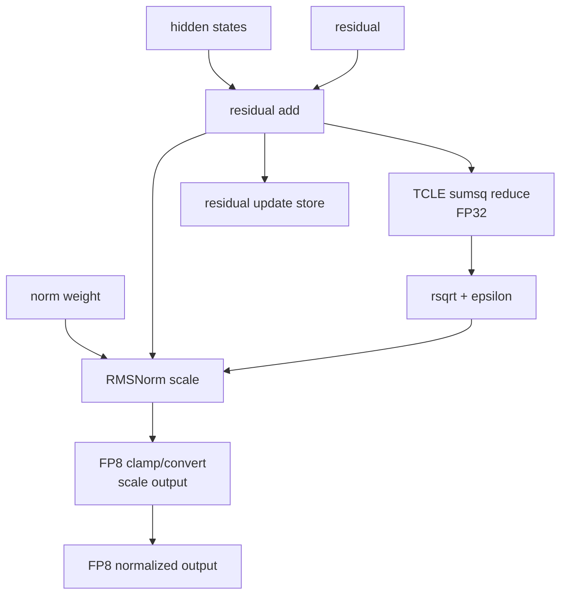

# 25. `fused_add_rms_norm_kernel_impl_fp8_gcu400` 深度解读

[TOC]

## 一句话定位

`fused_add_rms_norm_kernel_impl_fp8_gcu400` 是 vLLM fused add RMSNorm 的 GCU400 FP8 输出实现。它把 residual add、RMSNorm 平方和归约、`ivstd` 计算、可选 RMSNorm weight、scale 乘法、FP8 E4M3/E5M2 输出量化、`residual_update` 写回融合到一个 device kernel 族中。

和普通 RMSNorm 相比，它的性能主线不是公式本身，而是两个工程选择：第一，`input + residual` 的结果同时服务 `residual_update` 和 FP8 normalized output；第二，host 根据 D 维是否能放入 L1 分派 `fulld` 和通用 kernel，分别优化小 D 的低延迟和大 D 的可运行性。

## 0. 当前实现片段与 FP8 fused add RMSNorm 优化主线

### 0.1 op/host 入口：只让 FP8 output 进入专用快路

上层语义可以压缩成下面这段。它先把任意 rank 的输入展平成 `[N, D]`，然后根据 `scaling` 的长度选择 per-tensor 或 per-D 量化 scale。FP8 专用 host 只处理 `tops::float_e4m3` / `tops::float_e5m2` 输出；其它输出类型在这里直接结束，交给其它分派链路。

```cpp
// 逻辑 shape：最后一维是 RMSNorm 的归约维，其余维度展平成 N。
int64_t N = product(input.shape[0 : rank - 1]);
int64_t D = input.shape[rank - 1];

// scaling 缺省表示不做量化 scale；长度为 1 表示 per-tensor；
// 长度为 D 表示每个 D 位置一个 scale。
RmsNormQuantType quant_type = RmsNormQuantType::NO_QUANT;
if (scaling != nullptr && scaling.numel() == 1) {
  quant_type = RmsNormQuantType::SCALAR;
}
if (scaling != nullptr && scaling.numel() == D) {
  quant_type = RmsNormQuantType::VECTOR;
}

// FP8 host 的第一道门：输出不是 E4M3/E5M2 时不启动这套 kernel。
template <typename input_host_t, typename residual_host_t,
          typename weight_host_t, typename output_host_t,
          typename residual_update_host_t, typename ivstd_host_t>
__host__ topsError_t fused_add_rms_norm_host_gcu400(
    int64_t numBlocks, int64_t dimBlocks,
    input_host_t* input, input_host_t* scaling,
    residual_host_t* residual, weight_host_t* weight,
    output_host_t* output, residual_update_host_t* residual_update,
    ivstd_host_t* ivstd, int64_t N, int64_t D, float epsilon,
    RmsNormQuantType quant_type, topsStream_t stream) {
  if constexpr (!(std::is_same<output_host_t, tops::float_e4m3>() ||
                  std::is_same<output_host_t, tops::float_e5m2>())) {
    return topsSuccess;
  }

  // Host tensor type 映射到 device 侧底层表示。
  // FP8 output 在 device 侧是 byte store，语义由 fp8_flag 决定。
  using input_t = typename cc_kernel::UnderlyingType<input_host_t>::type;
  using resid_t = typename cc_kernel::UnderlyingType<residual_host_t>::type;
  using weigh_t = typename cc_kernel::UnderlyingType<weight_host_t>::type;
  using outpt_t = typename cc_kernel::UnderlyingType<output_host_t>::type;
  using resid_update_t =
      typename cc_kernel::UnderlyingType<residual_update_host_t>::type;
  using ivstd_t = typename cc_kernel::UnderlyingType<ivstd_host_t>::type;

  bool has_resid = residual != nullptr;
  bool has_weigh = weight != nullptr;
  bool has_resid_update = residual_update != nullptr;
  bool has_ivstd = ivstd != nullptr;
  bool has_scaling = scaling != nullptr;

  // FP8 fused add RMSNorm 语义要求 residual add 和 residual_update 都存在。
  if (!has_resid || !has_resid_update) {
    return topsErrorInvalidValue;
  }

  // weight / scaling 缺省时用 input 指针占位，device 侧靠开关避免读取。
  weigh_t* dev_weigh = has_weigh ? reinterpret_cast<weigh_t*>(weight)
                                 : reinterpret_cast<weigh_t*>(input);
  input_t* dev_scaling = has_scaling ? reinterpret_cast<input_t*>(scaling)
                                     : reinterpret_cast<input_t*>(input);

  constexpr bool out_f8e5m2 =
      std::is_same<output_host_t, tops::float_e5m2>::value;
  constexpr bool out_f8e4m3 =
      std::is_same<output_host_t, tops::float_e4m3>::value;
  constexpr bool fp8_output = out_f8e5m2 || out_f8e4m3;
  constexpr int fp8_flag =
      fp8_output ? (out_f8e5m2 ? F8E5M2 : F8E4M3) : 0;

  auto split_n = SplitDim<int64_t>(N, dim_limit);
  auto split_d = SplitDim<int64_t>(D, dim_limit);
  int n0 = static_cast<int>(split_n[0]);
  int n1 = static_cast<int>(split_n[1]);
  int d0 = static_cast<int>(split_d[0]);
  int d1 = static_cast<int>(split_d[1]);

  farn_gcu400::Param param{{n0, n1, d0, d1},
                           {has_resid, has_weigh, has_ivstd, quant_type},
                           {0, 0, 0, 0, 0, 0},
                           epsilon};

  // 如果完整 D 和少量 row 可以放进 L1，就进入 fulld。
  // 否则进入按 D 分块的通用 kernel。
  int use_dim_d = AlignUp(D, TCLE_MAX_VECTOR_LENGTH);
  int use_dim_n = num_subthreads_per_sip;
  int l1_use_size =
      use_dim_d * use_dim_n * sizeof(input_t) +
      use_dim_d * use_dim_n * sizeof(resid_t) +
      use_dim_d * sizeof(weigh_t) +
      use_dim_d * sizeof(input_t) +
      TCLE_MAX_VECTOR_LENGTH * sizeof(float);

  if (l1_use_size < sip_size) {
    dispatch_fulld<input_t, resid_t, weigh_t, outpt_t, resid_update_t, ivstd_t,
                 fp8_output, fp8_flag>(
        input, dev_scaling, residual, dev_weigh, output, residual_update,
        ivstd, param, stream);
  } else {
    dispatch_generic<input_t, resid_t, weigh_t, outpt_t, resid_update_t, ivstd_t,
                   fp8_output, fp8_flag>(
        input, dev_scaling, residual, dev_weigh, output, residual_update,
        ivstd, param, stream);
  }

  return topsSuccess;
}
```

这段决定了三件事：

- FP8 mode 是编译期常量，内层输出转换不需要判断 E4M3/E5M2。
- `residual` 和 `residual_update` 是 FP8 快路的硬前提；这里不是纯 RMSNorm。
- `fulld` / 通用 kernel 的选择在 host 完成，device 侧可以使用完全不同的 L1 分区和循环结构。

### 0.2 参数结构：shape、optional、epsilon 集中下发

device 侧只需要一个紧凑参数包。`split` 在这条快路中保持零值，真正影响控制流的是 `[n0,n1,d0,d1]` 和 optional 开关。

```cpp
namespace farn_gcu400 {

struct Shape {
  int n0;
  int n1;
  int d0;
  int d1;
};

struct Optional {
  bool has_resid;                 // FP8 host 当前要求为 true。
  bool has_weigh;                 // weight 可缺省，缺省时 stage3 不乘 weight。
  bool has_ivstd;                 // 参数中保留，但 stage2 仍会写 ivstd 指针。
  RmsNormQuantType quant_type;    // NO_QUANT / SCALAR / VECTOR。
};

struct Split {
  int block;
  int block_start;
  int thread;
  int thread_start;
  int start;
  int sub_c;
};

struct Param {
  Shape shape;
  Optional optional;
  Split split;
  float epsilon;
};

}  // namespace farn_gcu400
```

`quant_type` 的实际作用很直接：`SCALAR` 只读 `scaling[0]` 并广播；`VECTOR` 按 D 维读取 scale 向量；`NO_QUANT` 路径保留在模板里，但 FP8 输出通常会带 scale。

### 0.3 helper：stage1 融合 add、residual_update、sumsq

stage1 是整套实现的第一个关键融合点。它从 L1 读 input 和 residual，得到 `y = input + residual`，一边把 `y` 写成 `residual_update`，一边把 `y * y` 累到当前 row 的平方和槽位。

```cpp
template <typename input_t, typename resid_t, typename resid_update_t>
__device__ void compute_stage1(
    const input_t* l1_input,
    const resid_t* l1_resid,
    resid_update_t* residual_update,
    float* l1_squ_f32,
    int row_l3_offset,
    int dim_d,
    bool has_resid) {
  using input_vtype = tcle::altivec<input_t>;
  using resid_vtype = tcle::altivec<resid_t>;
  using resid_update_vtype = tcle::altivec<resid_update_t>;
  using float_vtype = tcle::altivec<float>;

  float_vtype vsqu_f32 = tcle::vdup<float>(0.0f);

  int loop_num = dim_d / input_vtype::size;
  int tail = dim_d % input_vtype::size;

  for (int i = 0; i < loop_num; ++i) {
    input_vtype vinput = tcle::vload<input_vtype>(l1_input + i * input_vtype::size);
    float_vtype vinput_f32 = tcle::cvt<float_vtype>(vinput);

    if (has_resid) {
      resid_vtype vresid = tcle::vload<resid_vtype>(l1_resid + i * resid_vtype::size);
      float_vtype vresid_f32 = tcle::cvt<float_vtype>(vresid);
      vinput_f32 = vinput_f32 + vresid_f32;
    }

    // residual_update 是用户可见输出，也是通用 kernel 第二遍的中间输入。
    resid_update_vtype vupdate = tcle::cvt<resid_update_vtype>(vinput_f32);
    tcle::vstore(vupdate, residual_update + row_l3_offset + i * resid_update_vtype::size);

    // RMSNorm denominator 基于 add 后的 y，而不是乘 weight 之后的值。
    vsqu_f32 = vsqu_f32 + vinput_f32 * vinput_f32;
  }

  if (tail > 0) {
    auto mask = tcle::vset_mb(input_vtype::size, tail);
    input_vtype vinput =
        tcle::vload<input_vtype>(l1_input + loop_num * input_vtype::size, mask);
    float_vtype vinput_f32 = tcle::cvt<float_vtype>(vinput);

    if (has_resid) {
      resid_vtype vresid =
          tcle::vload<resid_vtype>(l1_resid + loop_num * resid_vtype::size, mask);
      float_vtype vresid_f32 = tcle::cvt<float_vtype>(vresid);
      vinput_f32 = vinput_f32 + vresid_f32;
      vsqu_f32 = vsqu_f32 + vinput_f32 * vinput_f32;
    }

    resid_update_vtype vupdate = tcle::cvt<resid_update_vtype>(vinput_f32);
    tcle::vstore(vupdate, residual_update + row_l3_offset +
                              loop_num * resid_update_vtype::size, mask);
  }

  l1_squ_f32[0] += tcle::redsum<0>(vsqu_f32);
}
```

维护点：泛型 tail 中平方和累加写在 `has_resid` 分支内。当前 FP8 host 已经要求 `residual != nullptr`，所以这条快路不会触发 `has_resid == false` 的 tail 漏加；如果未来复用到纯 RMSNorm，tail 逻辑必须先拆出来。

FP32 输入有专门特化，省掉 `cvt<float>`。这是主模板泛化、热点 dtype 局部特化的合理取舍。

### 0.4 helper：stage2 只做每行 scalar `ivstd`

stage2 在所有 D chunk 的平方和都完成后运行。它把 `sum(y*y)` 变成 `1/sqrt(mean(y*y)+epsilon)`，同时写回 L1 和 global `ivstd`。

```cpp
template <typename ivstd_t>
__device__ void compute_stage2(
    float* l1_squ_f32,
    ivstd_t* ivstd,
    int n_l3_offset,
    int n_count,
    int D,
    float epsilon) {
  using float_vtype = tcle::altivec<float>;
  using ivstd_vtype = tcle::altivec<ivstd_t>;

  float recip = 1.0f / static_cast<float>(D);
  auto mask = tcle::vset_mb(float_vtype::size, n_count);

  float_vtype sum = tcle::vload<float_vtype>(l1_squ_f32, mask);
  float_vtype x = sum * tcle::vdup<float>(recip) + tcle::vdup<float>(epsilon);

  // msf<7> 在这里承担 reciprocal sqrt。
  float_vtype inv_std = tcle::msf<7>(x);

  tcle::vstore(inv_std, l1_squ_f32, mask);
  ivstd_vtype ivstd_out = tcle::cvt<ivstd_vtype>(inv_std);
  tcle::vstore(ivstd_out, ivstd + n_l3_offset, mask);
}
```

stage2 由 subthread 0 执行，因为每行只有一个 scalar。让所有 subthread 参与会引入额外同步和合并，收益不明显。

### 0.5 `fulld` kernel：完整 D 常驻 L1，stage3 重读 L1 input/residual

`fulld` 路径的前提是完整 D 加少量 row 能放进 L1。它的核心优化是：input/residual 只从 global 读一次，stage1 和 stage3 都复用 L1 中的数据。stage3 不读 `residual_update`，而是从 L1 input/residual 重新构造 `y`，用少量加法换掉一次 global read。

```cpp
template <typename input_t, typename resid_t, typename weight_t,
          typename outpt_t, typename resid_update_t, typename ivstd_t,
          bool fp8_output, int fp8_flag>
__thread_dims__(num_subthreads_per_sip, 1, 1)
__global__ void fused_add_rms_norm_fulld_gcu400(
    input_t* input,
    input_t* scaling,
    resid_t* residual,
    weight_t* weight,
    outpt_t* output,
    resid_update_t* residual_update,
    ivstd_t* ivstd,
    farn_gcu400::Param param) {
  tcle::set_vl(TCLE_MAX_VECTOR_LENGTH);
  tcle::set_spr<NACCOVR>(0);

  int thread_id = GetThreadIdx();
  int thread_num = GetThreadNum();
  int subthread_id = subThreadIdx.x;

  int dim_n0 = param.shape.n0;
  int dim_n1 = param.shape.n1;
  int dim_d0 = param.shape.d0;
  int dim_d1 = param.shape.d1;
  int D = dim_d0 * dim_d1;

  int vlen = TCLE_MAX_VECTOR_LENGTH / MIN(sizeof(input_t), sizeof(outpt_t));
  int l1_dim_d = AlignUp(dim_d1, vlen);

  __local__ __valigned__ char l1_mem[sip_size];
  char* cursor = l1_mem;

  int n_unit = compute_n_unit_for_fulld(l1_dim_d, thread_num, dim_n1);
  input_t* l1_input = reinterpret_cast<input_t*>(cursor);
  cursor += n_unit * l1_dim_d * sizeof(input_t);
  resid_t* l1_resid = reinterpret_cast<resid_t*>(cursor);
  cursor += n_unit * l1_dim_d * sizeof(resid_t);
  weight_t* l1_weight = reinterpret_cast<weight_t*>(cursor);
  cursor += l1_dim_d * sizeof(weight_t);
  input_t* l1_scaling = reinterpret_cast<input_t*>(cursor);
  cursor += l1_dim_d * sizeof(input_t);
  float* l1_squ_f32 = reinterpret_cast<float*>(cursor);

  tops::local_dte local_dte;

  // weight 和 vector scaling 对所有 N row 复用，只需在进入 N 循环前准备。
  if (subthread_id == 0 && param.optional.has_weigh) {
    local_dte.slice_async(l1_weight, weight, D);
  }
  if (subthread_id == 0 &&
      param.optional.quant_type == RmsNormQuantType::VECTOR) {
    local_dte.slice_async(l1_scaling, scaling, D);
  }
  if (subthread_id == 0 &&
      param.optional.quant_type == RmsNormQuantType::SCALAR) {
    l1_scaling[0] = scaling[0];
  }
  __syncsubthreads();

  for (int n0_idx = 0; n0_idx < dim_n0; ++n0_idx) {
    for (int n1_idx = thread_id * n_unit;
         n1_idx < dim_n1;
         n1_idx += n_unit * thread_num) {
      int n_count = MIN(n_unit, dim_n1 - n1_idx);

      if (subthread_id == 0) {
        l1_memset(l1_squ_f32, n_count);
        local_dte.slice_async(l1_input, input + row_offset(n0_idx, n1_idx, D),
                              n_count * D);
        local_dte.slice_async(l1_resid, residual + row_offset(n0_idx, n1_idx, D),
                              n_count * D);
      }
      __syncsubthreads();

      // subthread 按 row 分摊；每个 row 的 D 维归约在同一个 subthread 内完成。
      RowSpan rows = split_rows_for_subthread(n_count, subthread_id);
      for (int local_row = rows.begin; local_row < rows.end; ++local_row) {
        int l3 = row_offset(n0_idx, n1_idx + local_row, D);
        compute_stage1(l1_input + local_row * l1_dim_d,
                       l1_resid + local_row * l1_dim_d,
                       residual_update, l1_squ_f32 + local_row,
                       l3, D, param.optional.has_resid);
      }
      __syncsubthreads();

      if (subthread_id == 0) {
        compute_stage2(l1_squ_f32, ivstd, n0_idx * dim_n1 + n1_idx,
                       n_count, D, param.epsilon);
      }
      __syncsubthreads();

      for (int local_row = rows.begin; local_row < rows.end; ++local_row) {
        float inv_std = l1_squ_f32[local_row];
        for (int d = 0; d < D; d += vlen) {
          auto mask = tcle::vset_mb(vlen, MIN(vlen, D - d));

          auto y = load_as_f32(l1_input + local_row * l1_dim_d + d, mask);
          if (param.optional.has_resid) {
            y = y + load_as_f32(l1_resid + local_row * l1_dim_d + d, mask);
          }
          if (param.optional.has_weigh) {
            y = y * load_as_f32(l1_weight + d, mask);
          }

          auto scale = make_scale_vector(l1_scaling, d, param.optional.quant_type, mask);
          auto out_f32 = y * scale * tcle::vdup<float>(inv_std);
          auto out_vec = tcle::cvt<tcle::altivec<outpt_t>,
                                   fp8_flag | CLAMP>(out_f32);
          tcle::vstore(out_vec, output + row_offset(n0_idx, n1_idx + local_row, D) + d,
                       mask);
        }
      }
      __syncsubthreads();
    }
  }
}
```

`fulld` 的 L1 布局是这条快路的核心：

```text
l1_input:   n_unit * AlignUp(D, vlen) * sizeof(input_t)
l1_resid:   n_unit * AlignUp(D, vlen) * sizeof(resid_t)
l1_weight:  AlignUp(D, vlen) * sizeof(weight_t)
l1_scaling: AlignUp(D, vlen) * sizeof(input_t)
l1_squ_f32: n_unit * sizeof(float)
```

这里故意不保存完整 `y = input + residual`。保存 `y` 会再占一块 `[n_unit, D]` L1，降低 `n_unit` 或让 `fulld` 无法成立；重算一次 add 通常比增加一块 L1 常驻激活更划算。

### 0.6 通用 kernel：D 分块，两遍计算，`residual_update` 充当中间态

通用 kernel 面向完整 D 放不进 L1 的场景。它承认 stage1 和 stage3 不能共享完整 input/residual，于是把第一遍已经必须写出的 `residual_update` 作为第二遍的输入。这样第二遍只读一个 `y` tensor，而不是重新读 input 和 residual 两个 tensor。

```cpp
template <typename input_t, typename resid_t, typename weight_t,
          typename outpt_t, typename resid_update_t, typename ivstd_t,
          bool fp8_output, int fp8_flag>
__thread_dims__(num_subthreads_per_sip, 1, 1)
__global__ void fused_add_rms_norm_gcu400(
    input_t* input,
    input_t* scaling,
    resid_t* residual,
    weight_t* weight,
    outpt_t* output,
    resid_update_t* residual_update,
    ivstd_t* ivstd,
    farn_gcu400::Param param) {
  tcle::set_vl(TCLE_MAX_VECTOR_LENGTH);
  tcle::set_spr<NACCOVR>(0);

  int thread_id = GetThreadIdx();
  int thread_num = GetThreadNum();
  int subthread_id = subThreadIdx.x;

  int dim_n0 = param.shape.n0;
  int dim_n1 = param.shape.n1;
  int dim_d0 = param.shape.d0;
  int dim_d1 = param.shape.d1;
  int D = dim_d0 * dim_d1;

  constexpr int l1_io_size = 128 * 1024;
  constexpr int n_unit = num_subthreads_per_sip;
  int d_unit = l1_io_size / (n_unit * sizeof(input_t));
  d_unit = AlignDown(d_unit, TCLE_MAX_VECTOR_LENGTH);

  __local__ __valigned__ char l1_mem[sip_size];
  input_t* l1_input = reinterpret_cast<input_t*>(l1_mem);
  resid_t* l1_resid = reinterpret_cast<resid_t*>(l1_mem + l1_io_size);
  weight_t* l1_weight = reinterpret_cast<weight_t*>(l1_mem + 2 * l1_io_size);
  input_t* l1_scaling =
      reinterpret_cast<input_t*>(reinterpret_cast<char*>(l1_weight) +
                                 d_unit * sizeof(weight_t));
  float* l1_squ_f32 =
      reinterpret_cast<float*>(reinterpret_cast<char*>(l1_scaling) +
                               d_unit * sizeof(input_t));

  tops::local_dte local_dte;

  for (int n0_idx = 0; n0_idx < dim_n0; ++n0_idx) {
    for (int n1_idx = thread_id * n_unit;
         n1_idx < dim_n1;
         n1_idx += n_unit * thread_num) {
      int n_count = MIN(n_unit, dim_n1 - n1_idx);
      int local_row = subthread_id;

      if (subthread_id == 0) {
        l1_memset(l1_squ_f32, n_count);
      }
      __syncsubthreads();

      // 第一遍：按 D 分块读取 input/residual，写 residual_update，累计整行 sumsq。
      for (int d0_idx = 0; d0_idx < dim_d0; ++d0_idx) {
        for (int d1_idx = 0; d1_idx < dim_d1; d1_idx += d_unit) {
          int d_count = MIN(d_unit, dim_d1 - d1_idx);

          if (subthread_id == 0) {
            local_dte.slice_async(l1_input, input + offset(n0_idx, n1_idx, d0_idx, d1_idx),
                                  n_count * d_count);
            local_dte.slice_async(l1_resid, residual + offset(n0_idx, n1_idx, d0_idx, d1_idx),
                                  n_count * d_count);
          }
          __syncsubthreads();

          if (local_row < n_count) {
            int l3 = offset(n0_idx, n1_idx + local_row, d0_idx, d1_idx);
            compute_stage1(l1_input + local_row * d_count,
                           l1_resid + local_row * d_count,
                           residual_update, l1_squ_f32 + local_row,
                           l3, d_count, param.optional.has_resid);
          }
          __syncsubthreads();
        }
      }

      if (subthread_id == 0) {
        compute_stage2(l1_squ_f32, ivstd, n0_idx * dim_n1 + n1_idx,
                       n_count, D, param.epsilon);
      }
      __syncsubthreads();

      // 第二遍：不再读取 input/residual，而是读取第一遍写好的 y。
      for (int d0_idx = 0; d0_idx < dim_d0; ++d0_idx) {
        for (int d1_idx = 0; d1_idx < dim_d1; d1_idx += d_unit) {
          int d_count = MIN(d_unit, dim_d1 - d1_idx);

          if (subthread_id == 0) {
            local_dte.slice_async(l1_input,
                                  residual_update + offset(n0_idx, n1_idx, d0_idx, d1_idx),
                                  n_count * d_count);
            if (param.optional.has_weigh) {
              local_dte.slice_async(l1_weight, weight + d0_idx * dim_d1 + d1_idx, d_count);
            }
            if (param.optional.quant_type == RmsNormQuantType::VECTOR) {
              local_dte.slice_async(l1_scaling, scaling + d0_idx * dim_d1 + d1_idx, d_count);
            }
          }
          __syncsubthreads();

          if (local_row < n_count) {
            float inv_std = l1_squ_f32[local_row];
            for (int d = 0; d < d_count; d += TCLE_MAX_VECTOR_LENGTH) {
              auto mask = tcle::vset_mb(TCLE_MAX_VECTOR_LENGTH,
                                        MIN(TCLE_MAX_VECTOR_LENGTH, d_count - d));
              auto y = load_as_f32(l1_input + local_row * d_count + d, mask);
              if (param.optional.has_weigh) {
                y = y * load_as_f32(l1_weight + d, mask);
              }
              auto scale = tcle::vdup<float>(1.0f);
              if (param.optional.quant_type == RmsNormQuantType::SCALAR) {
                // 通用 kernel 不为 scalar scale 保留 L1 常驻槽位，直接广播全局 scale。
                scale = tcle::vdup<float>(static_cast<float>(scaling[0]));
              }
              if (param.optional.quant_type == RmsNormQuantType::VECTOR) {
                scale = load_as_f32(l1_scaling + d, mask);
              }
              auto out_f32 = y * scale * tcle::vdup<float>(inv_std);
              auto out_vec = tcle::cvt<tcle::altivec<outpt_t>,
                                       fp8_flag | CLAMP>(out_f32);
              tcle::vstore(out_vec,
                           output + offset(n0_idx, n1_idx + local_row, d0_idx, d1_idx + d),
                           mask);
            }
          }
          __syncsubthreads();
        }
      }
    }
  }
}
```

通用 kernel 的 L1 分区固定得更激进：

```text
l1_input:   128 KiB，第一遍装 input，第二遍装 residual_update
l1_resid:   128 KiB，只在第一遍装 residual
l1_weight:  一个 D chunk
l1_scaling: 一个 D chunk
l1_squ_f32: n_unit 个 float row sum
```

这条路径多了一次 `residual_update` global read，但避免了让 L1 同时容纳完整 D 的 input/residual/weight/scaling。对于大 D，它比强行保留 `fulld` 结构更稳。

### 0.7 模板实例化：dtype 和 FP8 mode 都在编译期固化

每个输入 dtype 和 FP8 输出格式都会同时生成 `fulld` 与通用 kernel。这里的 `char` 是 FP8 tensor 的底层 byte 表示，真正的 E4M3/E5M2 语义由 `fp8_flag` 固化在转换指令上。

```cpp
#define DECLARE_GLOBAL_FUNC(input_t, resid_t, weight_t, outpt_t,             \
                            resid_update_t, ivstd_t, fp8_output, fp8_flag)  \
  template __thread_dims__(num_subthreads_per_sip, 1, 1)                    \
  __global__ void fused_add_rms_norm_fulld_gcu400<                          \
      input_t, resid_t, weight_t, outpt_t, resid_update_t, ivstd_t,          \
      fp8_output, fp8_flag>(input_t*, input_t*, resid_t*, weight_t*,         \
                            outpt_t*, resid_update_t*, ivstd_t*,            \
                            farn_gcu400::Param);                            \
  template __thread_dims__(num_subthreads_per_sip, 1, 1)                    \
  __global__ void fused_add_rms_norm_gcu400<                                \
      input_t, resid_t, weight_t, outpt_t, resid_update_t, ivstd_t,          \
      fp8_output, fp8_flag>(input_t*, input_t*, resid_t*, weight_t*,         \
                            outpt_t*, resid_update_t*, ivstd_t*,            \
                            farn_gcu400::Param);

// 三组输入精度分别生成 E4M3 / E5M2 输出。
DECLARE_GLOBAL_FUNC(float,  float,  float,  char, float,  float,  true, F8E4M3)
DECLARE_GLOBAL_FUNC(float,  float,  float,  char, float,  float,  true, F8E5M2)
DECLARE_GLOBAL_FUNC(__fp16, __fp16, __fp16, char, __fp16, __fp16, true, F8E4M3)
DECLARE_GLOBAL_FUNC(__fp16, __fp16, __fp16, char, __fp16, __fp16, true, F8E5M2)
DECLARE_GLOBAL_FUNC(__bf16, __bf16, __bf16, char, __bf16, __bf16, true, F8E4M3)
DECLARE_GLOBAL_FUNC(__bf16, __bf16, __bf16, char, __bf16, __bf16, true, F8E5M2)
```

实际 FP8 快路覆盖的是 input、residual、weight、residual_update、ivstd 同 dtype，output 为 E4M3/E5M2 的组合。混合 dtype 权重不是这条快路的主要目标。

## 算子语义

逻辑输入先展平成二维：

```text
N = product(input.shape[:-1])
D = input.shape[-1]
```

每行执行：

```python
x = input[row, :]
r = residual[row, :]
y = x + r

residual_update[row, :] = y

ivstd[row] = 1 / sqrt(mean(y * y) + epsilon)

if weight exists:
    y = y * weight

if scaling is scalar:
    scale = scaling[0]
else:
    scale = scaling[:]

output[row, :] = fp8(y * scale * ivstd[row])
```

注意 RMSNorm 的平方和基于 `input + residual`，不是基于乘 weight 之后的值。weight、scale、ivstd 都在 stage3 作用到输出。

## 数据生命周期

`input` 在 `fulld` 中只从 global 读一次，保存在 `l1_input`，stage1 用它计算平方和和 `residual_update`，stage3 再从同一块 L1 重读生成 output。通用 kernel 中 input 只在第一遍读取；第二遍不再读取 input。

`residual` 的生命周期类似。`fulld` 把 residual 常驻 L1 到 stage3；通用 kernel 只在第一遍读取 residual，然后依赖 `residual_update` 保存 add 后结果。

`residual_update` 有双重角色。对外它是用户可见输出；在通用 kernel 中它还是第二遍输出阶段的中间输入。这个设计把第二遍的两个 global read 压成一个 global read。

`l1_squ_f32` 的语义会变化。stage1 后它是每行 `sum(y*y)`；stage2 后它被覆盖为每行 `ivstd`，供 stage3 直接读取。这个复用省掉了单独的 L1 `ivstd` buffer。

`weight` 不参与 stage1。它只在 stage3 乘到 normalized 输出上。这样既符合 RMSNorm 语义，也避免 stage1 做无用权重读取。

`scaling` 有 scalar 和 vector 两种布局。scalar 只读一个元素并广播；vector 需要按 D 维读取一整条或一个 chunk。

## block、thread、subthread 分工

两条 kernel 都使用 `__thread_dims__(num_subthreads_per_sip, 1, 1)`。thread 维负责 N 行的分块，subthread 维负责同一个 thread 内的少量 row；D 维主要交给 TCLE vector loop 和通用 kernel 的 D chunk loop。

`fulld` 中，一个 thread 一次处理最多 `n_unit` 行。subthread 按 row 分摊这些行，每个 subthread 对自己负责的 row 完成整条 D 的 stage1 和 stage3。这样不需要跨 subthread 合并同一行的 partial sum。

通用 kernel 中，`n_unit` 固定为 subthread 数，通常每个 subthread 负责一行。所有 subthread 都按自己的 row 遍历所有 D chunk，平方和累加到各自的 `l1_squ_f32[row]`。这牺牲了同一行 D 维上的 subthread 并行，但避免了跨 subthread reduction。

## scale 的两种布局

`SCALAR` 表示所有 D 元素使用同一个 scale。`fulld` 会把 `scaling[0]` 放到 L1，通用 kernel 在输出阶段直接广播 `scaling[0]`。scalar scale 更省带宽，适合 per-tensor quant。

`VECTOR` 表示每个 D 位置有自己的 scale。`fulld` 会把完整 scale 向量常驻 L1；通用 kernel 每个 D chunk 读取对应 scale chunk。vector scale 更灵活，但多一条 D 维读取。

`NO_QUANT` 保留在模板控制流里；这让 device 侧结构更通用，但 FP8 输出场景通常会带 scale。

## FP8 输出转换

两条 kernel 的输出转换模式一致：

```cpp
if constexpr (fp8_output) {
  auto out_vec = tcle::cvt<tcle::altivec<outpt_t>, fp8_flag | CLAMP>(out_f32);
  tcle::vstore(out_vec, output + out_offset, mask);
} else {
  auto out_vec = tcle::cvt<tcle::altivec<outpt_t>, CLAMP | RND_EVEN>(out_f32);
  tcle::vstore(out_vec, output + out_offset, mask);
}
```

本报告讨论的实例化中 `fp8_output = true`，`outpt_t = char`，`fp8_flag` 是 `F8E4M3` 或 `F8E5M2`。`CLAMP` 放在最后一步，避免中间 FP32 计算过早饱和。

## 复杂度和访存

设每行 D 个元素，总行数为 N。

`fulld` 每行的 global 访存大致是：读 input D、读 residual D、读 weight D 或零、读 scale D 或一、写 `residual_update` D、写 output D、写 `ivstd` 一。stage3 重读的是 L1 input/residual，不增加 global input/residual 读取。

通用 kernel 每行第一遍读 input D、读 residual D、写 `residual_update` D；第二遍读 `residual_update` D、读 weight/scale、写 output D；最后写 `ivstd` 一。它比 `fulld` 多一次 `residual_update` 读取，但支持完整 D 放不进 L1 的形状。

瓶颈通常在 global 带宽、DTE 搬运和 per-row reduction，而不是 scalar 算术。小 D 时 launch、同步和 DTE 固定开销更明显；大 D 时第二遍 global read 的代价更明显。

## 优化点和可迁移洞见

第一，融合边界覆盖 residual add、RMSNorm、residual_update、weight、scale 和 FP8 output。很多朴素实现会先写 add 结果，再另起 RMSNorm 或 quantize；这里把热路径压到一组 kernel 内。

第二，`fulld` 用算术换 L1。它不保存完整 `y`，stage3 重算 `input + residual`，换来更小 L1 占用和更高的 fulld 命中概率。

第三，通用 kernel 复用 `residual_update`。当完整 D 不能留在 L1 时，第二遍读取 add 后结果，比第二遍重新读取 input 和 residual 更省带宽。

第四，host 侧决定 L1 策略。`fulld` 与通用 kernel 没有合在一个 device 分支里，因此两边可以各自拥有最合适的 L1 layout。

第五，FP8 format 编译期固化。E4M3/E5M2 不进入运行时 hot loop，输出转换只剩 TCLE `cvt`。

第六，scalar/vector scale 分支避免无谓搬运。per-tensor scale 不需要搬整条 D 维 scale。

第七，`msf<7>` 把 reciprocal sqrt 放到 TCLE special function，避免手写 sqrt/div 组合。

第八，`set_spr<NACCOVR>(0)` 出现在 kernel 入口。包含 FP8 clamp convert 的 kernel 应显式初始化相关状态，避免继承前序状态。

第九，尾部统一用 mask load/store，主循环保持 vector 化，避免为了 remainder 退回标量路径。

## 维护注意点

第一，FP8 host 当前要求 `residual` 和 `residual_update` 都存在。helper 虽有 `has_resid` 分支，但这条快路的实际语义是 fused add RMSNorm。

第二，泛型 stage1 的 tail 平方和累加依赖 `has_resid` 分支。当前不影响 FP8 快路；如果放开 residual 缺省，必须先修正。

第三，通用 kernel 第二遍读取 `residual_update`。调用方不能让 `residual_update` 与 FP8 output 发生会破坏读取语义的 alias。

第四，stage2 只由 subthread 0 执行。stage1 后、stage2 后的同步不能删除，否则其它 subthread 可能读到未更新的 `ivstd`。

第五，`l1_use_size < sip_size` 是严格小于。刚好贴满 L1 时会走通用 kernel，这是保守选择，给对齐和临时状态留余量。

第六，`has_ivstd` 被放进参数包，但 stage2 仍会写 `ivstd` 指针。若未来允许 `ivstd == nullptr`，需要同步调整 host guard 和 device 写回。

第七，`vlen` 使用 `MIN(sizeof(input_t), sizeof(outpt_t))` 推导。FP8 输出下 `outpt_t` 是 byte，维护 stvector/altivector 类型时要重新确认 input load 与 output store 的 lane 解释一致。

## 优化技巧总结

1. 融合 residual add、RMSNorm、residual_update、weight、scale 和 FP8 output quantize。
2. host 根据完整 D 是否能放入 L1 分派 `fulld` 或 D 分块通用 kernel。
3. `fulld` 只从 global 读一次 input/residual，stage3 复用 L1 数据。
4. 通用 kernel 第一遍写 `residual_update`，第二遍把它作为中间输入读回。
5. subthread 0 负责 DTE slice 和 `ivstd` scalar 计算，其它 subthread 按 row 并行。
6. stage1 用 vector load/add/square/redsum 累计平方和。
7. stage2 使用 `msf<7>` 计算 reciprocal sqrt。
8. FP8 输出使用 `F8E4M3/F8E5M2 | CLAMP` 编译期 flag。
9. scalar/vector scale 分支覆盖 per-tensor 和 per-D scale。
10. L1 手工分区，精确安排 input/residual/weight/scaling/sumsq buffer。
11. `l1_memset` 用 vector store 清零 per-row square-sum。
12. D 维尾部全部用 mask load/store，避免越界。
13. dtype 和 FP8 mode 通过模板实例化固化，hot loop 不做 dtype switch。
14. `SplitDim` 把大 N/D 拆成 `[n0,n1,d0,d1]`，规避单维限制。
15. FP32 stage1 特化省掉无用 `cvt<float>`。

## 总结

这份实现的高质量点在于它把 residual 的生命周期真正纳入优化：`input + residual` 既是 `residual_update`，也是 RMSNorm 的归约输入和 FP8 输出的前置值。小 D 时，它把 input/residual 留在 L1 中复用；大 D 时，它把 `residual_update` 变成第二遍的中间态，避免重复读取两个输入 tensor。

如果只看数学，它只是 RMSNorm；如果看执行组织，它是围绕 FP8 输出和 residual update 做过专门优化的 LLM 热路径 kernel。

## 硬件执行图解



这张图强调 residual 的生命周期：输入 residual 先参与 add，add 后结果既用于 RMSNorm，也要写回 residual update。实现把 sumsq reduction、rsqrt、weight scale、FP8 quant 和 residual update 放在一次 L1/TCLE 组织里，避免 hidden states 在 global memory 和中间 tensor 之间来回搬运。
