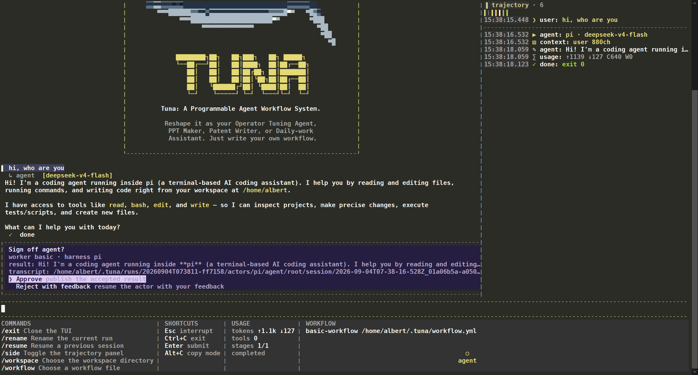
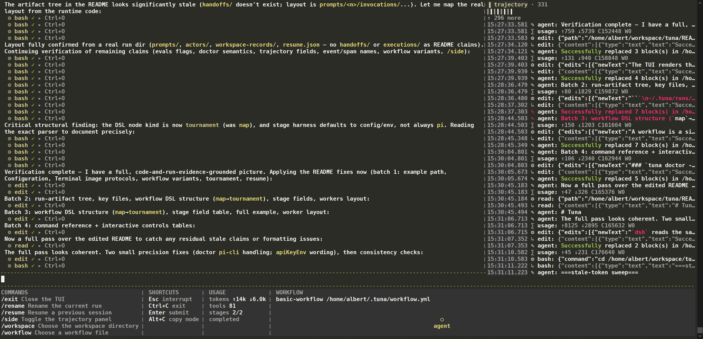
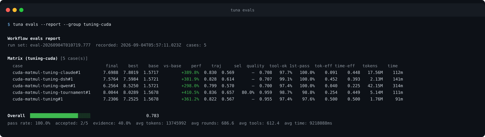

# Piano

**Piano** is a programmable AI agent workflow orchestrator: a flexible runtime
for turning ideas into executable graphs of AI agents, tools, approvals, loops,
and parallel branches. Its YAML workflow DSL makes graph engineering explicit,
diffable, and open to customization by anyone.

Piano can run repeatable coding, research, tuning, and automation workflows
through multiple agent harnesses. Every run leaves behind progress,
transcripts, context inputs, and results you can inspect, resume, and evaluate.

This guide follows the user journey: get Piano running, choose how to run it,
craft a workflow graph, then inspect and evaluate the results.

---

## Get started

### Requirements

- **Node.js 22** or newer.
- A configured Pi coding-agent endpoint: a `provider`, `model`, and `apiKey`
  (see [Configuration](#configuration)).
- Optional native harnesses for workflows that select them: Claude Code's
  `claude` executable and the official DeepSeek Harness's `dsh` executable.
  Install and authenticate these manually through their own supported setup;
  Piano only detects and invokes programs already available on `PATH`.

### Install

```bash
git clone <repo-url> piano
cd piano
bash scripts/setup.sh
```

`scripts/setup.sh` installs the Node dependencies, links the CLI, and installs
the default System One model (Laya) into an isolated Python environment. The
Laya English checkpoint is downloaded during setup, so the first workflow does
not pay that cost. Set `PIANO_SKIP_LAYA=1` to skip the model installation.

To install the Node side manually instead:

```bash
npm install
```

To expose the `piano` command on your `PATH`:

```bash
# User-scoped (recommended): links into ~/.local, no root access needed
npm run link:cli:user

# System-wide: links into the npm global prefix (may require sudo)
npm run link:cli
```

`link:cli:user` keeps the install inside your own account — a `piano` symlink in
`~/.local/bin` plus a package link in `~/.local/lib/node_modules`. Nothing is
written outside your home directory, so the command stays private to you.
`link:cli` does the same through the npm global prefix for a machine-wide
install.

The optional System One decision model (Laya) can also be installed separately:

```bash
bash scripts/setup-laya.sh   # venv, CPU-only torch, laya[serve], English checkpoint
```

The first `skippable` stage starts the installed local inference service
automatically. `scripts/serve-laya.sh` runs it manually instead;
`PIANO_LAYA_URL` points Piano at an already-running compatible endpoint.

The launcher starts `piano` from a prebuilt bundle of the CLI. The bundle is
built on first use and rebuilt whenever a source file or the lock file no longer
matches it, so editing sources takes effect on the next run with no reinstall
step. `npm run build:cli` builds it up front instead — useful before a
measurement run or in CI. The output lives in `packages/cli/dist/` and is
ignored by git.

> **Note:** `link:cli:user` only works if `~/.local/bin` is on your `PATH`,
> which is not the case for every shell. Verify it first:
>
> ```bash
> case ":$PATH:" in *":$HOME/.local/bin:"*) echo on PATH ;; *) echo missing ;; esac
> ```
>
> If it prints `missing`, add `~/.local/bin` to your shell startup file (e.g.
> `~/.bashrc`, `~/.zshrc`) and reload it, then run the link command again:
>
> ```bash
> echo 'export PATH="$HOME/.local/bin:$PATH"' >> ~/.bashrc
> source ~/.bashrc
> npm run link:cli:user
> ```

Without linking, replace every `piano …` below with `npm run run -- …`.

### Start in the TUI

Run `piano` with no prompt to open the interactive workspace. Use it when you
want to see the agent conversation, follow the workflow trajectory, and steer
or resume a run without leaving the terminal:

```bash
piano
```



Choose a target directory with `/workspace`, select a workflow with
`/workflow`, then type a task and press Enter. The TUI keeps the current
workflow, trajectory, usage, and shortcuts visible while the agent works. A
workflow stage that requests sign-off pauses in the same view so you can
approve its result or send it back with feedback.



Use `/resume` to continue a previous run and `/side` to show or hide the
trajectory pane. See [Interactive controls](#interactive-controls) for every
command and shortcut.

### Run a task from the CLI

For a non-interactive task, pass a prompt with `-p`. Piano uses its default
workflow — the plain coding-agent template
(`recipes/workflows/coding-pi.yml`), loaded directly from the installed
templates. The default is recorded in `~/.piano/config.json` under
`workflow`: `builtin:<template>` (for example `builtin:coding-pi`) means
that shipped template, and a workflow you select (in the TUI picker)
records its path and becomes the default for later runs. When the record is
missing it is created and reported on the first default run:

```bash
piano -p "write a haiku about a piano"
```

With `-p`, the task runs headlessly and prints its result when it finishes.

For scripts, `-p` can also act as the headless switch while the prompt is the
final argument after the other flags. Pass `--workflow` to pick another
template, for example the plain coding-agent template:

```bash
piano -p --json --workflow recipes/workflows/coding-pi.yml "print the code tree of this repo"
```

### Configuration

The adapter a stage runs on is its `harness` field; when omitted it defaults
to the workflow harness — `PIANO_HARNESS`, then the root `harness` in
`~/.piano/agent.config.json`, then `pi`. `pi` is the in-process SDK adapter;
`pi-cli`, `claude`, and `dsh` are the subprocess adapters. The `pi` adapter
finds the installed SDK through `npm root -g`; set `PIANO_PI_SDK_ROOT` to the
SDK package directory to skip that lookup on installs without npm.

Model and thinking-level resolution is a fallback chain. For any stage, the
effective `model` and `thinkingLevel` are selected in this order:

1. the caller's request override,
2. the stage fields (`model`, `thinkingLevel`),
3. the adapter's environment variables (`PIANO_PI_MODEL` /
   `PIANO_PI_THINKING_LEVEL` for `pi`; the parallel `PIANO_PI_CLI_*`,
   `PIANO_CLAUDE_*`, and `PIANO_DSH_*` / legacy `PIANO_DEEPSEEK_*` for the
   subprocess adapters),
4. the adapter's section in `~/.piano/agent.config.json`.

The `provider` and `apiKey` have no stage-level fields; they resolve from the
adapter environment (`PIANO_PI_PROVIDER` / `PIANO_PI_API_KEY` and their
`PIANO_<ADAPTER>_*` counterparts), then the adapter's config section. The
root-level `provider`/`model`/`apiKey` fields double as the `pi` section (they
predate per-adapter nesting).

Example `~/.piano/agent.config.json` (the same shape as
`scripts/agent.config.template.json`; Piano never prints configured
values, and a `CHANGE_ME` placeholder is treated as unset):

```json
{
  "harness": "pi",
  "provider": "example-provider",
  "baseUrl": "https://api.example.com/v1",
  "model": "deepseek-v4-flash",
  "apiKey": "CHANGE_ME",
  "dsh": {
    "provider": "example-provider",
    "model": "deepseek-v4-flash",
    "apiKey": "CHANGE_ME",
    "baseUrl": "https://api.example.com/v1"
  },
  "claude": {
    "model": "deepseek-v4-flash",
    "authToken": "CHANGE_ME",
    "baseUrl": "https://api.example.com"
  },
  "models": [
    "deepseek-v4-flash",
    "deepseek-flash",
    "deepseek-v4-pro",
    "glm-5.3-flash",
    "glm-5.3",
    "qwen3.8-27b",
    "qwen3.8-max",
    "kimi-k3",
    "gpt-5.6-luna",
    "gpt-5.6-terra",
    "gpt-5.6-sol",
    "claude-haiku-4-5-20251001",
    "claude-sonnet-4-6",
    "claude-sonnet-5",
    "claude-opus-4-6",
    "claude-opus-4-8",
    "claude-opus-5"
  ]
}
```

The sections are per-adapter. Root `baseUrl`, `provider`, `model`, and
`apiKey` configure the in-process `pi` adapter (an OpenAI-compatible gateway;
a bare origin gets `/v1` appended); an explicit `pi` section overrides them.
`dsh` reads the same OpenAI-compatible shape from its own section, `claude`
uses the Anthropic-style `authToken` + `baseUrl` pair, and either native
adapter may override its executable with `bin`, pass through keys such as
`home`/`homePath`, `profile`, and `toolsMode`, or name an environment variable
that holds its key with `apiKeyEnv`.

The root `models` array records the models this install has proven against its
provider. It is the sweep range for model diagnostics, not a whitelist: a model
outside the list stays selectable, so a stale list never blocks a newly
published model. `piano doctor --model all` sweeps exactly this list, sending one
real request per model.

`scripts/setup.sh` copies `scripts/agent.config.template.json` to
`~/.piano/agent.config.json` only when that file does not exist; an existing
config is never overwritten. The template and your own config are therefore
separate files — when the proven model list changes, update both.

The `pi`, `pi-cli`, `claude`, and `dsh` namespaces are independent. A stage's
`harness` selects its native adapter; `dsh` is not a Pi fallback. During a Piano
mission, Claude and dsh run with temporary private copies of their native homes
(`CLAUDE_CONFIG_DIR` and `DSH_HOME`) plus the selected Piano provider/model/key.
The user's native files are captured before the scope starts and are never
modified; the temporary scope is removed on normal completion, `/exit`,
cancellation, and handled failure. A durable marker is recovered before the
next mission if the process was killed before cleanup.

`thinkingLevel` uses Pi's portable levels, from least to most effort:
`off` → `minimal` → `low` → `medium` → `high` → `xhigh` → `max`.

Check your setup before a long run:

```bash
piano doctor --harness all
piano doctor --model
```

---

## Choose how to run

### Run a task

The top-level command runs one workflow (headless `--json`, or the interactive
TUI when no `-p` is given) and accepts these flags:

| Flag | Meaning |
|------|---------|
| `--workflow <path>` | Select exactly one `.yaml`/`.yml` workflow file. |
| `-p` | Run headlessly; provide the prompt as the final positional argument or with `--prompt`. |
| `--prompt <text>` | Provide the prompt text (headless mode is implied). |
| `--json` | Emit a newline-delimited headless event stream to stdout (requires `-p`). |

The same workflow can run interactively, headlessly, or as a JSON event stream:

```bash
# run a workflow headlessly against a prompt
piano --workflow ./tuning.yaml -p "tune the kernel"

# stream the run as machine-readable JSON lines
piano --workflow ./tuning.yaml -p "tune the kernel" --json
```

### Terminal image protocols

The TUI renders the live workflow DAG from an SVG scene rasterised to a PNG,
then picks the transport at runtime. Terminals that negotiate a raster-image
protocol with pi-tui (Kitty, iTerm2, and similar) receive the PNG through that
protocol. Terminals without one fall back to Sixel when it is available, and
otherwise to a text line-DAG.

Sixel is selected when `PIANO_IMAGE_PROTOCOL=sixel`, and also automatically
when the terminal advertises it (`TERM` containing `sixel`, or mintty/mlterm);
set the variable to `kitty`, `iterm2`, or `none` to force Sixel off. A bare
`xterm-256color` does not advertise Sixel, so an xterm build with Sixel
compiled in needs the explicit opt-in:

```bash
PIANO_IMAGE_PROTOCOL=sixel piano --workflow ./tuning.yaml
```

Without it Piano stays on the text fallback instead of emitting graphics
escape sequences the terminal may display as garbage.

### Run a built-in tuning workflow

#### CUDA

The CUDA template takes a kernel through setup, measurement, iterative tuning,
and a final summary:

```bash
piano --workflow recipes/workflows/gpu-cuda-tuning.yml -p "optimize the gemm"
```

`gpu-triton-tuning.yml` is the equivalent starting point for Python/Triton
workloads. The workflows directory also ships harness/model variants of the
CUDA template for side-by-side comparison — `gpu-cuda-tuning-claude.yml`,
`gpu-cuda-tuning-dsh.yml`, `gpu-cuda-tuning-qwen.yml`, and
`gpu-cuda-tuning-codex-luna.yml` — plus the plain
coding-agent templates `coding-pi.yml`, `coding-dsh.yml`, and
`coding-claude.yml`, each a single `basic`-worker stage whose suffix names the
adapter it runs on.

### Try tournament mode

`gpu-cuda-tuning-tournament.yml` runs the same 10-iteration loop but replaces
the single implementer with a `tournament` region: each round the idea stage
emits several strategies, `race` fans one lane per strategy, and the benchmark
decides the winner when the region exits. Use it when broader exploration is
worth the additional tuning budget:

```bash
piano --workflow recipes/workflows/gpu-cuda-tuning-tournament.yml \
  -p "optimize the gemm"
```

Compare the built-in serial and tournament workflows directly:

```bash
diff -u recipes/workflows/gpu-cuda-tuning.yml \
  recipes/workflows/gpu-cuda-tuning-tournament.yml
```

### Choose your harness and model

Copy a built-in workflow and set the harness and optional model on the stages
you want to vary. Piano supports `pi`, `pi-cli`, `claude`, and `dsh`:

```yaml
harness: dsh
model: deepseek-v4-flash
```

The supplied CUDA variants are useful starting points, and you can mix choices
by stage. Harness and model affect tuning quality as well as token and
wall-clock efficiency, so compare them as experimental choices rather than
assuming one pair is always best.

### Tool selection and naming

A stage's `tools` list carries the **exact native tool ids of that stage's
harness**. There is no translation layer: adapters transport the names
verbatim, and a wrong-harness or wrong-cased name is rejected when the
workflow is parsed (`stage.tools has unknown tool "read" for harness
"claude"`) instead of being silently dropped by the CLI at run time.

| Harness | Name style | Names you can list |
|---------|------------|--------------------|
| `pi` | lowercase | `read`, `bash`, `edit`, `write`, `find`, `grep`, `ls`, `web_fetch`, `web_search` |
| `pi-cli` | lowercase | `read`, `bash`, `edit`, `write`, `find`, `grep`, `ls`, `web_search` |
| `claude` | PascalCase | `Read`, `Bash`, `Edit`, `Write`, `Glob`, `Grep`, `WebFetch`, `WebSearch`, `Task`, `TodoWrite`, `AskUserQuestion`, … |
| `dsh` | lowercase | `read`, `bash`, `edit`, `write`, `read_image`, `glob`, `grep`, `ask_user_question`, `web_search`, … |
| `codex` | lowercase | `read`, `bash`, `edit`, `write`, `find`, `grep`, `ls` |

- **Pick the smallest set that does the job.** A read-only analysis stage
  does not need `edit`/`write`; a stage with no `tools` field inherits the
  harness's own default surface.
- **`claude` supports permission-rule scoping**: `Bash(git *)` narrows the
  Bash tool to git commands, and `mcp__<server>__<tool>` addresses MCP server
  tools. Both forms are valid only for `claude`.
- **`dsh` is the exception**: headless dsh spawns with its preset's own tool
  mount set and never receives the stage list, so most `tools` entries on a dsh
  stage document intent and are validated against dsh's native ids. `web_search`
  is the deliberate exception: dsh mounts it by default, and Piano applies a
  generated ablation overlay unless the stage explicitly declares it.
- **`codex` uses its sandbox instead of a tool flag**: Piano validates the
  lowercase capability names above, then starts `codex exec` with
  `--sandbox workspace-write` and grants the run-owned evidence directory with
  `--add-dir`; the stage list is not rewritten into an unsupported `--tools`
  argument. Codex keeps the native `CODEX_HOME` by default so its existing
  login and model-provider configuration remain available. Set
  `PIANO_CODEX_HOME` or `codex.home` in the agent config only when an isolated
  Codex home is intentional.
- **Extending the catalog**: the authoritative per-harness name list lives in
  `packages/harness/src/tool-names.ts`. When a harness ships a new built-in
  tool (or you install a dsh plugin), add its exact id there; parse
  validation and the write/exec capability check for stages whose worker has a
  contract both read from that single registry.

### Continue a previous run

List previous runs and continue one with its trajectory and evidence available
as context:

```bash
piano resume --list
piano resume <run-id>
```

A run is one execution: resuming reopens the same run directory (the
ledger's `actor-turn` rows record each actor's session), replays the prior
transcript into the chat, and continues the actors the previous prompts left
behind — it takes the same path as sending the next prompt in a live session.
Inside the TUI, `/resume` routes to the same mechanism.

---

## Track and manage your run artifacts

Piano keeps its user-level state under **`~/.piano/`**:

```
~/.piano/
├── agent.config.json  # provider, model, and harness configuration
├── prompt-history     # interactive prompt history
├── harness/           # generated adapter configuration
├── evals/             # case history/baselines, reports, and isolated eval workspaces
└── runs/<run-id>/     # one persistent Piano run
```

Entries are created on demand, so a new installation may not contain every
path yet.

Runs live under `~/.piano/runs/<run-id>/`. A run id looks like
`20260824T051320-f17b74` (UTC timestamp + short random suffix):

```
~/.piano/runs/<run-id>/
├── system-log/
│   ├── log.jsonl                 # run + stage lifecycle events (machine-readable)
│   ├── trace.jsonl               # function-level span traces
│   ├── trajectory.jsonl          # append-only record of each write
│   └── invocations.jsonl         # invocation-started/accepted rows (producer evidence)
├── status.json                   # the run's single state document
├── contracts/<worker>.json       # run-local worker-contract copy (when the worker has a contract)
├── eval-metrics/
│   ├── benchmark.jsonl           # validated task metrics by iteration (when the workflow declares one)
│   ├── duration.jsonl            # stage-attempt durations
│   ├── token-usage.jsonl         # token reports: cumulative plus per-attempt deltas
│   ├── tool-calls.jsonl          # tool outcomes and durations
│   └── selection.jsonl           # tournament/selection decisions
├── results/inv-<ref>-attempt-<k>.json  # agent-written validation result per attempt
├── context/inv-<ref>/<file>            # immutable context injected into a consumer
├── git/workspaces.git             # bare store: non-Git lane baselines and transaction commits
├── sessions/
│   ├── trajectory-<harness>-<worker>-<lane>/
│   │   └── session/<session>.jsonl # per-worker actor transcript
│   ├── side-agent/                # `/btw` side-agent harness session files
│   └── task-mnemonic/             # preflight lane-naming turn session files
├── workspace-records/<key>/record.json   # live lane record: branch, base commit, source branch
└── workspaces/worktree-<key>/            # lane worktree checked out on tuna/<mnemonic>/lane-<n>
```

Each invocation's evidence name is `inv-<ref>` — a run-wide serial its
`invocation-started` row records on `system-log/invocations.jsonl`, so one `jq`
names the stage, instance, and attempt behind any `results/` or `context/` path
and no directory spells a dotted stage id or a slash-joined instance. A run may
hold several jobs: a prompt after a finished job opens the next one, whose
ordinal is the highest the run's state document records plus one. A prompt
after a pause continues that job when the workflow is a single stage — the
shape where `/restart` and `/continue` would re-enter the same node — and is
refused mid-workflow otherwise, where `/continue` and `/restart` are the
explicit choices. The actors continue under `sessions/` across prompts, and a
loop iteration or a map slot does not start a new job: `<lane>` carries only the
map frames, so one worker keeps one conversation across stages, iterations, and
prompts. A map slot's workspace
`<key>` is `job-<n>/<instance>` so that two jobs' slots can never rebind
each other; `record.json` carries the lane branch, its base commit, and the
source branch it forked from while the slot lives. `contracts/`, validated
result files, context files, and workspace directories appear only when the
workflow uses those features; completed runs clean up `workspaces/` and
`workspace-records/` alike — the lane branch under
`tuna/<task-mnemonic>-<runId>/lane-<n>` is the durable record — and a run's
`/restart`ed job hands its preserved slots to the next job, which reclaims
them.

Key files:

- **`status.json`** — the run's single state document, written by the
  orchestrator as it schedules: `status` (`running` | `completed` | `failed` |
  `paused` | `cancelled`), the per-prompt `turns`, the plan's `plannedStages`
  and `completedStages` plus the per-stage `stageCounts` (acceptance is
  completion: there is no separate accepted counter), the currently running or
  last accepted invocation (loop iteration, validation attempt), the job list
  with each job's accepted invocations (structured entries: `invocationId`,
  `stageId`, `frames`, `iteration`), attempts and finalized regions, and the
  actor table — the session id and transcript path per conversation, plus
  `runId`/`workflowPath`/`workspaceCwd`, a `name` once you `/rename` the
  run, and the `mnemonic` namespace (`<task-slug>-<runId>`) that names its lane
  branches. Every reader — the TUI graph, the pickers, the logs picker, the headless
  `status_path`, the evals — reads this one document; a monitor never has to
  infer progress from a worker name or count accepted lines by hand.
  The vocabulary every package shares — the lifecycle unions, the run-directory
  paths, the cause-reading helpers and the atomic writer — lives in
  `packages/base`, so a reader and the writer name the same field the same way.
- **`system-log/trajectory.jsonl`** — the append-only record each write
  appends: one line carrying that write's prompt and events, or the single
  field a rename touched. The state document's narrative fields are refreshed
  from it after every trajectory write.
- **`system-log/invocations.jsonl`** — one row per invocation event: an
  `invocation-started` allocation of the invocation's `inv-<ref>` evidence
  name, and an accepted attempt's producer evidence (stage, worker, session,
  text, result path). A continue rebuilds skipped stages from these rows; the
  payload itself stays in its result file.
- **`eval-metrics/`** — the recorder streams (`benchmark.jsonl`,
  `duration.jsonl`, `token-usage.jsonl`, `tool-calls.jsonl`,
  `selection.jsonl`). Each is the evidence for its own metric; there is no
  index document, so a stream's health is a property of its file.
- **`contracts/<worker>.json`** — the exact declarative contract used by each
  validating worker in this run, copied once under the worker's own name.
- **`system-log/log.jsonl`** — ordering, prompt/skill injection, agent
  messages, tools, resource cleanup. Filter by `event` (for example
  `run.created`, `workflow.loaded`, `workflow.compiled`, `stage.started`,
  `agent.turn.started`, `agent.event.received`, or `function.enter`).
- **`system-log/trace.jsonl`** — the `fn` spans through the session and
  orchestrator (`createSession`, `loadOrCreateWorkflow`,
  `createAgentSession`, `executeWorker`, `executeAgent`, `sendPrompt`, …).

### Locate a run

```bash
# pick a run from a list and print its directory
piano logs
# skip the picker
piano logs 20260824T051320-f17b74
# open the evidence with whatever tool you like
cd "$(piano logs)"
```

`piano logs` only prints the run directory's absolute path. It does not render
or page through the evidence; use `jq`, `less`, `$EDITOR` or any other tool on
the files below.

To inspect raw evidence directly:

```bash
RUN_DIR=~/.piano/runs/20260824T051320-f17b74
jq . "$RUN_DIR/status.json"
jq -C . "$RUN_DIR/system-log/log.jsonl" | less
cat     "$RUN_DIR/system-log/trajectory.jsonl" | jq -c .
find "$RUN_DIR" -type f -print | sort
```

---

## Customize Your Own Tuning Workflow

A workflow is a single YAML document, `version: 3`, with a `workflow` block. Its
`nodes` are an ordered list of `stage`, `loop`, and `tournament` nodes. Piano compiles
this into a DAG of concrete invocations and schedules it deterministically.

Start with a few stages, then add loops or parallel alternatives as the tuning
process grows. A workflow is a first-class, diffable file rather than an
imperative graph hidden in code.

### Monitor

Set `monitor: true` in the `workflow` block to start a read-only web dashboard
beside the run. It is off by default and cannot fail the run. The server reads
`~/.piano/runs`, plots `benchmark/v1` metrics (plus performance-shaped fields
found in `results/*.json`) as a best-so-far step curve, keeps each tournament
lane as a faint step trace, and summarizes harness, token usage, and stage
time. It outlives the run, so a remote browser can keep reading the evidence
after the process exits. Hovering a measurement shows its lane branch and fork
commit (or the loop iteration's commit for a non-lane point), falling back to
the workflow repository's current branch and commit when the run has no lane
evidence; links point at the repository page when an origin remote is known.
The shipped GPU tuning templates opt in;
`piano dashboard [--run <id>]` prints the URL (port 7317 by default) and
`piano dashboard --stop` stops it.

### Concurrency

`concurrency: 2` in the `workflow` block lets the root scope run up to that many
independent ready nodes at once. The default is `1`, which keeps the historical
stable serial order. Only siblings with no dependency between them can overlap,
and stages that share an actor (same harness and worker) still run one at a
time. They also share the scope's workspace, so concurrency does not isolate
writes; enable it only for branches that do not race on the same files. A
failed node stops new nodes from starting; nodes already running finish,
then the run fails. Tournament lanes already run in parallel and are unaffected.

### Stage

```yaml
- stage:
    name: measure                # unique name in its scope
    worker: cuda-benchmark-store # recipes/<worker> plugin identity
    harness: pi                 # pi, pi-cli, claude, dsh, or codex
    model: <optional-model>      # omit to fall through config/ENV
    thinkingLevel: high          # off..max
    tools: [read, bash, edit, write]  # exact native tool ids for this stage's harness
    signoff: true                # gate each accepted attempt behind a human review
    prologue: "Read WORKLOG.md before you start."    # spoken before the stage's work, inside its first prompt
    epilogue: "Append your WORKLOG.md entry."       # spoken after acceptance, as one ungraded follow-up turn
    discuss: true                # pi, claude, dsh: expose Piano's discuss tool for interactive alignment
    memory: true                 # reuse the actor transcript; false starts each worker turn fresh
    retry:                       # retry a failed attempt instead of failing the run
      attempts: unbounded
      backoff: 30
      backoffMax: 900
    skippable: true              # let the local System One model skip this loop stage
    decision:                    # optional selector for the skip decision
      model: laya                # default: laya
    from: [idea, implement]      # scheduling dependencies in this scope
```

| Field | Required | Meaning |
|-------|----------|---------|
| `name` | yes | Identifies the stage; dotted ids nest under regions (`tune.measure`). |
| `worker` | yes | Selects a worker plugin directory under `recipes/`. |
| `harness` | no | Agent adapter: `pi`, `pi-cli`, `claude`, `dsh`, or `codex`. Defaults to `PIANO_HARNESS` → root `harness` in `~/.piano/agent.config.json` → `pi`. |
| `from` | yes | Upstream stage/region names in the same scope (empty for entry stages). |
| `signoff` | no | `true` pauses each accepted attempt for a human review: Continue publishes it, Retry reopens the same actor with the reviewer's note. The interactive TUI mounts the review; headless `-p` runs auto-continue without a dialog. |
| `discuss` | no | `true` exposes Piano's supervisor-question tool. `pi` mounts it natively as `discuss`; `claude` and `dsh` mount `mcp__piano__discuss` through Piano's local MCP bridge. `pi-cli` and `codex` are rejected at load, as is a stage whose declared `tools` list omits `discuss`. A run without a supervisor channel is rejected before any stage starts. Headless/evals answer with the deterministic "please make decision by yourself" substitute. |
| `memory` | no | Defaults to `true`; reuses the stage actor's transcript across loop iterations, retries, and resumed prompts. `false` starts each worker turn in a new harness session while preserving inputs, contract, and other stage context. |
| `retry` | no | Per-stage retry policy for a failed attempt — see [Retry](#retry). |
| `model` | no | Stage model override. |
| `thinkingLevel` | no | Reasoning effort passed to the selected harness; Codex receives it as `model_reasoning_effort`. |
| `tools` | no | Tool allowlist; must be the stage harness's exact native tool ids — see [Tool selection and naming](#tool-selection-and-naming). The logical `discuss` id is accepted on `pi`, `claude`, and `dsh`; Claude maps it to `mcp__piano__discuss` in its allowed-tools list, while dsh's tool list is validated but never sent to the child. |
| `prologue` | no | Prompt text appended to this stage's first prompt, read just before the worker starts. Plain text: never parsed, never validated, never part of a result. Falls back to the worker's `recipes/<worker>/prologue.md`. |
| `epilogue` | no | One follow-up message sent to the same actor session after the stage is accepted. Same session, so it sees the work it is tidying up; ungraded, so it cannot change the result or fail the stage. Falls back to the worker's `recipes/<worker>/epilogue.md`. |
| `timeout` | no | Per-stage wall-clock timeout in seconds. |
| `skippable` | no | `true` lets a stage inside a loop ask the local System One model whether this iteration should skip its worker turn. A skipped stage reuses its previous accepted result, and downstream prompts are told the result is stale. The engine starts the installed Laya service on the first decision; if it cannot start, the stage runs normally. |
| `decision` | no | Provider settings for `skippable`: `model` (default `laya`) and `timeout` (seconds). A stage that declares `decision` must also declare `skippable: true`; both are rejected outside a loop. The model's choice is authoritative; Piano only records its confidence. |

`prologue` and `epilogue` are the two places a workflow speaks to the worker in
its own words, framing the stage before and after its graded work. Both are
prompt text, and neither is evidence. `prologue` rides along with the graded
attempt, so it shapes the work that gets graded. `epilogue` costs one extra turn
and runs after every artifact is durable, so it is where a workflow asks for
work it wants a human to read — a `WORKLOG.md` entry, tidying up — without
letting free-form writing into `contract` results, acceptance records, or the
run's evidence files. Because the epilogue is not graded, the stage keeps the
result it already produced and an epilogue that fails does not fail the stage.

Same-session continuation is why these are not two extra stages. An `epilogue`
turn sees the conversation it is describing through the actor's own session; a
downstream stage would only see whatever an upstream result had serialized into
its automatic inputs context.

Set `memory: false` when a stage should not resume its actor transcript. Every
worker turn, including repairs, sign-off retries, and epilogues, then starts a
new harness session; automatic inputs, the run-local contract copy, validation,
and other stage context are unchanged.

Either primitives can come from a worker plugin instead of the workflow (see
`prologue.md` / `epilogue.md` below). Which level to use follows the scope of the
instruction: a worker that always wants to tidy up after itself should carry it,
while an instruction that spans several *different* workers — one wording that
every stage must agree on — belongs in the workflow. Which level is chosen is
visible where it matters: reading a workflow shows its pipeline, and reading a
worker directory shows what that worker's stage will do. The cuda-tuning workers
journal through `recipes/cuda-<worker>/epilogue.md`, so `gpu-cuda-tuning.yml`
carries no epilogue at all and there is no copy of the text for a recipe to
alias or keep in step.

That same continuation is the cost, and it is not a rounding error. The turn
reopens the conversation, so each of its API calls carries the context the stage
just built, and the total grows with the number of calls the turn makes. On a
measured CUDA-tuning run with a journal on every stage, epilogues were 29% of
all tokens spent; the share tracks how heavy the stage's own turns are, roughly
50–70% on light stages and 20–30% on ones that compile and benchmark. What goes
in an epilogue is the author's business — but its price is not zero, which is
worth knowing before putting one on every stage of a long run.

`from` expresses **scheduling** order and also routes upstream results. When a
stage has upstream inputs, Piano writes one standard `inputs.json` beneath that
invocation's private context directory and injects it into the stage prompt.
The file contains immutable acceptance records — the orchestrator's internal
proof that a producer's result was accepted. Neither the file name nor the
directory is a workflow choice.

A worker with `recipes/contracts/<worker>.json` is validated automatically; a
worker without one requires no structured result. There is no stage-level
validation switch, and a workflow that still declares `validate` is rejected at
parse time. For a contracted worker, the stage writes result JSON to a path
Piano supplies.
Piano validates it against that contract; a malformed,
missing, or schema-invalid result receives one resumed repair turn in the same
actor session. A result that still fails that turn is accepted with a
`validationWarning` instead of failing the stage: the warning is recorded on the
acceptance, carried into `inputs.json`, named in the prompt of every downstream
consumer, and makes the branch ineligible in tournament selection. The
declarative contract is JSON Schema Draft 2020-12 and may
declare metric outputs with RFC 6901 pointers. A malformed contract or invalid
example fails workflow load before any worker runs.

With `signoff: true`, every accepted attempt pauses before its result is
published and asks the human running Piano how to proceed. The review is
harness-independent — it happens in Piano's own UI after the worker turn
finishes. Continue publishes the result; Retry reopens the same actor with the
reviewer's note as a follow-up message; either choice may carry a note.
Cancelling the review fails the stage. The interactive TUI mounts each review as
the last block of the chat area — a bordered panel so it reads as a distinct
gate pinned right above the prompt. Headless `-p` runs auto-continue and never
render the dialog. A programmatic run with a sign-off stage and no sign-off
channel fails before any stage starts.

### Loop

A `loop` repeats its child nodes, entry→exit, until one of its two bounds is
reached. It runs for the **whole** bound regardless of per-round results — a
candidate that underperforms is a `DISCARD`, never a reason to stop the loop.

```yaml
- loop:
    name: tune
    from: [setup]
    entry: profile
    exit: measure
    feedback: measure          # prior iteration's `measure` result feeds the next entry
    iterations: 10             # bound by count: exactly 10 rounds
    nodes:
      - stage: { name: profile, worker: …, from: [] }
      - stage: { name: measure, worker: …, from: [profile] }
```

- `entry` / `exit` name direct child nodes that begin/end each iteration.
- `feedback`, when present, names a direct child whose prior-iteration accepted
  result is prepended to the next iteration's entry inputs.
- Exactly one bound is required: `iterations` (a count) or `duration` (seconds
  of continuous work). Declaring both, or neither, fails the load with a
  message naming the loop.

#### Iteration commits

Every loop iteration is a durable point. After the iteration's accepted results
(and a tournament's winner carry) the orchestrator scans the loop workspace and
commits its dirty files — tracked modifications and untracked files alike,
including memory/notes documents an agent wrote outside its result payload.
Files that were already dirty when the execution started are excluded, so
pre-existing user changes are never swept in; staging is always explicit paths
(`git add -- <path>`), never `git add -A`, and there is no push. With no
changed files the iteration logs `auto.commit.skipped` (`no-changes`) and
continues. A workspace that is not a git worktree logs
`auto.commit.skipped` (`not-a-git-worktree`) and continues without inventing a
commit.

The message uses whatever projections the iteration produced
(`build.target`, `round.hypothesis`, `change.summary`, verification/profile
facts) and falls back to the loop name and iteration when a stage has no
contract. A commit that still fails after three attempts fails the run with a
`WorkflowError`; a rejection by a git hook is never silent. Only loops commit:
stages outside a loop leave their workspace changes uncommitted.

#### `duration`

```yaml
- loop:
    name: polish
    from: [calibrate]
    entry: storyline
    exit: revise
    duration: 21600            # six hours of continuous work
    nodes: [ … ]
```

`duration` bounds the loop by wall-clock working time instead of round count.
The deadline is sampled when the loop starts; the bound is checked **between**
iterations, so the first iteration always runs and a long final iteration may
overshoot the deadline. The run log records `workflow.loop.duration.reached`
when the loop stops on time.

Choose `duration` when a round's cost varies by an order of magnitude — a code
edit is minutes, regenerating a figure set from raw measurements is hours — so
that a fixed count would make the run's total cost unknowable. `iterations`
remains the better bound when the trajectories themselves are the measurement
and must be comparable across templates (see the GPU tuning recipes).

Because the iteration count is decided at run time, `duration` loops report
progress from the iterations actually observed rather than from a fixed
denominator.

### Retry

Any stage may declare `retry` to have a failed attempt retried instead of
failing the run:

```yaml
- stage:
    name: write
    worker: paper-write
    retry:
      attempts: unbounded      # or a positive integer
      backoff: 30              # seconds before the first retry
      backoffMax: 900          # cap on the exponential wait
    from: [storyline, figures]
```

| Field | Required | Meaning |
|-------|----------|---------|
| `attempts` | no | `unbounded` (default) or a positive integer. Counts **retries**, not attempts: `attempts: 2` allows two retries after the first attempt fails. |
| `backoff` | no | Seconds before the first retry. Default 30. |
| `backoffMax` | no | Cap on the exponentially growing wait (doubling each retry). Default 900. Must not be less than `backoff`. |

An empty `retry: {}` is a meaningful opt-in: it enables retrying with the
defaults. A stage that omits `retry` fails the run on a failed attempt, exactly
as before.

The wait is interruptible: pressing Escape stops the run during a backoff
rather than being absorbed as a retry. A declared stage `timeout` also ends only
that attempt — the retry policy picks it up again — which is why `timeout` is
worth setting generously on a stage that must survive an unattended night.

Stage retries sit above the harness's own short in-turn retry (`[5s, 20s]` on
typed retryable failures): by the time an error reaches the stage boundary the
cheap retries are already spent, so the default wait starts at 30 seconds and
doubles.

### Tournament

A `tournament` region runs `count` lanes from the fan-out array declared by the
`from` source stage's worker contract: the `workflow.map-items` entry in
`outputs.projections`. `over` names that source node — only the part before the
first dot is read. A dotted suffix such as `over: idea.strategies` is the
legacy spelling: it is accepted and ignored, because the contract projection is
the only fan-out source. Each lane is an independent actor with its own
workspace snapshot; the region's `exit` stage decides the winner by the
declared benchmark metric, and the winning lane is merged back at region exit.
A source worker without a contract, or one whose contract lacks the projection,
fails at schedule time.

```yaml
- tournament:
    name: race
    from: [idea]
    over: idea.strategies     # only `idea` is read; the suffix is legacy-ignored
    count: 3
    entry: implement
    exit: measure
    nodes: [ … ]
```

The `map` literal used for this in early previews was renamed `tournament`;
parsing a `map` node fails with a rename error.

Lanes race by default. Declaring `parallel: false` runs them one at a time:

```yaml
- tournament:
    name: race
    from: [idea]
    over: idea.strategies
    count: 3
    parallel: false           # omit (or true) for concurrent lanes
    entry: implement
    exit: measure
    nodes: [ … ]
```

The switch trades wall-clock for uncontended GPU and harness capacity, so two
otherwise identical templates — one that omits `parallel`, one that sets
`parallel: false` — measure what concurrency actually buys. See
`recipes/workflows/gpu-cuda-tuning-tournament.yml` and its
`gpu-cuda-tuning-tournament-serial.yml` twin.

### Full example

See `recipes/workflows/gpu-cuda-tuning.yml` for a complete `setup` →
`loop[profile → idea → implement → measure] × 10` → `summary` workflow.
`gpu-cuda-tuning-tournament.yml` swaps the implement+measure steps for a
per-round `race` tournament over implement strategies (see
[Try tournament mode](#try-tournament-mode)).

---

## Extend Piano with custom workers

A `worker` name in a workflow resolves to a directory under `recipes/
<worker>/` and/or a contract at `recipes/contracts/<worker>.json`. Workers are
**configuration, not workflows**: they contribute a system prompt, agent
context, and Agent Skills to the stage that selects them.

```
recipes/
  contracts/
    <worker-name>.json        # optional result schema; presence selects validation
  <worker-name>/
    system-prompt.md          # optional; absent = Pi default prompt
    agents.md                 # optional worker context injected as a context file
    agents.<harness>.md       # optional per-harness appendix (pi, pi-cli, claude, dsh, codex)
    prologue.md               # optional default front matter for every stage of this worker
    epilogue.md               # optional default back matter for every stage of this worker
    skills/
      <skill-name>/           # skill name (lowercase/digits/hyphens) must match dir name
        SKILL.md              # required inside each skill directory
```

- `system-prompt.md` is the worker's system prompt override. When absent, the Pi
  harness keeps its built-in default.
- `agents.md` is read as a context file (documentation/context for the agent),
  injected automatically.
- `agents.<harness>.md` extends `agents.md` for one harness only: a stage on
  `pi` gets `agents.md` + `agents.pi.md`, a stage on `claude` gets `agents.md`
  + `agents.claude.md`, and other harnesses' appendices are ignored. An
  unknown suffix (for example `agents.gpt.md`) fails the workflow load.
- `prologue.md` and `epilogue.md` are the worker's defaults for the two
  [prompt primitives](#stage) above: every stage that runs this worker gets
  them, and a stage that declares its own `prologue`/`epilogue` overrides it.
  For a worker that always wants the same instruction, this saves repeating it
  in each workflow. An empty file fails the load rather than behaving as no
  instruction at all.
- `skills/**/SKILL.md` are Agent Skills, discovered and passed to the harness.

Worker resolution is worker-bound: the stage DSL carries no system-prompt/skills
paths. Worker resources load from `recipes/` under the installed Piano root —
never from the target cwd or `~/.piano`.

### The `basic` worker

`recipes/basic/` intentionally has no prompt, context, or skills. It is the
default worker used by the coding templates (`recipes/workflows/coding-pi.yml`,
`coding-dsh.yml`, and `coding-claude.yml`).

### Example: a custom worker

To add a `review` worker:

```bash
mkdir -p recipes/review/skills/review
cat > recipes/review/system-prompt.md <<'EOF'
You are a careful code reviewer. Produce a concise, actionable review.
EOF
cat > recipes/review/skills/review/SKILL.md <<'EOF'
---
name: review
description: Review a change for correctness and clarity.
---
# Review
1. Read the change and its callers.
2. Report concrete defects with file:line references.
EOF
```

Then reference it from a stage:

```yaml
- stage:
    name: review
    worker: review
    harness: pi
    tools: [read, bash]
    from: []
```

Add `recipes/contracts/review.json` when this worker should produce a structured
result; its presence alone turns validation on. Omit the contract file when this
worker does not produce a structured result.

---

## Evaluate and compare results

Run the built-in eval cases against isolated workspace copies:

```bash
# list and run all cases
piano evals

# run one group, one tag, or one case
piano evals --group agentic
piano evals --group tflops
piano evals --case matmul-512

# inspect a finished run offline (add --delta for the per-metric Δ board)
piano evals --report

# compare completed CUDA tuning variants offline
piano evals --report --group tuning-cuda --delta

# run and report the single-stage coding harness matrix
piano evals --group develop --parallel=4
piano evals --report --group develop

# run tuning-cuda cases that do not already have a completed result
piano evals --group tuning-cuda --parallel=4 --skip-existing

# repeat a case and compare against a stored baseline
piano evals --case matmul-512 --trials 3
piano evals --record-baseline
piano evals --replay-baseline
```

The report starts compactly with its performance matrix and score summary, so
quality, changed lines, changed-file count, test integrity, tool calls, token
efficiency, and time efficiency stay easy to compare. `test=OK` means the agent
only added new test files; modifying or deleting an existing test file renders
the case `CHEAT` and prevents acceptance. Add `--details` only when you need
the per-case process output.

The `develop` group contains two repository bug-fix tasks plus a focused
`coding-team-questions` case. The latter runs `recipes/workflows/team-pi.yml`
(or `team-pi-mimo.yml` for the mimo coding lanes) and checks that the architect
resolves both supervisor questions before the implementation tournament; the
question channel is Piano's `discuss` tool (the pi stage mounts it natively;
Claude and dsh receive the same tool as `mcp__piano__discuss`). Headless eval
runs receive Piano's deterministic self-decision substitute rather than a
human answer.
The generated bug-fix workflows each have one `coding` stage with the `basic`
worker. Pi covers all configured models at
`medium` and `max`; Claude and DSH additionally cover the flash and Luna models.
Equivalent source-tree commands are `npm run evals:develop` and
`npm run evals:develop:report`.

Example output from `piano evals --report --group tuning-cuda` (results vary by
machine, harness, and model):



Use `--dry-run` to validate cases without executing them. Evals report
trajectory evidence, artifact checks, and benchmark results; the source
workload templates remain read-only.

---

## Command reference

All CLI commands route through the `piano` binary. Arguments are parsed and
validated; unknown arguments fail with a usage message.

### `piano [--workflow <path>] [-p] [--prompt <text>] [--json] [<prompt>]`

Run one workflow. With `-p` and a prompt, runs headlessly; without a prompt,
opens the interactive TUI. `--json` streams newline-delimited events to stdout
(requires headless mode).

### `piano logs [<run-id>]`

Print the absolute directory of a run. With no id, pick one from the stored
runs; with an id, print it directly. stdout carries exactly the path (one
line), so `cd "$(piano logs)"` works. The command does not read or render the
run's evidence.

### `piano resume [<run-id>] [--list]`

List prior runs (`--list`), open the session picker (plain `piano resume`), or
continue a specific run by id. Resuming reopens that run's session, replays
its transcript into the chat, and keeps writing to the same run directory —
the next prompt continues the actors the previous prompts left behind (see
[Continue a previous run](#continue-a-previous-run)).

### `piano clear-all [--days <n>] [--hours <n>] [--force]`

Remove runs older than the given age. Use `--days` **or** `--hours` (not both).
`--force` skips confirmation.

### `piano doctor --harness <pi|pi-cli|claude|dsh|codex|all>`

Check whether a harness is configured and runnable. For the subprocess
adapters (`pi-cli`, `claude`, `dsh`, `codex`), `doctor` also sends one bounded real
health request through the native executable; a version response alone is not
reported as ready. The health request may consume provider quota or incur
cost. For `pi` (the in-process SDK adapter), the SDK module and
provider/model configuration are checked.

### `piano doctor --model [<model>|all] [--harness <pi|pi-cli|claude|dsh|codex>]`

Fetch the OpenAI-compatible model list from the configured base URL and print
the advertised models. There is no built-in endpoint: an install that
configures no `baseUrl` reports `unconfigured` instead of probing a hardcoded
site.
When a model name is supplied, send one minimal completion request for that
model through the selected adapter — `pi` (the in-process SDK adapter) by
default, or `pi-cli`, `claude`, `dsh`, or `codex` with `--harness`. `all` sweeps every
model in the config's `models` array, one real request per model. The
configured `apiKey` is never printed.

### Real harness acceptance test

The default test suite does not make network calls. On a machine where both
native harnesses are installed and authenticated, opt into the real test
explicitly:

```bash
PIANO_HARNESS_REAL_E2E=1 \
  npm test -- --run tests/harness/real-subprocess.e2e.test.ts
```

Every arm resolves its LLM service from the same `agent.config.json` a real
mission reads, so the run goes to the configured endpoint and model.
`PIANO_REAL_MODEL=<id>` points a one-off run at a different model on that same
service.

This makes real Claude, dsh, and Codex calls, creates and reads a proof file in an
isolated temporary workspace, and checks the exact bytes, tool events, usage,
final response, and transcript evidence. It is intentionally skipped without
the opt-in variable and may incur provider cost.

### `piano evals [--group <group>] [--case <id>] [--trials <n>] [--parallel=<n>] [--skip-existing] [--timeout <seconds>] [--variant <name>] [--record-baseline|--replay-baseline] [--dry-run] [--root <path>]`

Run the evals pipeline: load all cases under the evals workloads (`--group`
selects one group — or, when the keyword matches a grader tag, every case
carrying that tag; `--case` selects one case), optionally `--trials` (1–10)
per case, execute each in an isolated copy of its workspace template, and
print a text report. `--timeout` sets the per-case launch timeout in seconds
(cases with a complete performance readout default to six hours); `--dry-run`
skips execution; `--root` overrides the case source root. `--variant` labels
the run for comparison; `--record-baseline` pins successful grader-owned
measurements, and `--replay-baseline` reuses the pinned baseline.
`--parallel=<n>` (or `--parallel <n>`) runs up to 1–64 case trials concurrently;
the default is 1. `--skip-existing` omits selected cases that have a persisted
real result in `~/.piano/evals`; completed, failed, and cancelled attempts are
skipped, while dry-run `skipped` rows remain eligible. Completed results still
serialize their report and history writes, so interruption leaves an atomic
partial run set.

### `piano evals --report [--group <group> | --case <id>] [--runset <id>] [--delta] [--details]`

Analyze persisted run sets under `~/.piano/evals` without running anything. By
default it renders the compact performance matrix plus the aggregate summary
of the latest run set (`--runset <id>` picks another). With `--group`/`--case`
the report becomes a board of every persisted case matching the keyword, each
taken from its newest run set. A group keyword names a whole family, so
`--group tuning` selects `tuning` and `tuning-cuda` alike; anything finer (one
case, a cross-cutting concern) is what `--case` and the grader tags are for. A
keyword *selects* cases and never re-labels them, so every case is still
displayed by its own group: a keyword that spans groups (a shared grader tag)
renders one table per group, each with the columns its own group's family
declares. A family claims
groups by name prefix, so `tuning`, `tuning-cuda`, and a future `tuning-triton`
all render the tuning columns; `develop` renders per task/harness; and
`agentic` renders the basic capability columns — the verification verdict plus
tool competence and cost, since a capability probe has no metric, no baseline,
and no test suite. A group no family claims falls back to the tuning columns.
`--delta` appends a per-case Δ board next to that matrix: every metric
of the case's own matrix, as a `Δvalue` (arithmetic for raw magnitudes,
percentage points for 0..1 scores and rates) and a `Δ%` cell between the
case's latest record and its own previous one, signed and colored by which way
is an improvement. It diffs each case against its own previous occurrence, so
it needs a selection (`--group` or `--case`) to scope and refuses `--runset`.
A metric with no reading on either side renders `—`, and a case with no
previous record keeps a row marked `NEW`. The efficiency columns (`tok-eff`,
`time-eff`) normalise against the section's own cheapest run, so their two
sides would have no common reference and they stay out of the Δ board; the
agentic family renders its own board and reports the probe verdict as a
transition (`PASS → FAIL`). `--details` adds the per-case
process print (status, cost, stage and progress lines).

---

## Interactive controls

The interactive TUI (opened by plain `piano` without `-p`) accepts slash
commands typed into the input box, plus terminal shortcuts.

### Slash commands

| Command | Meaning |
|---------|---------|
| `/btw` | Hand the whole screen to a side agent that can read, edit, write and run bash in the workspace. `/btw <prompt>` enters and runs that prompt at once; a bare `/btw` toggles back to the run. |
| `/exit` | Cancel the active prompt and close the session. |
| `/quit` | Alias for `/exit`. |
| `/rename <name>` | Rename the current run. |
| `/resume` | Take over another run through the session picker (disabled while a prompt is running). |
| `/side` | Toggle the side panel (live workflow DAG). |
| `/workspace` | Choose the workspace directory. |
| `/workflow` | Choose a workflow file. |

`/btw` is one direct agent call per prompt, never a second workflow: consecutive
`/btw` prompts continue the same side conversation, and the run's screen is put
aside intact and restored on return. It shares the run's workspace and run
directory (its harness session files land in `<run-id>/side-agent/`), but writes
no trajectory turn — the trajectory is the workflow's evidence, so a side task
never appears as one of its turns.

A visit swaps the screen, not just the chat pane: the side agent gets its own
chat area, its own trajectory ledger and its own palette — a teal workbench
theme against the run's dark red — and its footer is a single bar line naming the
mode instead of the run's `COMMANDS` / `SHORTCUTS` / `USAGE` / `WORKFLOW` panel,
so which conversation owns the keyboard is never a guess. `/rename`, `/resume`,
`/workspace` and `/workflow` address the run and are refused from the side
screen with a pointer back to `/btw`.

A prompt already in flight does not block the visit: the run keeps working on
its own screen while the side agent owns the foreground. Each screen routes its
own events and keeps its own counters, `Esc` interrupts the turn of the screen
in front, and a sign-off gate brings the run forward because its panel would
otherwise be invisible while holding the keyboard.

### Keyboard shortcuts

| Key | Meaning |
|-----|---------|
| `Esc` | Interrupt the prompt of the screen in front (the run, or the `/btw` side agent). |
| `Ctrl+C` | Exit the session. |
| `Ctrl+O` | Toggle tool-box expansion in the transcript. |
| `Ctrl+E` | Toggle the latest error detail in the transcript. |
| `Alt+C` | Toggle copy mode: hand the mouse back to the terminal for native selection and copy. |

---
